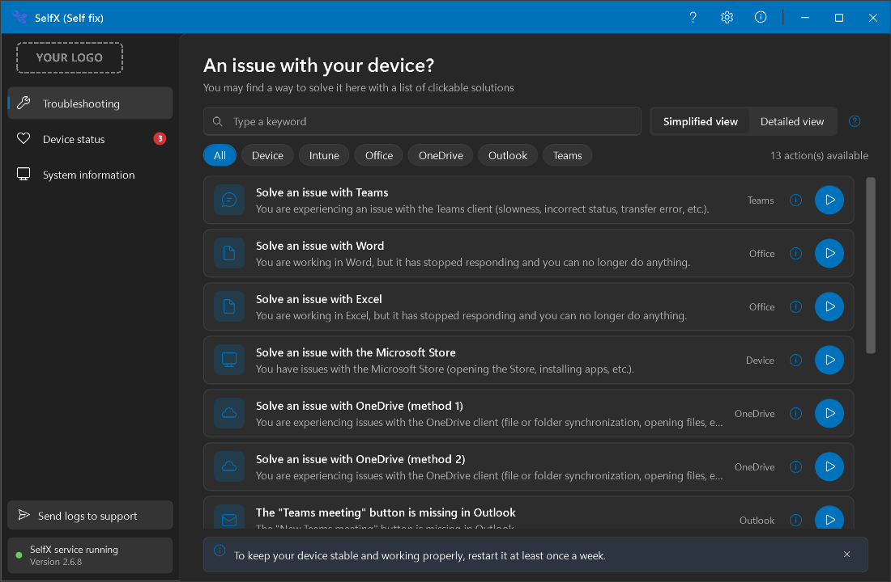
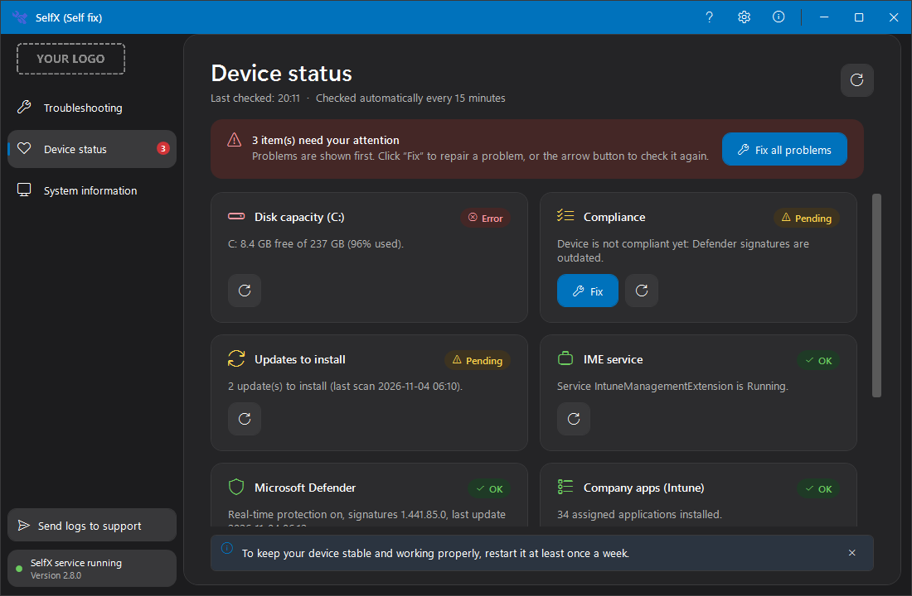
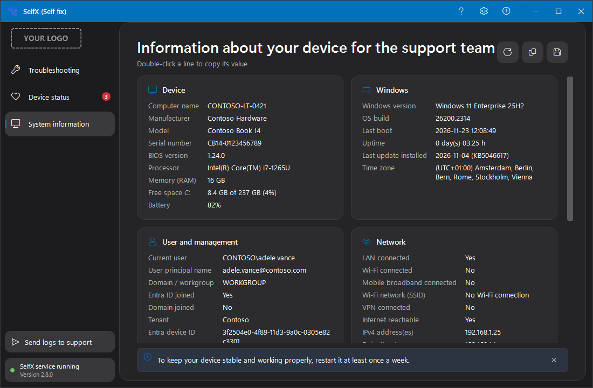
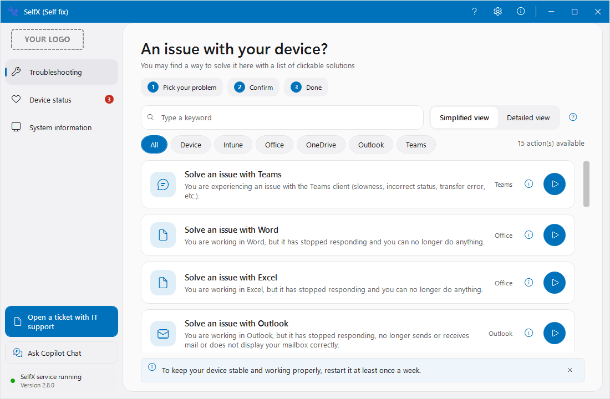
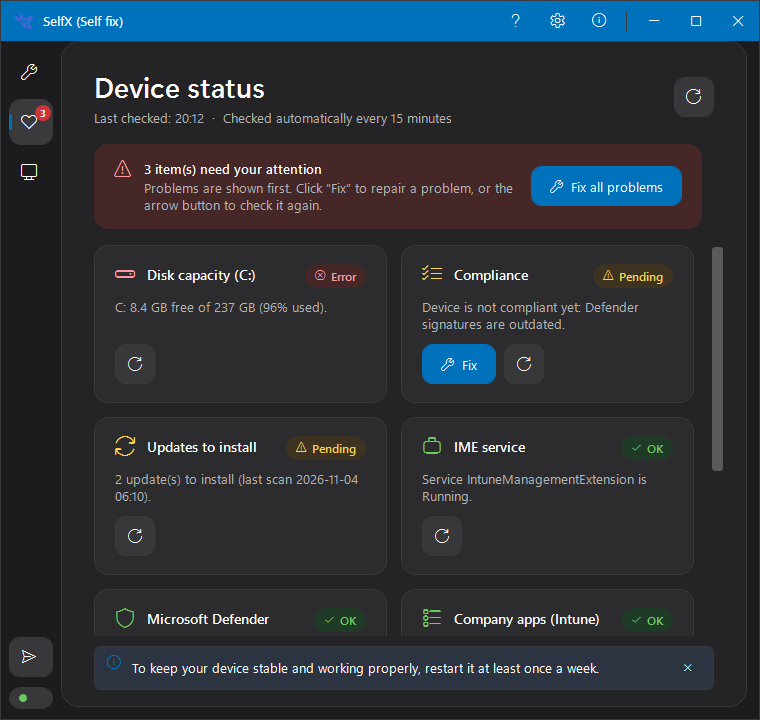
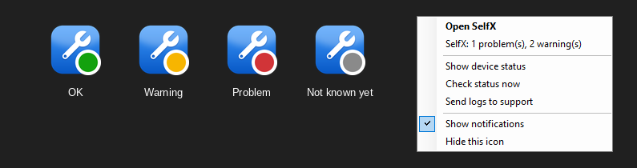
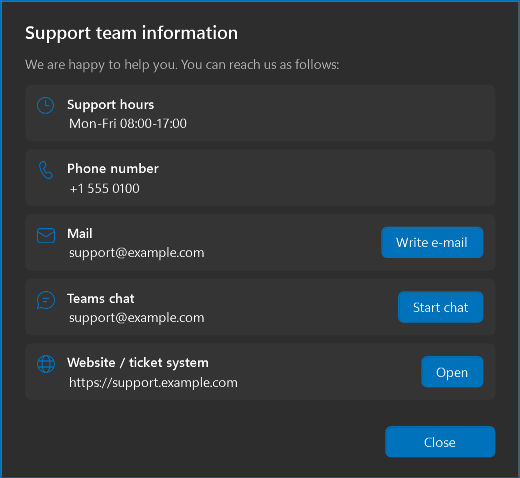
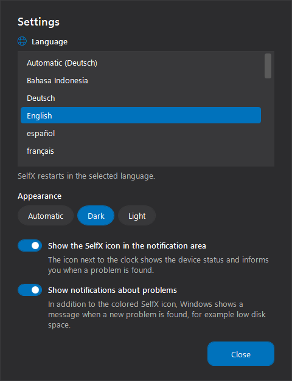
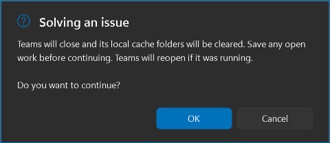

# SelfX (Self fix)

[English](README.md) | **Deutsch**

SelfX ist ein Self-Service-Werkzeug für die Fehlerbehebung unter Windows,
geschrieben in PowerShell und WPF. Nutzer ohne technisches Wissen sehen den
Zustand ihres Geräts und beheben häufige Probleme mit Teams, Office, OneDrive,
Outlook, Intune, Windows Update und dem Netzwerk selbst, bevor sie den Support
anrufen. Sie können die Protokolle ihres Geräts außerdem mit wenigen Klicks an
den Support senden.

**SelfX Service** wird für das ganze Gerät installiert und arbeitet vollständig
offline. Es führt Aktionen entweder als angemeldeter Nutzer aus oder über den
lokalen Windows-Dienst **SelfXService** mit SYSTEM-Rechten. Zur Behebung eines
Problems sind weder Netzwerkzugriff noch SCCM oder Intune nötig. Siehe
[Funktionen](#funktionen-von-selfx-service).

SelfX hat kein zentrales Backend, keine Push-Nachrichten und keine zentrale
Auswertung der Aktionen.

Dieses Repository ([fubu2k/SelfX](https://github.com/fubu2k/SelfX)) ist ein Fork
von [wbaeck/SelfX](https://github.com/wbaeck/SelfX) und wird **nur für SelfX
Service** weiterentwickelt. 
Die Arbeit in diesem Fork konzentriert sich auf
Sicherheit, Tests und Bereitstellung von SelfX Service: siehe
[Sicherheitshärtung in diesem Fork](#sicherheitshärtung-in-diesem-fork) und das
[Änderungsprotokoll](CHANGELOG.md). Aktuelle Version: **3.0.1**.

Deutsch ist die Basissprache der Oberfläche und dieser Dokumentation; Englisch
ist der Rückfall für fehlende Texte und die Übersetzung der Dokumentation (Dateien
mit der Endung `.en.md` und der Ordner `docs/en`).

## Bildschirmfotos

Die Bildschirmfotos stammen von SelfX Service 2.8 (englische Oberfläche) und
zeigen Beispieldaten (fiktives Gerät *Contoso*) sowie das Platzhalter-Logo der
mitgelieferten Konfiguration.

**Fehlerbehebung:** Aktionen in einfacher Sprache, mit Suche, Kategorien und
einer Erklärung zu jeder Aktion.

**Gerätestatus:** die Ergebnisse der Hintergrundprüfungen, Probleme zuerst, mit
einer Schaltfläche **Beheben**, wo eine Reparatur möglich ist.

**Systeminformationen:** alles, was der Support erfragt, an einer Stelle, zum
Kopieren oder Exportieren.

**Helles Design:** *Automatisch* folgt dem dunklen oder hellen Modus von Windows;
jeder Nutzer kann auch *Dunkel* oder *Hell* wählen.

**Hilfe in der Navigation:** mit `Ticket_Enabled` erscheint die Schaltfläche *Ticket beim IT-Support eröffnen*, mit `Copilot_Enabled` zusätzlich *Copilot Chat fragen* (beide standardmäßig aus).

**Anpassbares Fenster:** in einem schmalen Fenster zeigt die Navigation nur
Symbole und die Karten ordnen sich neu an.

**Statussymbol neben der Uhr:** ein farbiger Punkt zeigt den Gerätestatus; das
Menü öffnet SelfX, prüft den Status oder sendet die Protokolle.

| Hilfe und Support-Kontakte | Einstellungen | Bestätigung vor einer Aktion |
|---|---|---|
|  |  |  |

## Funktionen von SelfX Service

### Für Nutzer

- **Seite Fehlerbehebung**
  - Eine Karte pro Aktion mit einer kurzen Beschreibung in einfacher Sprache.
  - Suchfeld, Kategorien (Gerät, Intune, Office, OneDrive, Outlook, Teams,
    Browser) und ein Schalter zwischen der *einfachen* Ansicht (wenige
    allgemeine Aktionen) und der *detaillierten* Ansicht (eine Aktion pro
    Symptom, zum Beispiel *Teams hängt bei „Microsoft Teams wird geladen“*).
  - Eine Info-Schaltfläche erklärt, was die Aktion tut. Jede Aktion fragt vorher
    nach und sagt dem Nutzer, was passiert (zum Beispiel „Teams wird
    geschlossen“).
  - Während eine Aktion läuft, zeigt ihre Schaltfläche ein drehendes Symbol und
    *Wird ausgeführt…*. Das Ergebnis erscheint in der Meldungsleiste. Ein Schild
    kennzeichnet Aktionen, die über den Dienst mit Administratorrechten laufen.
- **Enthaltene Aktionen**
  - Teams: Cache leeren und neu starten.
  - Word und Excel: Anwendung schließen und wieder starten.
  - OneDrive: Client starten, neu starten oder zurücksetzen; Datenträger auf
    gesperrte Dateien prüfen (chkdsk).
  - Outlook: Schaltfläche *Teams-Besprechung* wiederherstellen.
  - Microsoft Store: Store zurücksetzen.
  - Netzwerk: DNS-Cache leeren; Netzwerkadapter neu starten.
  - Gerät: Papierkorb und temporäre Dateien leeren, wenn das Gerät langsam ist.
  - Browser: Cache von Chrome und Firefox leeren.
  - Intune: Intune-Dienst neu starten und eine Synchronisierung erzwingen.
  - Support: Geräteprotokolle an den Support senden.
  - Administratoren können eigene Aktionen in einer XML-Datei ergänzen.
- **Seite Gerätestatus**
  - Eine Karte pro Prüfung mit dem Zustand OK (grün), Bald erledigen (gelbe
    Warnung, technisch „Pending“), Fehler (rot) oder Unbekannt (grau), Probleme zuerst. Ein Zähler an
    der Navigation zeigt die Zahl der offenen Punkte.
  - **Beheben** repariert ein Problem nach Bestätigung:
    - Defender-Signaturen aktualisieren;
    - ausstehende Windows-Updates und App-Updates aus dem Microsoft Store
      installieren;
    - fehlgeschlagene Unternehmens-Apps erneut installieren;
    - das Gerät neu starten, mit eigener Warnung.
  - **Alle Probleme beheben** führt alle Reparaturen auf einmal aus, außer dem
    Neustart. Die Pfeil-Schaltfläche prüft einen einzelnen Status erneut.
- **Seite Systeminformationen**
  - Gerät, Windows, Nutzer und Intune-/Entra-ID-Verwaltung sowie
    Netzwerkdetails (LAN, WLAN, VPN, Internet, IP, DNS, MAC).
  - Doppelklick auf eine Zeile kopiert sie. Alles kopieren oder als TXT, HTML,
    CSV oder JSON exportieren.
  - Sofort aus der letzten Erfassung angezeigt und im Hintergrund aktualisiert.
- **Protokolle an den Support senden**
  - Der Dienst sammelt als SYSTEM alle Protokolle, die zur Analyse eines
    Geräteproblems nötig sind (Ereignisprotokolle, Intune / Autopilot / ESP,
    Apps, Updates, SelfX-Protokolle).
  - SelfX öffnet danach eine neue E-Mail an den Support mit dem Bericht im
    Anhang (`.zip`). Der Nutzer beschreibt das Problem und sendet sie ab; es wird
    nichts automatisch gesendet.
- **Hilfe-Dialog (?)**
  - Supportzeiten, Telefonnummer, E-Mail, Teams-Chat und Website bzw.
    Ticketsystem, jeweils mit einer Schaltfläche zum Starten.
- **Einstellungen (Zahnrad)**
  - Sprache: 24 Sprachen; Deutsch ist voreingestellt, *Automatisch* nutzt die
    Anzeigesprache von Windows (Deutsch, wenn sie nicht verfügbar ist). Texte,
    die in einer Sprache fehlen, erscheinen auf Englisch.
  - Design: *Automatisch*, *Dunkel* oder *Hell*.
  - Statussymbol ein oder aus; Windows-Benachrichtigungen über Probleme ein oder
    aus.
  - Alle Auswahlen werden pro Nutzer gespeichert.
- **Statussymbol neben der Uhr**
  - Grüner, gelber, roter oder grauer Punkt.
  - Kurzinfo mit der Zahl der Probleme und Warnungen.
  - Eine Windows-Benachrichtigung, wenn ein neues Problem gefunden wird, zum
    Beispiel wenig Speicherplatz.
  - Menü: SelfX öffnen, Gerätestatus anzeigen, jetzt prüfen, Protokolle senden,
    Benachrichtigungen umschalten, Symbol ausblenden.
- **Modernes, anpassbares Fenster**
  - Größe änderbar, mit kompakter Navigation in schmalen Fenstern.
  - Merkt sich Größe und Position.
  - Rechts-nach-links-Layout für Arabisch, Persisch und Urdu.
  - Eigenes Symbol in der Taskleiste.
  - Pro Nutzer nur ein Fenster: ein zweiter Start bringt das offene Fenster nach
    vorn.

### Für IT-Administratoren

- **Lokaler Windows-Dienst, vollständig offline.**
  - `SelfXService` läuft als SYSTEM.
  - Er führt nur die Skripte aus, die im Katalog als Systemaktionen stehen
    (Positivliste); der Nutzer kann dem Dienst weder einen Pfad noch Code
    übergeben.
  - Kein zentraler Server, keine Cloud-Zugangsdaten auf dem Client.
- **Gesundheitsprüfungen im Hintergrund**
  - Standardmäßig alle 15 Minuten (5–1440).
  - Pausiert im Akkubetrieb und verschoben, solange der Prozessor ausgelastet
    ist; die erste Prüfung startet verzögert nach dem Systemstart.
  - Das Ergebnis wird zwischengespeichert, sodass SelfX und das Statussymbol es
    sofort anzeigen.
- **Prüfungen**
  - Dienst Intune Management Extension.
  - Microsoft Defender (Schutz aktiv, Signaturen aktuell).
  - Lokale Compliance-Kriterien (BitLocker, Secure Boot, TPM, Firewall,
    Defender, Betriebssystemversion).
  - Unternehmens-Apps aus dem lokalen IME-Cache.
  - Datenträgerkapazität (Standard: Fehler bei 90 % belegt oder unter 20 GB frei).
  - BitLocker auf allen festen Laufwerken.
  - Ausstehender Neustart.
  - Zu installierende Windows-Updates (lokaler Cache, keine Online-Suche).
  - Zusätzliche Dienste mit ihrem erwarteten Zustand.
  - Eigene, nur lesende Prüfskripte.
- **Konfigurierbare Reparaturen:** jede Prüfung kann einem Reparaturskript
  zugeordnet werden; Sie legen fest, ob die Schaltfläche **Beheben** immer oder
  nur bei nicht erfüllter Prüfung erscheint.
- **Protokollierung**
  - Alle Skripte protokollieren nach `%ProgramData%\SelfX\Logs`; die Protokolle
    jedes Nutzers liegen in einem eigenen, geschützten Ordner.
  - Die Bereinigung löscht Protokolle, die älter als 90 Tage sind
    (konfigurierbar).
- **Branding**
  - Firmenlogo, Symbol, Akzentfarbe, Titelleiste, Farben von Schaltflächen und
    Infos.
  - Name des Werkzeugs, Verknüpfungen und Support-Kontakte.
  - Die mitgelieferte Konfiguration enthält Platzhalter
    (`Branding\company_logo.png`, `example.com`); ersetzen Sie sie vor dem
    Paketieren.
- **Einstellungen für jede Funktion**
  - Administratoren können Seiten, Schaltflächen, die Einstellungen für Sprache
    und Design, das Statussymbol und seine Benachrichtigungen ein- oder
    ausblenden.
  - Alle Texte stehen in Sprachdateien (`Languages\<Kultur>.xml`) und können
    geändert oder übersetzt werden.
- **Bereitstellung mit Intune**
  - Ein Win32-App-Paket, erstellt mit `tools\New-SelfXIntuneWin.ps1`.
  - Skripte für Installation, Deinstallation und Erkennung. Erhöhen Sie bei jedem
    Release `Tool_Version` und `$ExpectedVersion` in `Detection.ps1`, sonst
    verteilt Intune das Update nicht.
  - Dienst und Starter sind .NET-10-Programme (self-contained, LTS), die einmal auf
    einem Build-Rechner gebaut werden (`tools\Build-SelfXBinaries.ps1`, mit
    fertigen AppLocker-Hashregeln). `Install.ps1` prüft sie per SHA256, bevor es
    etwas auf dem Gerät ändert; auf dem Gerät wird nichts kompiliert.
  - Ein Update oder eine Deinstallation schließt die laufenden SelfX-Fenster und
    Statussymbole; nach der Installation startet das Statussymbol sofort für alle
    angemeldeten Nutzer.
- **Getestet:** neun Testsuiten (Oberfläche, Gesundheitsprüfungen,
  Geräteprotokolle, Aktionsskripte, Sprachdateien, Katalog, Deinstallation,
  Dienst-Pipe, Installer-Programme). Sie ersetzen jeden Befehl, der das Gerät
  verändert, durch einen Mock; der Pipe-Test startet nur den Pipe-Listener des
  Dienstes unter einem Testnamen. GitHub Actions führt sie alle sowie eine
  sicherheitsorientierte Skriptanalyse für jeden Pull Request aus.

Die Einzelheiten stehen in der [Konfiguration](docs/Configuration.md) und der
[Installation](docs/Installation.md); das [Benutzerhandbuch](docs/User-Manual.md)
erklärt SelfX für die Nutzer.

## Sicherheitshärtung in diesem Fork

SelfX Service kann für jeden angemeldeten Nutzer Skripte mit SYSTEM-Rechten
starten und gilt deshalb als sicherheitskritisches Programm. Der Dienst wurde im
November 2026 geprüft und in den Versionen 2.6.10 und 2.6.11 gehärtet; die
Einzelheiten stehen im [Änderungsprotokoll](CHANGELOG.md) und im
[Sicherheitsmodell](SelfX%20Service/README.md#sicherheitsmodell) des Pakets.

- **Nur freigegebene Aktionen.** Der Dienst führt nur Skripte aus, die im
  installierten Katalog mit `Context=System` stehen. Nutzer können nie einen
  Pfad, Code oder Argumente übergeben. `Test-Catalog.ps1` prüft den Katalog bei
  jedem Release.
- **Geschützte Pipe.** Der Dienst begrenzt Verbindungen (8 pro Nutzer, 64
  insgesamt), gibt jeder Anfrage eine Frist von 5 Sekunden, legt zwischen
  Anfragen desselben Nutzers eine Pause ein und bereinigt den Text, den er
  protokolliert. Das SelfX-Fenster prüft, dass die Pipe vom echten Dienst
  bedient wird.
- **Mehrere Nutzer auf einem Gerät.** Der Bericht mit den Geräteprotokollen
  enthält nur die Daten des anfragenden Nutzers, außer ein Administrator mit
  erhöhten Rechten fragt ihn an. Aktionen, die andere stören würden (Neustart,
  Windows-Updates, Datenträgerprüfung, Neustart der Netzwerkadapter), stehen
  einem normalen Nutzer nicht zur Verfügung, solange ein anderer Nutzer
  angemeldet ist (`OtherSessions`).
- **Sorgfältiger Umgang mit Dateien.** SYSTEM liest keine Protokolle aus
  Ordnern, die Nutzer ändern können, und die Deinstallation folgt keinen
  Junctions.
- **Kontrollierter Bau und Rollout.** Die .NET-10-Programme werden einmal gebaut
  (reproduzierbar, offline aus einem per Hash geprüften Paketordner gebaut), bei der Installation
  per Hash geprüft und mit AppLocker-Hashregeln zugelassen. Auf dem Gerät läuft
  kein Compiler.
- **Automatische Prüfungen.** Jeder Pull Request kompiliert den Dienst und führt
  die Tests und eine Skriptanalyse aus.

Melden Sie Sicherheitslücken vertraulich, wie in [Sicherheitsrichtlinie](SECURITY.md)
beschrieben.

## Dokumentation

- [Paketassistent](docs/Assistent.md): geführte Konfiguration bis zum Intune-Paket
- [Installation](docs/Installation.md), mit der Release-Checkliste von SelfX Service
- [Konfiguration](docs/Configuration.md)
- [Benutzerhandbuch](docs/User-Manual.md)
- [Pakethinweise zu SelfX Service](SelfX%20Service/README.md)
- [Änderungsprotokoll](CHANGELOG.md)
- [Sicherheitsrichtlinie](SECURITY.md)
- Englische Fassungen: [README](README.md), [Installation](docs/en/Installation.md),
  [Configuration](docs/en/Configuration.md), [User manual](docs/en/User-Manual.md),
  [Changelog](CHANGELOG.en.md), [Security policy](SECURITY.en.md)

## Aufbau des Repositorys

| Verzeichnis | Inhalt |
|---|---|
| `SelfX Service` | Das Paket: Installer, lokaler Windows-Dienst (C#-Quelltext), Aktionskatalog mit Nutzer- und Systemaktionen, WPF-Anwendung, Skripte und Tests |
| `tools` | `New-SelfXIntuneWin.ps1`, das das Intune-Paket mit dem signierten Win32 Content Prep Tool von Microsoft erstellt (siehe [Intune-Paket erstellen](docs/Installation.md#schritt-2-paket-bauen)), und `Build-SelfXBinaries.ps1`, das die .NET-10-Programme von SelfX Service baut (siehe [Programme bauen](docs/Installation.md#schritt-2-paket-bauen)) |
| `offline-feed` | NuGet-Pakete für den Offline-Bau mit `SelfX.OfflineFeed.json` (SHA512 je Datei); erzeugt von `tools\Export-SelfXOfflineFeed.ps1`. `NuGet.config` im Hauptordner erlaubt nur diesen Ordner. |
| `docs` | Installation, Konfiguration und Benutzerhandbuch (Deutsch); `docs/en` enthält die englischen Fassungen, `docs/images` die Bildschirmfotos |
| `.github` | GitHub-Actions-Workflow (Kompilieren, Tests, Skriptanalyse), `CODEOWNERS`, Dependabot-Konfiguration |
| `build` | Nicht eingecheckt. Ausgabe von `New-SelfXIntuneWin.ps1`: `SelfX-Service-<Version>.intunewin`; und von `Build-SelfXBinaries.ps1`: `SelfX.AppLocker.xml` |

Prüfen Sie jedes Aktionsskript und seinen Ausführungskontext, bevor Sie es
bereitstellen. Aktionen werden als versteckte PowerShell-Prozesse gestartet und
können den Gerätezustand ändern oder Anwendungen beenden.

## Herkunft und Dank

SelfX wurde von **Damien Van Robaeys** ([Syst & Deploy](https://www.systanddeploy.com))
als Werkzeug entwickelt, mit dem Nutzer häufige IT-Probleme selbst lösen.
**Wolfgang Baeck** ([wbaeck/SelfX](https://github.com/wbaeck/SelfX)) hat darauf
SelfX Service aufgebaut: den lokalen Windows-Dienst, den zusammengeführten
Aktionskatalog, die Gesundheitsprüfungen, das Statussymbol, die Sprachen und das
Intune-Paket. Dieses Repository ist ein Fork seines Projekts. Das
ursprüngliche Projekt finden Sie hier:

- Ursprüngliches Repository: [damienvanrobaeys/SelfX](https://github.com/damienvanrobaeys/SelfX)
- Vorstellung des Werkzeugs: [Blogbeitrag auf Syst & Deploy (August 2022)](https://www.systanddeploy.com/2022/08/selfx-tool-allowing-users-to-solve.html)

Vielen Dank an Damien für die Idee, die ursprüngliche WPF-Oberfläche, den
XML-Aktionskatalog und die Skripte zur Fehlerbehebung. Vielen Dank an Wolfgang
Baeck: Ohne sein SelfX Service, seine klare Struktur, seine Dokumentation und
seine Tests gäbe es diesen Fork nicht, und die Sicherheitsarbeit wäre nicht
möglich gewesen. Die Sicherheitshärtung, die zusätzlichen Tests, die
gebauten .NET-10-Programme und die CI wurden in diesem Fork ergänzt (siehe das
[Änderungsprotokoll](CHANGELOG.md)). Die Lizenz des ursprünglichen Projekts
bleibt in [Lizenz](LICENSE.md) erhalten; Urheber und Quellen stehen in [Hinweise zu Autoren und Quellen](NOTICE.md).

Die Seite Systeminformationen beruht auf der Idee und den Datenpunkten des
[System Information Tool](https://github.com/JayRHa/windows-system-information)
von Jannik Reinhard (MIT-Lizenz, Copyright (c) 2026 Jannik Reinhard). SelfX
setzt die Erfassung in `SelfX Service\Sources\SystemInfo.ps1` selbst um.

Das Intune-Paket wird mit dem
[Win32 Content Prep Tool](https://github.com/microsoft/Microsoft-Win32-Content-Prep-Tool)
von Microsoft erstellt. Die ausführbare Datei gehört nicht zu diesem Repository;
das Bauskript prüft vor der Verwendung ihre Authenticode-Signatur von Microsoft.
