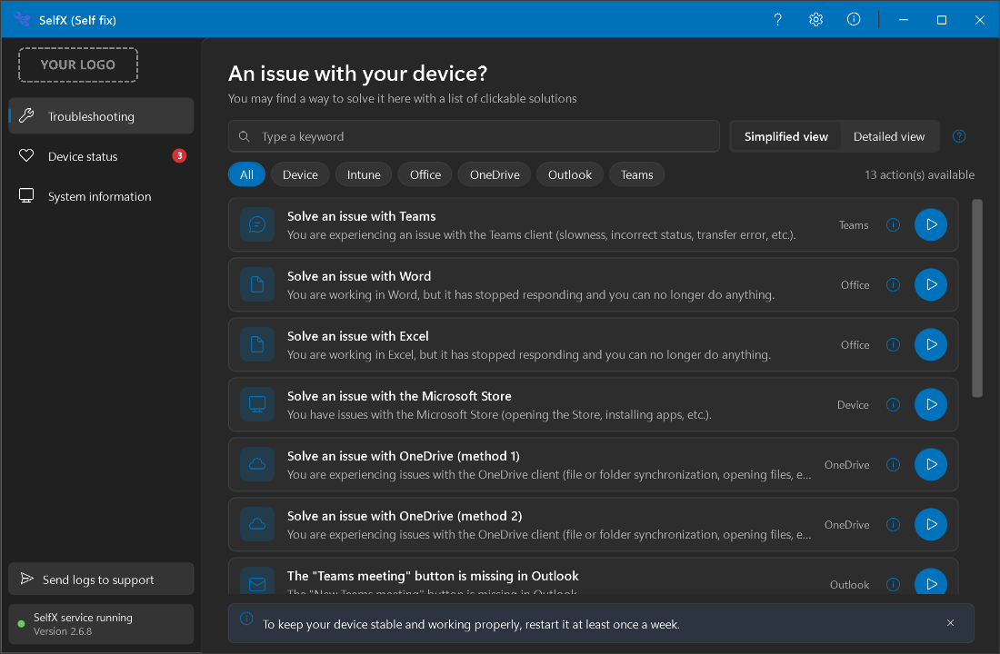
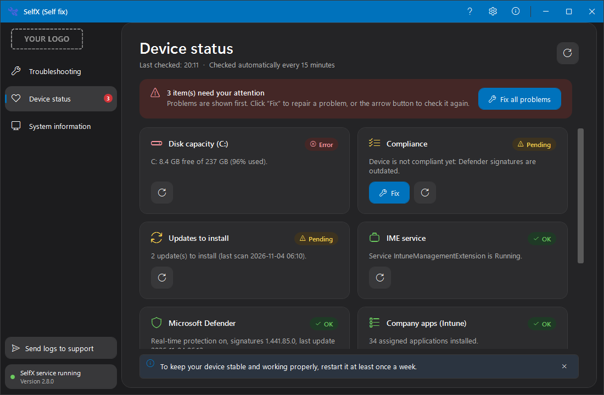
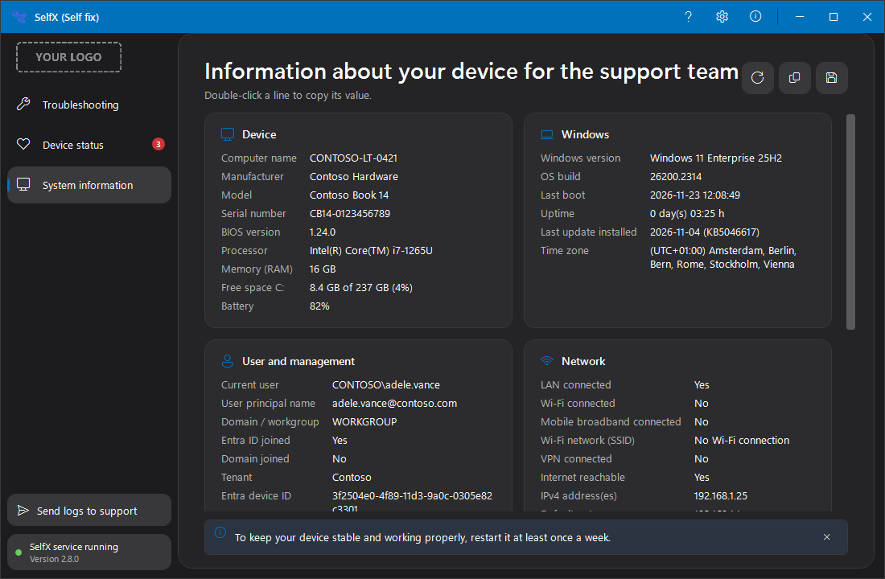
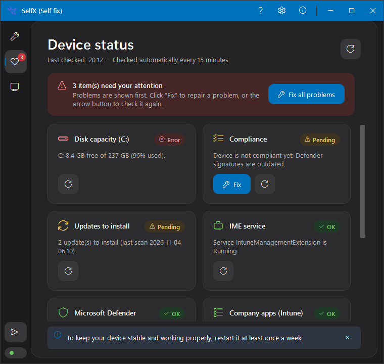
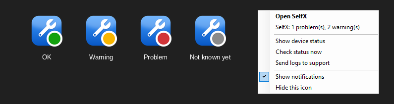
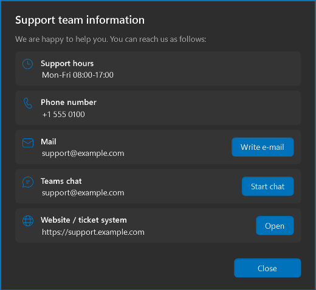
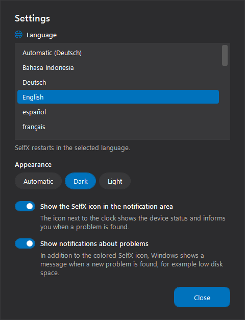
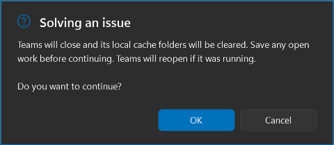

# SelfX (Self fix)

SelfX is a self-service troubleshooting tool for Windows, written in PowerShell
and WPF. Users without technical knowledge can see the health of their device
and fix common problems with Teams, Office, OneDrive, Outlook, Intune, Windows
Update and the network on their own, before they call the support. They can also
send the logs of their device to the support in a few clicks.

The repository contains three packages:

- **SelfX Service** (recommended) combines Standard and
  Admin into one package. It is installed machine-wide, works fully offline and
  runs actions either as the user or, through the local **SelfXService**
  Windows service, with SYSTEM rights. No network access, SCCM or Intune is
  needed to fix a problem. See [Features](#features-of-selfx-service).
- **SelfX Standard** is installed per user and offers quick and detailed
  troubleshooting actions, plus a **System information** tab that shows device,
  Windows, user/Intune and network details that users can copy or export for the
  support team.
- **SelfX Admin** is a separately launched interface for actions that may
  require an elevated execution context. It does not install a service. Its
  `ServiceUI.exe` can display an application started by a deployment system in a
  signed-in user's session; it does not grant administrator rights or change the
  token used by the process.

SelfX has no central backend, push messaging or centralized task reporting.

This repository ([fubu2k/SelfX](https://github.com/fubu2k/SelfX)) is a fork of
[wbaeck/SelfX](https://github.com/wbaeck/SelfX) (SelfX Service 2.6.9), which in
turn builds on the original SelfX by Damien Van Robaeys (see
[Upstream and credits](#upstream-and-credits)). It continues with the security
of SelfX Service: see [Security hardening in this fork](#security-hardening-in-this-fork)
and the [Changelog](CHANGELOG.md). Current version: **2.6.11**.

## Screenshots

The screenshots were taken with SelfX Service 2.6.8 and show sample data (fictional device
*Contoso*) and the placeholder logo of the delivered configuration.

**Troubleshooting:** actions in plain language, with search, categories and an
explanation for each action.

**Device status:** the results of the background checks, problems first, with
a **Fix** button where a repair is available.

**System information:** everything the support team asks for, in one place,
ready to copy or export.

**Light appearance:** *Automatic* follows the dark or light mode of Windows;
each user can also choose *Dark* or *Light*.

**Adaptive window:** in a narrow window the navigation shows only icons and the
cards rearrange.

**Status icon next to the clock:** a colored dot shows the device status; the
menu opens SelfX, checks the status or sends the logs.

| Help and support contacts | Settings | Confirmation before an action |
|---|---|---|
|  |  |  |

## Features of SelfX Service

### For the user

- **Troubleshooting page**
  - One card per action with a short description in plain language.
  - Search field, category buttons (Device, Intune, Office, OneDrive, Outlook,
    Teams, Browser) and a switch between the *simplified* view (a few general
    actions) and the *detailed* view (one action per symptom, for example
    *Teams is stuck on "Loading Microsoft Teams"*).
  - An info button explains what the action does. Every action asks for
    confirmation and tells the user what will happen (for example "Teams will
    close").
  - While an action runs, its button shows a rotating icon and *Running…*. The
    result appears in the message bar. A shield marks actions that run with
    administrator rights through the service.
- **Included actions**
  - Teams: clear the cache and restart.
  - Word and Excel: close the application and start it again.
  - OneDrive: start, restart or reset the client; check the disk for locked
    files (chkdsk).
  - Outlook: restore the *Teams meeting* button.
  - Microsoft Store: reset the Store.
  - Network: clear the DNS cache; restart the network adapters.
  - Device: empty the recycle bin and the temporary files when the device is
    slow.
  - Browsers: clear the cache of Chrome and Firefox.
  - Intune: restart the Intune service and force a synchronization.
  - Support: send the device logs to the support.
  - Administrators can add their own actions in an XML file.
- **Device status page**
  - One card per check with the state OK (green), Pending (yellow warning),
    Error (red) or Unknown (gray), problems first. A counter on the navigation
    shows the number of open points.
  - **Fix** repairs a problem after confirmation:
    - update the Defender signatures;
    - install pending Windows updates and Microsoft Store app updates;
    - try again to install company apps that failed;
    - restart the device, with its own warning.
  - **Fix all problems** runs all repairs at once, except the restart. The arrow
    button checks a single status again.
- **System information page**
  - Device, Windows, user and Intune/Entra ID management, and network details
    (LAN, Wi-Fi, VPN, internet, IP, DNS, MAC).
  - Double-click a line to copy it. Copy all, or export as TXT, HTML, CSV or JSON.
  - Shown immediately from the last collection and refreshed in the background.
- **Send logs to support**
  - The service collects all logs needed to analyze a device problem (event
    logs, Intune / Autopilot / ESP, apps, updates, SelfX logs) as SYSTEM.
  - SelfX then opens a new e-mail to the support with the report attached
    (`.zip`). The user describes the problem and sends it; nothing is sent
    automatically.
- **Help dialog (?)**
  - Support hours, phone number, e-mail, Teams chat and website / ticket
    system, each with a button to start it.
- **Settings (gear)**
  - Language: 24 languages; *Automatic* uses the Windows display language,
    with English as fallback.
  - Appearance: *Automatic*, *Dark* or *Light*.
  - Status icon on or off; Windows notifications about problems on or off.
  - All choices are stored per user.
- **Status icon next to the clock**
  - Green, yellow, red or gray dot.
  - Tooltip with the number of problems and warnings.
  - One Windows notification when a new problem is found, for example low disk
    space.
  - Menu: open SelfX, show the device status, check now, send logs, switch
    notifications, hide the icon.
- **Modern, adaptive window**
  - Resizable, with a compact navigation in narrow windows.
  - Remembers size and position.
  - Right-to-left layout for Arabic, Persian and Urdu.
  - Own taskbar icon.
  - Only one window per user: a second start brings the open window to the front.

### For IT administrators

- **Local Windows service, fully offline.**
  - `SelfXService` runs as SYSTEM.
  - It only runs the scripts listed as system actions in the catalogue
    (whitelist); the user cannot pass a path or code to the service.
  - No central server, no cloud credentials on the client.
- **Background health checks**
  - Default every 15 minutes (5–1440).
  - Paused on battery and postponed while the processor is busy; the first
    check is delayed after start-up.
  - The result is cached, so SelfX and the status icon show it immediately.
- **Checks**
  - Intune Management Extension service.
  - Microsoft Defender (protection on, signatures up to date).
  - Local compliance criteria (BitLocker, Secure Boot, TPM, firewall, Defender,
    OS version).
  - Company apps from the local IME cache.
  - Disk capacity (default: error at 90% used or below 20 GB free).
  - BitLocker on all fixed volumes.
  - Pending restart.
  - Windows updates to install (local cache, no online scan).
  - Additional services with their expected state.
  - Your own read-only check scripts.
- **Configurable repairs:** map any check to a repair script and choose whether
  the **Fix** button is shown always or only when the check is not OK.
- **Logging**
  - All scripts log to `%ProgramData%\SelfX\Logs`; each user's logs go to their
    own, protected folder.
  - Housekeeping deletes logs older than 90 days (configurable).
- **Branding**
  - Company logo, icon, accent color, title bar, button and info colors.
  - Tool name, shortcuts and support contacts.
  - The delivered configuration contains placeholders (`Branding\company_logo.png`,
    `example.com`); replace them before packaging.
- **Settings for each feature**
  - Administrators can show or hide pages, buttons, the language and appearance
    settings, the status icon and its notifications.
  - All texts are in language files (`Languages\<culture>.xml`), so they can be
    changed or translated.
- **Intune deployment**
  - One Win32 app package, built with `tools\New-SelfXIntuneWin.ps1`.
  - Install, uninstall and detection scripts. Raise `Tool_Version` and
    `$ExpectedVersion` of `Detection.ps1` for every release, otherwise Intune
    does not roll out the update.
  - Optional prebuilt programs that `Install.ps1` checks by SHA256, with ready
    AppLocker hash rules (`tools\Build-SelfXBinaries.ps1`); without them, the
    device compiles the programs as before.
  - An update or uninstall closes the running SelfX windows and status icons;
    after the installation the status icon starts right away for all signed-in
    users.
- **Tested:** nine test suites (user interface, health checks, device logs,
  action scripts, language files, catalogue, uninstall, service pipe,
  installer programs). They mock every command that changes the device; the pipe
  test starts only the pipe listener of the service under a test name. GitHub
  Actions runs all of them, and a security-focused script analysis, for every
  pull request.

The details are described in [Configuration](docs/Configuration.md) and
[Installation](docs/Installation.md); the [User manual](docs/User-Manual.md)
explains SelfX for the users.

## Security hardening in this fork

SelfX Service can start scripts with SYSTEM rights for every signed-in user, so
it is treated as a security-critical program. The service was reviewed in
November 2026 and hardened in versions 2.6.10 and 2.6.11; the details are in the
[Changelog](CHANGELOG.md) and in the
[security model](SelfX%20Service/README.md#security-model) of the package.

- **Only approved actions.** The service runs only scripts that are listed with
  `Context=System` in the installed catalogue. Users can never pass a path,
  code or arguments. `Test-Catalog.ps1` checks the catalogue for every release.
- **Protected pipe.** The service limits connections (8 per user, 64 in total),
  gives every request one 5-second deadline, pauses between requests of the
  same user and cleans the text it logs. The SelfX window checks that the pipe
  is served by the real service.
- **Several users on one device.** The device logs report contains only the
  data of the requesting user, unless an elevated administrator asks for it.
  Actions that would disturb others (restart, Windows updates, disk check,
  restart of the network adapters) are not available to a normal user while
  another user is signed in (`OtherSessions`).
- **Careful file handling.** SYSTEM does not read logs from folders that users
  can change, and the uninstallation does not follow junctions.
- **Controlled build and deployment.** Optional prebuilt programs are checked by
  hash during installation and can be allowed with AppLocker hash rules. Without
  them, the compiler on the device uses a protected temporary folder.
- **Automatic checks.** Every pull request compiles the service and runs the
  tests and a script analysis.

SelfX Standard and SelfX Admin are older code bases and were not part of this
hardening. SelfX Admin runs its actions with the token of the process that
starts it; started as SYSTEM by a deployment tool, they run as SYSTEM. Use SelfX
Service for actions that need administrator rights.

Report vulnerabilities privately as described in [SECURITY.md](SECURITY.md).

## Documentation

- [Installation](docs/Installation.md), including the release checklist of SelfX Service
- [Configuration](docs/Configuration.md)
- [User manual](docs/User-Manual.md)
- [SelfX Service package notes](SelfX%20Service/README.md)
- [SelfX Standard package notes](SelfX%20Standard/README.md)
- [SelfX Admin package notes](SelfX%20Admin/README.md)
- [Changelog](CHANGELOG.md)
- [Security policy](SECURITY.md)

## Repository layout

| Directory | Contents |
|---|---|
| `SelfX Service` | Machine-wide offline package: installer, local Windows service (C# source), merged action catalogue with User and System actions, WPF application and scripts |
| `SelfX Standard` | Per-user installer, detection and uninstall scripts, WPF application, XML configuration and troubleshooting scripts |
| `SelfX Admin` | WPF application, ServiceUI launcher, XML action list and administrative troubleshooting scripts |
| `tools` | `New-SelfXIntuneWin.ps1`, which builds the Intune packages with Microsoft's signed Win32 Content Prep Tool (see [Building the Intune packages](docs/Installation.md#building-the-intune-packages)), and `Build-SelfXBinaries.ps1`, which builds the optional prebuilt programs of SelfX Service (see [Prebuilt programs](docs/Installation.md#prebuilt-programs-selfx-service-2611)) |
| `.github` | GitHub Actions workflow (compile, tests, script analysis), `CODEOWNERS`, Dependabot configuration |
| `build` | Not committed. Output of `New-SelfXIntuneWin.ps1`: `SelfX-Admin-<version>.intunewin`, `SelfX-Service-<version>.intunewin`, `SelfX-User-<version>.intunewin`; and of `Build-SelfXBinaries.ps1`: `SelfX.AppLocker.xml` |

Review each action script and its execution context before deploying it. Actions
are started as hidden PowerShell processes and may change device state or
terminate applications.

## Upstream and credits

SelfX was created by **Damien Van Robaeys** ([Syst & Deploy](https://www.systanddeploy.com))
as a tool that helps users solve common IT issues on their own. SelfX Service
was added in the fork of Wolfgang Baeck ([wbaeck/SelfX](https://github.com/wbaeck/SelfX)),
and this repository is a fork of that project. The original project is here:

- Original repository: [damienvanrobaeys/SelfX](https://github.com/damienvanrobaeys/SelfX)
- Introduction of the tool: [blog post on Syst & Deploy (August 2022)](https://www.systanddeploy.com/2022/08/selfx-tool-allowing-users-to-solve.html)

Many thanks to Damien for the idea, the original WPF interface, the XML action
catalogue and the troubleshooting scripts this project builds on. SelfX Service,
the local Windows service, the health checks, the status icon and the other
extensions described above were added in the fork by Wolfgang Baeck. The
security hardening, the additional tests, the prebuilt programs and the CI were
added in this fork (see the [Changelog](CHANGELOG.md)). The license of the
original project is kept in [LICENSE.md](LICENSE.md).

The System information tab of SelfX Standard is based on the idea and data
points of the [System Information Tool](https://github.com/JayRHa/windows-system-information)
by Jannik Reinhard (MIT License, Copyright (c) 2026 Jannik Reinhard). SelfX
reimplements the collection in `SelfX Standard\Sources\SystemInfo.ps1` (also used by SelfX Service).

The Intune packages are built with Microsoft's
[Win32 Content Prep Tool](https://github.com/microsoft/Microsoft-Win32-Content-Prep-Tool).
The executable is not included in this repository; the build script verifies
its Microsoft Authenticode signature before use.
