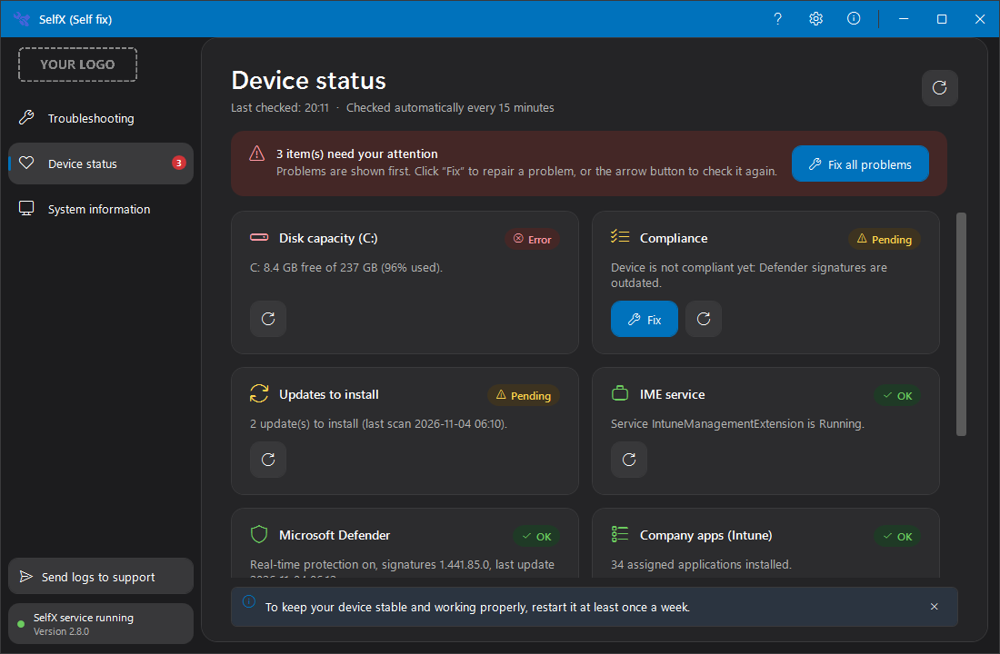

# Configuration

**English** | [Deutsch](de/Configuration.md)

This guide explains which settings exist and where you change them. It is written for
administrators. You do not need programming skills. The installation itself is described in the
[installation guide](Installation.md).



*The device status in SelfX 3.0. The interface has a light and a dark design.*

## Contents

1. [Where the settings are](#where-the-settings-are)
2. [The most important settings](#the-most-important-settings)
3. [Actions (troubleshooting)](#actions-troubleshooting)
4. [User interface and design](#user-interface)
5. [Remote support: Remote Help or Quick Assist](#remote-support-remote-help-or-quick-assist)
6. [Status icon](#status-icon)
7. [Device status and background checks](#device-status)
8. [Repairs](#repairs)
9. [Device logs for support](#device-logs-for-support)
10. [Network measurements](#network-measurements)
11. [Ticket by e-mail](#ticket-by-e-mail)
12. [Company wiki](#company-wiki)
13. [Copilot Chat](#copilot-chat)
14. [Logs and retention](#logs-and-retention)
15. [Branding (company logo and colors)](#branding)
16. [Languages](#languages)
17. [Delivering changes safely](#delivering-changes-safely)

## Where the settings are

SelfX is configured with XML files in the folder `SelfX Service\Sources`.

- You change the files **in the package, before installation**.
- After installation they are in `%ProgramFiles%\SelfX\Config` (the code is in
  `%ProgramFiles%\SelfX\App`). Only administrators can change them there. The package build sorts
  every file of `Sources` into `App` or `Config` by its file class ([Architecture](Architecture.md));
  a file that has no class stops the build.
- SelfX does not download settings from the network. New settings come with a new package version.

| File | Purpose |
|---|---|
| `Tool_Config.xml` | General settings, contacts, branding, switch features on or off |
| `Issues_List.xml` | Actions for troubleshooting |
| `Health_Config.xml` | Device status: checks, repairs, background check |
| `Network_Test_Config.xml` | Connection check and network measurements (optional, off by default) |
| `Ticket_Config.xml` | Assignment of tickets to your IT units (optional) |
| `Languages\<language>.xml` | All texts, per language |
| `Texts\<language>.xml` | Optional: replaces single texts of a bundled language ([text overrides](#change-single-texts-text-overrides)) |

## The most important settings

`Tool_Config.xml` contains only settings, no texts. The texts are in the language files (see
[Languages](#languages)).

The version number is **not** a setting. It is a property of the code: it is the one line of
`SelfX Service\Version.txt`, must equal `$ExpectedVersion` in `Detection.ps1` for every release and
is written into `SelfX.Code.json` (`ToolVersion`) by the build. An old `Tool_Version` element in a
`Tool_Config.xml` is ignored. The configuration has its own marker: `SelfX.Config.json` contains
`ConfigRevision`, the UTC time of the packaging run. Changing the version changes no settings file,
and changing the settings does not change the version.

| Setting | Default | What it does |
|---|---|---|
| `Tool_Language` | `de` | Default language. `Auto` takes the display language of Windows. You can also write `en`, `fr-CH` or `zh-Hans`. |
| `Show_Language_Setting` | `True` | Users can choose the language. `False`: always `Tool_Language`. |
| `Tool_Name` | SelfX | Name in the title bar. |
| `TerminalServer_Health` | `Off` | Only on Windows Server (mode `TerminalServer`, see [Terminal server](#terminal-server-windows-server)): who gets the device status. `Off`: nobody. `AdminOnly`: only administrators who started SelfX with elevated rights. Any other value counts as `Off`. |
| `Tool_Theme` | `Auto` | Default color scheme: `Auto` (follows Windows), `Dark` or `Light`. |
| `Show_Theme_Button` | `True` | Users can choose the design themselves. |
| `Disturb_Warning` | `True` | Before an action that closes Teams or Office programs, restarts the network adapters or restarts the device, SelfX adds the hint *You appear to be in a meeting or presentation* to the confirmation when Windows reports presentation settings, a full-screen program or quiet time for the own session of the user. See [Hint before disruptive actions](#hint-before-disruptive-actions). `False`: no hint. |
| `Greeting_Name` | `FirstName` | Greeting above the title of the window, for example *Good morning, Anna.* (morning, day or evening). SelfX asks Windows for the first name of the account (`Windows.System.User`, property `FirstName`, through the checked Windows SDK projection in `App\WinRT`) in a short process of its own, for at most 2 seconds (the window itself loads no WinRT library, so an open window does not block an update); the window opens at once with *Welcome.* and adds the name when it arrives. Without a first name, or when the Windows privacy setting *Account info* does not allow it, the greeting stays *Welcome.*; the display name or the account name is never used instead. The name is cleaned (control characters and characters that change the reading direction removed, at most 40 characters), shown only as text, not logged, not saved and not sent anywhere. `Off`: always *Welcome.* Any other value counts as `Off`. The texts are `Greeting_Morning`, `Greeting_Day`, `Greeting_Evening` (with `{0}`) and `Greeting_Neutral` in the language files and can be changed in `Config\Texts`; a text without `{0}` never shows the name. |
| `Default_Solution_Mode` | `Simplified` | Start view of troubleshooting: `Simplified` (easy) or `Detailed`. |
| `Show_Status_Page` | `True` | Show the *Device status* page. |
| `Show_SystemInfo_Tab` | `True` | Show the *System information* page. |
| `Show_Support_Button` | `True` | Show the help button (?) with your contacts. |
| `Show_Reboot_Warning` | `True` | Show a reminder about a pending restart. |
| `Show_Computer_Name_MainGUI` | — | Show the computer name in the window. |
| `Show_Computer_Name_title_bar` | `False` | Show the computer name in the title bar. |
| `Show_About_Button` | `True` | Show the info button (i) in the title bar. |
| `About_Logo` | `logo.png` | Logo in the info dialog. |
| `Show_SystemInfo_Intune_Actions` | `True` | Show the tools (Intune, Company Portal, remote support, logs) on the *System information* page. |
| `SystemInfo_Internet_Test_Host`, `SystemInfo_Internet_Test_Port` | `www.msftconnecttest.com`, `80` | Target of the "Internet reachable" check on the *System information* page. |
| `Ticket_Subject_Tag` | `SelfX` | Marker at the start of the subject of a ticket e-mail. Letters, digits, `.`, `_`, `-` and at most 20 characters, otherwise `SelfX`. |
| `Shortcut_Desktop`, `Shortcut_StartMenu`, `Shortcut_Name` | — | Shortcuts that the installation creates for all users. |
| `Log_Retention_Days` | `90` | How long logs are kept (1 to 3650 days). |
| `EventLog_CallerSid` | `False` | `True`: the Windows event log SelfX names the SID of the user who started an action as SYSTEM (events 4010 to 4012). Any other value: no SID. See [Logs and retention](#logs-and-retention). |
| `Service_FileCheck` | `Enforce` | `Enforce`: the service starts nothing if files do not match. `Audit`: the service only reports it. See the [installation guide](Installation.md#the-file-lists-selfxcodejson-and-selfxconfigjson). |
| `Service_Privileges` | `Restricted` | Limits the rights of the service. `Default` only for troubleshooting. See the [installation guide](Installation.md#service-privileges). |
| `Show_Tray_Icon` | `True` | Show the status icon next to the clock. See [Status icon](#status-icon). |
| `Ticket_Enabled` | `False` | Switch on ticket by e-mail. See [Ticket by e-mail](#ticket-by-e-mail). |
| `Copilot_Enabled` | `False` | Switch on Copilot Chat. See [Copilot Chat](#copilot-chat). |
| `Wiki_Enabled` | `False` | Switch on the company wiki button. See [Company wiki](#company-wiki). |
| `DeviceLogs_Days` | `7` | How many days of events are in the device logs (1 to 60). |

**Support contacts** (in the help dialog):

| Setting | Example |
|---|---|
| `Support_Hours` | `Mon–Fri 08:00–17:00` |
| `Support_Phone_number` | `+49 000 0000` |
| `Support_Mail` | `it-support@your-company.example` |
| `TerminalServer_Support_Mail` | `ts-support@your-company.example`. Only on Windows Server: replaces `Support_Mail` and `Ticket_Mail` (see [Terminal server](#terminal-server-windows-server)). |
| `Support_Teams` | Teams address or `https://` link |
| `Support_Website` | `https://support.your-company.example` (`https://` only) |

`Support_Mail` is also the recipient of the e-mail with the device logs. Enter **a shared
mailbox**, not a personal one.

## Actions (troubleshooting)

`Issues_List.xml` contains every action that users see on the *Troubleshooting* page. Each action
has a unique `Id`. The translations are linked through this `Id`.

| Element | Meaning |
|---|---|
| `Id` (attribute) | Unique name, for example `D_Teams_SoundCuts`. |
| `Name`, `Explanation`, `Alerte_MSG` | Title, explanation and confirmation text. The base text is English. |
| `Category` | Category, for example `Teams`, `Outlook`, `Intune`, `Device`. The display name comes from the language file. |
| `Context` | `User`: the script runs as the signed-in user. `System`: the service runs it as SYSTEM. `Link`: it only opens an internet address from `Tool_Config.xml`. If the element is missing, `User` applies. |
| `Script` | Name of the script in `Scripts_to_run`. Not needed for `Link`. |
| `Link` | Only for `Link`: name of the setting (`Link_<Name>`) in `Tool_Config.xml`. |
| `TimeoutSeconds` | Only for `System`: time limit from 1 to 7200 seconds, default 900. |
| `OtherSessions` | Only for `System`: `Block` prevents the action for normal users while another user is signed in. Administrators are not affected. |
| `TerminalServer` | Required. `Show`: the action only affects the own session or profile and is offered on a terminal server (Windows Server). `Hide`: it affects the whole device or all users and is hidden there. Use the same value on every entry of the same script. |
| `Disruptive` | Optional. `True` marks an action that closes a program, restarts the network adapters or restarts the device and can therefore end a meeting. Only the value `True` is valid. Use the same value on every entry of a script (`Test-Catalog.ps1` checks this). See [Hint before disruptive actions](#hint-before-disruptive-actions). |
| `Post_Action` | Only for `System`: `MailReport` opens an e-mail to support with the report after a successful run. |

Example:

```xml
<Action Id="D_Intune_RestartService">
    <Name>Restart Intune service</Name>
    <Buttons>Ok_Cancel</Buttons>
    <Explanation>You want to force a synchronization between your device and Intune.</Explanation>
    <Script>SelfX_Intune_RestartService.ps1</Script>
    <Context>System</Context>
    <TimeoutSeconds>300</TimeoutSeconds>
    <Category>Intune</Category>
    <Alerte_MSG>The Intune Management Extension service will be restarted.

Do you want to continue?</Alerte_MSG>
</Action>
```

**Security rules for `System` actions:**

- `Script` is only a file name (letters, digits, `_`, `-`, `.`), ends in `.ps1` and is in
  `Scripts_to_run`. The service rejects anything else.
- Users cannot pass paths, arguments or code to the service.
- Every signed-in user can start every `System` action. Therefore only add actions that are safe
  for every user.
- The script runs without a profile, without a desktop and without a command prompt. Exit code `0`
  means success. Output is logged.
- The service passes the identifier of the requesting user in `SELFX_CALLER_SID`. Use it only to
  send a result to that user, never to decide whether something is allowed.

**Add a new action:** Give it a new `Id` and add the texts to the language files. Without a
translation, the English text appears. Classify it with `TerminalServer`; `Test-Catalog.ps1` fails
without it.

### Terminal server (Windows Server)

One package works on PCs and on terminal servers. SelfX takes the mode from Windows; there is no setting
for it, and nobody on the device can change it:

- Windows 11 (mode `Client`): a PC or notebook of one person. All actions are shown.
- Windows Server 2022 or 2025 with Desktop Experience (mode `TerminalServer`): a terminal server where
  several people work at the same time. Only actions and repairs with `TerminalServer` = `Show` are
  shown. They affect only the own session or profile. Actions with `Hide` affect the whole server or all
  users, such as a restart, Windows updates or the network adapters.

Windows Enterprise multi-session, Server Core and domain controllers are not supported: `Install.ps1`
stops there before it changes anything. If the product type of Windows cannot be read, SelfX works as on
a terminal server. An `Environment_Mode` element from an earlier build in `Tool_Config.xml` is ignored
(the service writes a note in its log). Intune cannot install apps on Windows Server; see
[Installation, Windows Server](Installation.md#windows-server-terminal-server).

On a terminal server the service also refuses every `System` action and repair that is not classified
`Show`, also for administrators (event 4008). Hiding them in the window is not enough, because the
window is not a security boundary. An action without a classification counts as `Hide`.

The check of other active sessions (`OtherSessions`) works the same in both modes.

**Support address on a terminal server.** `TerminalServer_Support_Mail` in `Tool_Config.xml` is one
fixed e-mail address of the team that supports the terminal server. On Windows Server it is the support
e-mail, the recipient of the ticket and the address in the help window. The ticket routing
(`Ticket_Config.xml` and the address set for a device in the registry) is not used there: support units,
group tags and device classes describe the device of one person. The computer name of the server stays
in the ticket. If `TerminalServer_Support_Mail` is empty or not one plain address, `Support_Mail` and
`Ticket_Mail` are used, still without routing, and SelfX writes a warning to its log. The package wizard
asks for the address for a package for Windows Server; on Windows 11 the setting is ignored.

**Device status and system information on a terminal server.** The device status describes the server,
not the place of work of the user. `TerminalServer_Health` decides who gets it:

- `Off` (default): no background checks, no page *Device status* and no status in the tray icon. The
  service answers `HEALTH` and `STATUS` with `UNAVAILABLE TerminalServer` for every caller.
- `AdminOnly`: the checks run as on a PC, but only administrators who started SelfX with elevated rights
  get the status. The service checks this itself.

Normal users see in *System information*, in the ticket and in the text for Copilot only rows about their
account and session: user, UPN, time zone, proxy, network drives, Citrix Workspace and the time of the
collection. Rows about the server (name, hardware, Windows, management, addresses, connection check) are
shown to elevated administrators only. LAN, Wi-Fi, mobile and VPN are not shown on a terminal server.
SelfX reads these values with the rights of the user, so hiding them keeps the view clear; it is not a
security boundary.

Classification of the bundled actions:

| Action (script) | Affects | `TerminalServer` |
|---|---|---|
| Teams, Word, Excel, Outlook, OneDrive (restart, cache, reset, add-in, AutoComplete) | own session and profile | `Show` |
| Edge, Chrome and Firefox cache | browser of the own session | `Show` |
| Device slow, bring windows back, Citrix Workspace restart | own session | `Show` |
| Office licence reset | own profile (test it on your session host first) | `Show` |
| Group policy update (`SelfX_Device_GpUpdate.ps1`) | policies of the signed-in user only: on Windows Server the script runs `gpupdate.exe /target:user /force`, never the computer part; on Windows 11 `gpupdate.exe /force` | `Show` |
| Password reset, security info (links) | browser of the user | `Show` |
| No sound (`SelfX_Audio_Restore.ps1`) | redirected audio of a remote session, not tested | `Hide` |
| Clear DNS cache (`SelfX_Device_ClearCache.ps1`) | DNS cache of the whole device | `Hide` |
| Microsoft Store reset (`SelfX_Poste_WSReset.ps1`) | Store is not available on servers | `Hide` |
| Time sync, network adapters, disk check, Intune restart, Defender scan, device logs | whole device or all users | `Hide` |
| All repairs of the device status (Defender, updates, restart, apps, free up space) | whole device | `Hide` |


**Account actions with a web address (`Context` = `Link`):** They open an address from
`Tool_Config.xml` in the web browser. Two account actions are included:

| Action | Setting | Default |
|---|---|---|
| Forgot or expired password (`D_Account_PasswordReset`) | `Link_PasswordReset` | `https://passwordreset.microsoftonline.com/` |
| Manage sign-in methods (`D_Account_SecurityInfo`) | `Link_SecurityInfo` | `https://mysignins.microsoft.com/security-info` |

- Replace the address if your company uses its own page.
- An empty value or `Off` hides the action.
- An address that does not start with `https://` is invalid. The action is then not shown, and SelfX writes a warning to the log.
- The action runs in the user context; the service is not involved. The user confirms in the dialog first.

Bundled scripts for `System` actions:

| Script | Purpose |
|---|---|
| `SelfX_Intune_RestartService.ps1` | Restart the Intune Management Extension service |
| `SelfX_Device_AirePlaneMode.ps1` | Restart all active network adapters |
| `SelfX_Device_SyncTime.ps1` | Synchronize the clock with the time source (the time configuration stays unchanged) |
| `SelfX_OneDrive_CHKDSK.ps1` | Schedule a disk check for the system drive at the next restart |
| `SelfX_Device_CollectLogs.ps1` | Collect device logs and open an e-mail with the report |

### Hint before disruptive actions

Some actions can end a meeting or a presentation: they close Teams, Word, Excel or Outlook, restart the network
adapters, or (as a repair of the device status) restart the device. These actions carry `<Disruptive>True</Disruptive>`
in `Issues_List.xml`; the restart repair always has the hint.

Before the confirmation SelfX reads the state of the own Windows session of the user
(`SHQueryUserNotificationState`). It adds the sentence *You appear to be in a meeting or presentation. This action can
interrupt it.* to the confirmation when Windows reports one of these states:

- presentation settings are on (for example after `presentationsettings.exe`),
- a program runs in full screen,
- quiet time.

This is a hint only. Nothing is switched off, blocked or sent to the service, other sessions are not looked at, no
program name is read, and the log names only the action Id. Windows has no documented query for *Do not disturb*, for a
screen share in Teams or for a microphone or camera in use; such a meeting is not recognised unless Windows reports one of
the three states. If the state cannot be read, the confirmation is shown without the hint. `Disturb_Warning` = `False` in
`Tool_Config.xml` switches the hint off.

### Own scripts of the company

Own scripts for actions (`Scripts_to_run`) and own check scripts (`HealthChecks`) are
configuration of your company. You put them into `Sources\Scripts_to_run` or `Sources\HealthChecks`
of the package; the package build lists them in `SelfX.Config.json` and installs them into
`%ProgramFiles%\SelfX\Config\Scripts_to_run` or `Config\HealthChecks`.

- An own script runs only when the catalog (`Issues_List.xml`) or `Health_Config.xml` names it
  **and** `SelfX.Config.json` lists it with the SHA256 that the file has now. This holds also with
  `Service_FileCheck` = `Audit`. A script without an entry, a changed script and a script behind a
  link are not started.
- A script of the project with the same name always wins (`App\Scripts_to_run`); an own script cannot
  replace it. Give your scripts names of your own (for example with the prefix of your company).
- An own script is in another folder than the helpers of SelfX. Load them from the code folder:

  ```powershell
  $SelfXApp = Join-Path (Split-Path -Parent (Split-Path -Parent $PSScriptRoot)) 'App'
  $SelfXLogScript = Join-Path $SelfXApp 'SelfXLog.ps1'
  if (Test-Path -LiteralPath $SelfXLogScript) { . $SelfXLogScript; Initialize-SelfXLog -Component ([IO.Path]::GetFileNameWithoutExtension($PSCommandPath)) }
  ```

  Scripts written for 3.0.x that use `Split-Path -Parent $PSScriptRoot` to find `SelfXLog.ps1` or
  `SelfXOffice.ps1` do not find them any more and have to be adapted.

## User interface

The window is built for users without technical knowledge. You can resize it (at least 640 × 480).
SelfX stores size, position, design, language and the status icon setting for each user separately.
Only one window runs per user.

**The new design (SelfX 3.0):**

- Calmer look with larger spacing, rounded cards and large buttons.
- A three-step hint under the title: "Select problem – Confirm – Done".
- Status marks with a symbol, not only with color.
- A light and a dark design. `Tool_Theme` sets the default. With `Show_Theme_Button` = `True`, every
  user can choose *Automatic*, *Dark* or *Light*.
- New app icon for the window, the taskbar and the status icon.

**Parts of the window:**

- **Navigation (left):** *Troubleshooting*, *Device status* (with a counter for problems and warnings),
  *System information*, the company logo and at the bottom *Send logs to support*.
- **Troubleshooting:** search, categories and one card per action. An info symbol explains the action.
  If an action runs through the service, the card shows a shield. While an action runs, its button is
  locked. The result appears in the message bar and is logged.
- **Device status:** one card per check, problems first. See [Device status](#device-status).
- **System information:** one card per area (device, Windows, user and management, network, report).
  A double-click copies a value. The last values appear immediately and are refreshed in the background.
  Export as TXT, HTML, CSV or JSON.
- **Title bar:** help (?), settings (language, design, status icon) and info (i).
- **Help dialog:** shows only the contacts you entered. If a contact is missing, the dialog asks the
  user to contact the IT department.

## Remote support: Remote Help or Quick Assist

The remote support tile in the tools starts **Remote Help** if it is installed. Otherwise it starts
Quick Assist. If Remote Help is present, SelfX does not offer Quick Assist. This gives the company
one uniform standard.

- **Detection:** SelfX checks whether `%ProgramFiles%\Remote Help\RemoteHelp.exe` exists as a normal
  file (not a link) with a valid signature from "Microsoft Corporation". A file without a valid
  signature counts as not installed. The check runs when the window starts.
- **Deployment:** Remote Help is an Intune add-on with its own license. Deploy it as a Win32 app with
  the install command `remotehelpinstaller.exe /quiet acceptTerms=1`. SelfX cannot check whether a
  user is licensed. The rule is: app installed = Remote Help.
- **Limit:** SelfX controls only its own tile. Block Quick Assist itself through your policies (for
  example Intune, AppLocker or App Control).
- There is no setting for this.

## Status icon

The SelfX icon in the notification area shows the state with a colored dot: green (OK), yellow
(warning), red (problem) or grey (no result yet). The tooltip shows the number of problems and warnings.
When a check changes to *Error*, a Windows notification appears once. A click opens the device status.
The right-click menu opens SelfX, checks the status, sends logs or hides the icon.

| Setting in `Tool_Config.xml` | Default | Meaning |
|---|---|---|
| `Show_Tray_Icon` | `True` | The icon starts at every sign-in. `False` removes this start. |
| `Tray_Notifications` | `True` | Notification on an error. `False` switches them off for everyone. |
| `Tray_Poll_Seconds` | `60` | How often the icon reads the cache (15 to 3600). It runs no check itself. |
| `Tray_Pin_Icon` | `True` | Windows 11 hides new icons in the overflow (arrow). `True` keeps the icon permanently next to the clock. A user can switch this off with `HKCU\Software\SelfX\TrayPin = 0`. |

**Per user:** Each user can switch notifications off (`HKCU\Software\SelfX\TrayNotifications`) and hide
the icon (`HKCU\Software\SelfX\TrayIcon`). Problems are still remembered. Replies to the user's own
actions always appear.

The icon needs no administrator rights. It only reads the service cache. When Intune installs or
updates SelfX, the new version starts in every signed-in session.

## Device status

The *Device status* page shows the result of the health checks. It reads the cache of the background
check. The button for checking again starts a new check.

| Status | Meaning |
|---|---|
| **OK** (green) | Everything matches. |
| **Pending** (yellow) | An action is open, for example updates. This is a warning, not an error. |
| **Error** (red) | The check failed. |
| **Unknown** (grey) | Data is missing or the source is not available. This is **not** a passed check. |

Set `Sources\Health_Config.xml` before packaging. Users cannot change it.

**The checks:**

| Check | What is checked |
|---|---|
| IME | Is the service `IntuneManagementExtension` running? If it is missing or stopped, that is an error. |
| Defender | Service, antivirus and real-time protection active, signatures at most 7 days old. A third-party antivirus can cause an error here. |
| Compliance | Intune evaluates compliance in the cloud. With `<Compliance Script="Check-Compliance.ps1" />` SelfX checks the local criteria of a typical policy: registration, BitLocker, Secure Boot, TPM, firewall, Defender and optionally a minimum Windows version. Align `$Require` in the script with your policy. The company portal remains authoritative. |
| Applications | The Win32 apps from the Intune report. A failed installation shows the error code. An app that is not installed yet and whose download has not continued for `StalledMinutes` (default 120) is an error *download stalled since ...*. Excluded apps are not checked. |
| Disks | Each fixed drive is an error if it is 90 % used **or** has less than 20 GB free. Both values are adjustable. |
| BitLocker | Every system drive and every fixed data drive must be encrypted and protected. Keys are not collected. |
| Pending restart | Error when Windows requires a restart. The detail names the cause. |
| Updates to install | Checks only the local Windows Update cache, without a scan and without download. Open updates lead to *Pending*. |
| Additional services | A service with the expected state (`Running` or `Stopped`). |
| Script checks | Exit code `0` = OK, `1` = error. Anything else is also an error. |

**Example `Health_Config.xml`:**

```xml
<HealthConfig>
  <Disk UsedPercentError="90" MinimumFreeGB="20" />
  <Updates MaxSearchAgeDays="14" />
  <Applications StalledMinutes="120">
    <Exclude Name="Test application*" />
    <Application Name="Business client" Script="Check-BusinessClient.ps1" TimeoutSeconds="15" />
  </Applications>
  <Services>
    <Service Name="Spooler" Expected="Running" />
  </Services>
  <Compliance Script="Check-Compliance.ps1" TimeoutSeconds="30" />
  <CustomChecks>
    <Check Name="Local support data" Script="Check-SupportData.ps1" TimeoutSeconds="10" />
  </CustomChecks>
</HealthConfig>
```

**Background check:** The service runs the checks regularly in the background. The result is stored in
`%ProgramData%\SelfX\Cache\Health.json`. Only SYSTEM and administrators can read this file. Settings in
the element `Background` of `Health_Config.xml`:

```xml
<Background Enabled="true" IntervalMinutes="15" PauseOnBattery="true" MaxCpuPercent="75" StartDelaySeconds="120" />
```

| Attribute | Default | Meaning |
|---|---|---|
| `Enabled` | `true` | `false`: no background check. SelfX then checks when it is opened. |
| `IntervalMinutes` | `15` | Time between two checks (5 to 1440). |
| `PauseOnBattery` | `true` | No checks while on battery. |
| `MaxCpuPercent` | `75` | If the load is higher, the check is postponed by 2 minutes (10 to 100; 100 = no limit). |
| `StartDelaySeconds` | `120` | Waiting time after the service starts, so that sign-in is not slowed down (0 to 3600). |

**Inventory file (optional):** With `<Inventory Enabled="true" />` the service appends one JSON line to
`%ProgramData%\SelfX\Inventory\SelfX.Inventory.json` after every full check: status per check type and failed
apps with their error code, without names and detail texts. A log collector such as the Azure Monitor Agent can
send it to Log Analytics. The file has the same rights as the cache. On Windows Server nothing is written while
`TerminalServer_Health` is `Off`. Details: [Monitoring](Monitoring.md).

```xml
<Inventory Enabled="false" MaxSizeKB="1024" />
```

| Attribute | Default | Meaning |
|---|---|---|
| `Enabled` | `false` | `true`: write the inventory file. Any other value or a missing element: no file. |
| `MaxSizeKB` | `1024` | Size limit (64 to 10240). A larger file is renamed to `SelfX.Inventory.json.old`; an older `.old` is deleted. |

**Own check scripts:** Store them in `Sources\HealthChecks` (installed into `Config\HealthChecks`,
see [Own scripts](#own-scripts-of-the-company)). Only simple file names are allowed, no
subfolders and no paths. Check scripts may **only read**. They must never restart, sign out, change
settings, ask for input or start processes in the background. Review and sign them before deployment.
Do not put credentials into them. The exit code determines the status. Time limit: 1 to 30 seconds per
script.

**Note on apps:** The Intune cache is an internal detail, not an official inventory. It can be outdated.
A successful installation does not prove that an app works. For important apps, create your own checks.

## Repairs

The checks only read. For a row to show the *Fix* button, store a repair script in
`Sources\Scripts_to_run` (an own script is installed into `Config\Scripts_to_run`, see
[Own scripts](#own-scripts-of-the-company)) and add it to `Health_Config.xml`:

```xml
<Remediations>
  <Remediation Id="IME" Script="SelfX_Intune_RestartService.ps1" />
  <Remediation Id="Service" Name="Spooler" Script="Repair-Spooler.ps1" />
  <Remediation Id="Compliance" Script="SelfX_Defender_UpdateSignature.ps1" When="NotOK" />
</Remediations>
```

| Attribute | Meaning |
|---|---|
| `Id` | Kind of check, for example `IME`, `Defender`, `Disk`, `Updates`, `PendingReboot`. |
| `Name` | Optional. The exact technical name of the row. Without `Name` the repair applies to all rows of this kind. |
| `Script` | Script in `Scripts_to_run`. |
| `When` | `NotOK`: offer only while the row is not OK. `Always` (default): always offer. With `NotOK` the service also refuses the repair for a normal user (answer `ERROR NotNeeded`, message in the window) unless the status cache of the last 60 minutes lists the row as not OK; elevated administrators and a script that is also a `System` action of the catalogue are not restricted. |
| `TimeoutSeconds` | Time limit, 1 to 7200 seconds. Default 900. |
| `OtherSessions` | `Block` as for actions. The bundled configuration sets it for `Updates` and `PendingReboot`. |
| `TerminalServer` | Required: `Show` or `Hide` as for actions. `Hide` also hides the `UserScript` part. All bundled repairs are `Hide`. |
| `UserScript` | Optional. A first part that SelfX runs **as the signed-in user** before `Script`. The service never runs it. It must be a script with `Context : User` and must not be the same file as `Script`. A repair with `UserScript` has its own confirmation and is never part of *Fix all problems*. |

**How a repair runs:** The user confirms. The service checks whether the script is in the protected list
and runs it as SYSTEM. Users cannot pass their own scripts, paths or arguments. After the repair, SelfX
checks only the affected row again. The result of that check counts, not the exit code of the script.

**Bundled repairs:**

- **Defender signatures** (`SelfX_Defender_UpdateSignature.ps1`): updates the antivirus signatures.
  Needs a reachable update source.
- **Updates** (`SelfX_Updates_Install.ps1`): starts the search and installation through the Windows
  Update orchestrator. The script **never** restarts Windows itself. A required restart then appears in
  the row *Pending restart*. The logs are in `%ProgramData%\SelfX\Logs`.
- **Restart** (`SelfX_Device_Restart.ps1`): the user gets a warning. Windows restarts about 30 seconds
  after confirmation. The restart is never part of *Fix all problems*.
- **App retry** (`SelfX_Apps_RetryInstall.ps1`): resets the cached result and the retry plan of a failed
  Intune app and restarts the Intune Management Extension (`OtherSessions="Block"`). No app is uninstalled.
  The card lets the user retry **one** app: a failed app or an app whose download is stalled
  (`StalledMinutes` of `<Applications>`, 30-1440, default 120; a stalled download is a download file
  `Content\Incoming\<app id>_<revision>.bin` of the Intune Management Extension that has not changed for
  that time). The window sends only the ID of the app (`APPRETRY <app id>`); the service accepts it only
  when its own reading of the local IME cache lists the app as not installed, and the script resets only
  the entries of this app while it is still failed or stalled (otherwise it changes nothing and does not
  restart the Intune Management Extension). *Fix all problems* still retries all failed apps.
  `TerminalServer="Hide"`: Intune installs no apps on Windows Server.
- **Free up space** (`SelfX_Device_FreeSpaceUser.ps1`, then `SelfX_Device_FreeSpace.ps1`): on the row of drive
  `C:` while it is not OK. The user sees one confirmation that lists what is deleted. Then:
  1. As the user: empties the own recycle bin (cannot be undone), deletes the own temporary files, and deletes
     the own Teams cache only while Teams is closed. Teams is never closed; when it runs, its cache is kept
     and SelfX says so.
  2. As SYSTEM: `Dism.exe /Online /Cleanup-Image /StartComponentCleanup` with fixed arguments (never
     `/ResetBase`, so installed updates can still be uninstalled), the Delivery Optimization cache
     (`Delete-DeliveryOptimizationCache`, pinned files stay), and entries older than `MinimumAgeDays` in
     `Windows\Temp` and in the Intune content folders (`Content\Incoming`, `Content\Staging`,
     `Windows\IMECache`). The old entries are deleted by `SelfXService.exe /cleanold:`: it opens every
     entry once without following a link and deletes it through that handle, only below these four fixed
     folders. The Intune folders are skipped while `AgentExecutor.exe` or `msiexec.exe` runs or when
     something there changed during the last `ImeQuietMinutes`. This is a heuristic; Windows has no query
     for "no installation runs".

  At the end SelfX shows the free space before and after. It can take up to an hour (DISM). It is never
  part of *Fix all problems*. On another system drive than `C:`, change `Name` of the remediation.
  Thresholds in `Health_Config.xml`:

  ```xml
  <DiskCleanup MinimumAgeDays="7" ImeQuietMinutes="60" />
  ```

  | Attribute | Default | Meaning |
  |---|---|---|
  | `MinimumAgeDays` | `7` | Only entries older than this are deleted in `Windows\Temp` and in the Intune content (1 to 365). |
  | `ImeQuietMinutes` | `60` | The Intune content is skipped when something there changed during this time (1 to 1440). |

  An invalid value stops the SYSTEM part before anything is deleted. A file counts as old only when its
  creation, write and change time are all older than `MinimumAgeDays`.

## Device logs for support

With *Send device logs to support*, SelfX collects all logs needed to analyze a device problem. Then an
e-mail to support opens with the report attached. **Nothing is sent automatically.** The user describes
the problem and sends the e-mail themselves.

**Process:**

1. The user confirms. The service runs `SelfX_Device_CollectLogs.ps1` as SYSTEM.
2. The script creates the report in `%ProgramData%\SelfX\Reports\<user SID>`, as `.zip` (default) or `.txt`
   (`DeviceLogs_Compress`).
3. The folder is protected: full control for SYSTEM and administrators, read only for the requesting user.
   The service deletes reports older than 7 days once a day.
4. The user interface copies the report and opens the e-mail. The recipient is `Support_Mail`.

**What a normal user sees:** The report is shortened per user. Administrators with elevated rights get the
complete report. Normal users see:

| Area | Administrator | Normal user |
|---|---|---|
| Sessions, profiles, processes | all | only their own |
| Device registration account, identifiers | yes | no (only type and status) |
| Process command lines | yes | no (only name and start time) |
| Content of Intune and Windows Update logs | yes | no (only file name, size, time) |
| Text of events | yes | no (only time, ID, level, provider) |
| E-mail addresses and names of other users | unchanged | replaced |
| SelfX device logs | yes | no |
| Own SelfX user logs | yes | yes |

In user mode, e-mail addresses and foreign SIDs are replaced before writing, also in places that are not
explicitly shortened. The omitted areas are noted in the report.

**The event log summary** (section 8) shows errors and warnings of the last `DeviceLogs_Days` days,
counted by provider and event ID. The message text is deliberately left out, because it may contain
names, paths and addresses.

**SelfX logs in the report:** The service adds, as SYSTEM, the logs from `%ProgramData%\SelfX\Logs`
(only for administrators, without user folders). SelfX adds the logs of the signed-in user in the window.
User folders are never read as SYSTEM. Otherwise a user could redirect reads to protected files through
links.

**Exit codes of the collection script:** `0` report created, `1` error, `2` requesting user unknown.

## Network measurements

Optional and off by default. The file `Network_Test_Config.xml` adds the **connection check** to the *System
information* page in the network area. It answers the question of every support call: is it the Wi-Fi or the
router, the internet, the Microsoft services for device management, or the company network (VPN)?

- **Four rows** with a traffic-light symbol: *Local network (Wi-Fi, router)*, *Internet*, *Microsoft services
  (Intune, Entra ID)*, *Company network*. Each shows *reachable*, *partly reachable*, *not reachable* or
  *not measured*.
- **One sentence** that says what is probably wrong, for example "The internet cannot be reached.", "The internet
  works, the company network cannot be reached: check the VPN." or "Everything can be reached.".
- **Details** per target: name lookup time and the time to open a TCP connection. The default gateway is
  measured with a ping.

The rows and the sentence are part of *Copy*, *Export*, the support report and the ticket.

```xml
<Network_Test_Config>
  <Settings Enabled="True" Gateway="True" Microsoft="True" HostNames="True" Samples="3" TimeoutMs="2000" />
  <Targets>
    <Target Label="Intune service" Host="manage.microsoft.com" Port="443" Group="Microsoft" />
    <Target Label="VPN gateway" Host="vpn.example.org" Port="443" Group="Company" Kind="Vpn" />
    <Target Label="File server" Host="files.example.org" Port="445" Group="Company" Kind="Intranet" />
  </Targets>
</Network_Test_Config>
```

| Setting | Meaning |
|---|---|
| `Enabled` | `True` switches the measurements on. Default: `False`. |
| `Gateway` | `True`: measure the response time to the default gateway (group *Local*). |
| `Microsoft` | `True` (default): measure the targets of the group *Microsoft*. `False` leaves the group out. |
| `HostNames` | `True` (default): the rows show host name and port. `False`: only the result is shown, so that internal host names do not appear in *Copy*, *Export* and the ticket. |
| `Samples` | Measurements per value (1 to 5, default 3). |
| `TimeoutMs` | Waiting time per measurement (200 to 5000 ms, default 2000). |

| Target attribute | Meaning |
|---|---|
| `Label` | Display name (letters, digits, `.`, `_`, `-`, space; up to 40 characters; no label twice). |
| `Host` | A DNS name or an IPv4 address, without `https://`, without path, without port. |
| `Port` | Optional (1 to 65535). With a port the time to open a TCP connection is measured too. An IPv4 address needs a port. |
| `Group` | Which row the target belongs to: `Local` (printer, local device), `Internet` (a public address), `Microsoft` (Microsoft service) or `Company` (company network). Without a group the target is measured and shown, but it does not count for the result. |
| `Kind` | Only with `Group="Company"`: `Vpn` (reachable through VPN: the hint says "check the VPN") or `Intranet` (reachable at the location: the hint asks to check the network connection at the location). |

At most **12 targets** are read. The file is delivered with four targets in the group *Microsoft* (TCP 443):
`manage.microsoft.com` (Intune), `login.microsoftonline.com` and `graph.windows.net` (Entra ID sign-in and
directory) and `enterpriseregistration.windows.net` (device registration). The source is the Microsoft Learn
article *Network endpoints for Microsoft Intune* (checked on 2026-11-27); Microsoft changes the list from time
to time, so compare it before you rely on it. Switch the group off with `Microsoft="False"`.

**How the sentence is chosen:** the router does not answer and the internet is not reached: *Wi-Fi or router*.
The internet is not reached: *internet*. The internet works and the Microsoft services are not reached:
*Microsoft services* (check a firewall or proxy). The internet works and the company network is not reached:
*check the VPN* (`Kind="Vpn"`) or *check the network connection at the location* (`Kind="Intranet"`). Some
firewalls drop ping: a gateway that does not answer while the internet works is **not** reported as "router
down". The *Internet reachable* test of the system information counts as one Internet target.

**Choosing targets:** You decide what is measured. A **company name** shows whether the VPN or the location
works. Use only addresses your organization operates or that Microsoft documents. Users cannot add or change
targets.

**Security:** Targets come only from the file, which only administrators can change. `Host`, `Port`, `Group`
and `Kind` are checked strictly. The device only sends a name query, ping packets to the gateway and connection
attempts to the targets (opened and closed at once). No data is transferred and no throughput is measured. The
whole run stops after **15 seconds**; targets that were not reached by then are shown as *not measured*. The
file is readable by every user on the device: do not put secret names into it. The wizard writes it from the page
*Connection check* (see [Package wizard](Guided-Setup.md)).

**Check before deployment:** `tools\Test-SelfXNetworkMeasure.ps1` shows the settings, the targets with group and
kind and invalid entries. With `-Run` it performs the measurements once on the current device and prints the four
rows and the sentence.

## Ticket by e-mail

Optional and off by default (`Ticket_Enabled` = `False`). When the function is on, the help dialog shows
the row *Report a problem* with the button *Create ticket*.

**Process (without elevated rights):**

1. The user describes the problem (up to 3000 characters).
2. SelfX **always** adds the device information: device name, Windows version, SelfX version and the
   details from System information and Device status. The user cannot deselect them.
3. The e-mail is **only shown**. The user checks it and sends it themselves.

**Handover to the mail program:**

- *Classic Outlook:* recipient, subject, text and the file `TicketInfo-<device>-<time>.txt` as attachment.
- *New Outlook or another mail program:* recipient, subject and text. The text is length-limited and
  shortened if needed. SelfX marks the complete file in Explorer. The user attaches it themselves.

**Subject structure:** `[<Ticket_Subject_Tag>][<type>] <device>`. This helps with filters.

**Who receives the e-mail.** The order, from highest priority:

1. **Registry values per device:** `TicketMail` (and optionally `TicketCc`) in
   `HKLM\SOFTWARE\SelfX\Support`. Intune can set them per device group (see the
   [installation guide](Installation.md#ticket-routing-with-intune)).
2. **Rules in `Ticket_Config.xml`.**
3. **`Ticket_Mail`** in `Tool_Config.xml`, otherwise **`Support_Mail`**.

Every address must be exactly one plain address. Invalid values are skipped. The recipient is shown in the
dialog. The user cannot change it.

**Rules in `Ticket_Config.xml`:**

```xml
<Unit Id="IT1" Mail="it1-service@example.com" Cc="" />
<Rule Source="GroupTag" Match="DE-IT1-BER" Unit="IT1" />
<Rule Source="OU" Regex="OU=Berlin" Unit="IT1" />
```

- `Unit` defines a unit with recipient and optional copy.
- `Rule` assigns a value to a unit. `Source` is `GroupTag`, `OU` or `Category`. `Match` is an exact value.
  Instead of `Match` you can use a `Regex` expression.
- Rules are checked from top to bottom. **The first matching rule wins.**
- Invalid entries are skipped and noted in the SelfX log.
- **Check before deployment:** `tools\Test-SelfXTicketRouting.ps1 -GroupTag ... -Category ... -OU ...` shows
  which unit results. The script sends nothing.

**Mailboxes:** Use only shared functional mailboxes. `Ticket_Config.xml` is on every device and can be read by
every user. Addresses that not everyone should see belong in the registry values per device.

**Security:** Recipient and copy come only from the administrator-controlled files and the registry. Fields
are cleaned: no line breaks in the subject and fixed lengths. Free text and device information are placed
in code blocks, so that a ticket system does not run commands from them. Test before switching it on
whether your ticket system handles this. The log records only the result, never the text.

## Company wiki

Optional and off by default (`Wiki_Enabled` = `False`). When the function is on and `Wiki_Url` is valid, SelfX
shows a *Company wiki* button in the navigation. One click opens the address in the default web browser of the
user, for example a page with tips and tricks of your company. SelfX sends no data.

| Setting | Meaning |
| --- | --- |
| `Wiki_Enabled` | `False` (default) or `True`. |
| `Wiki_Url` | Address of the wiki. `https://` only, no user name or password, at most 2000 characters. If it is invalid, the button is not shown and a warning is written to the log. |
| `Wiki_Name` | Optional. Name on the button, up to 40 characters. Empty = the text "Company wiki" in the language of the user. |

The button runs in the user context; the service is not involved. The wizard (`tools\New-SelfXPackage.ps1`)
asks for the three values.

## Copilot Chat

Optional and off by default (`Copilot_Enabled` = `False`). When the function is on, the help dialog shows
the row *Ask Copilot Chat* with the button *Prepare text*. Copilot Chat is the chat function in Microsoft 365.
**SelfX uses no interface and no token.** The user pastes the text into Copilot Chat themselves.

**Process:**

1. The user describes the problem in their own words (optional, up to 1000 characters) and chooses
   *Create text*.
2. SelfX shows the finished text in a preview. The user can read and change it.
3. *Copy and open Copilot* copies the text and opens the address from `Copilot_Url`. The user pastes the
   text with Ctrl+V and sends it themselves.

**What the text contains:** Windows version and build, SelfX version and language, days since the last restart,
drives (percent used, GB free), the device status and the type of network connection (LAN, Wi-Fi, mobile,
VPN) as well as the type of proxy.

**What the text does not contain:** device name, user name, domain, e-mail addresses, IP and MAC addresses,
serial numbers, logs. If such data appears in the description, SelfX replaces it with placeholders (for
example `<email>`). Detection is not complete. Therefore the user sees the text before copying. The text is
limited to 6000 characters.

| Setting | Meaning |
|---|---|
| `Copilot_Enabled` | `False` (default) or `True`. |
| `Copilot_Url` | Address that is opened. Default `https://copilot.cloud.microsoft`. Must start with `https://`, must not contain credentials and may have at most 500 characters. |
| `Copilot_Audience` | `User` (default): simple answers. `Admin`: technical answers for IT staff. |
| `Copilot_Include_AppNames` | `True` (default): names of faulty company apps may appear in the text. `False`: only without names and error codes. |
| `Copilot_Clear_Clipboard` | `False` (default) or `True`: SelfX clears the clipboard later. See below. |
| `Copilot_Clear_Clipboard_Seconds` | 30 to 600, default 180. |

**Clear the clipboard (optional):** With `Copilot_Clear_Clipboard` = `True`, SelfX starts a timer when copying.
After it expires, SelfX clears the clipboard, but only if the text of this copy operation is still in it.
SelfX reads no other content for this. If the user has copied something else in the meantime, it stays unchanged.

Limits you should know:

- SelfX cannot detect whether the user has pasted the text. Therefore the time of 180 seconds leaves room for
  sign-in and verification in Copilot Chat.
- If the user closes SelfX earlier, the text stays in the clipboard. SelfX then does not clear it, because the
  text may not have been pasted yet.
- The clipboard history (Win+V) is not cleared. Per Windows request the text does not get there in the first
  place. This does not replace a DLP solution.

**Adjust the instruction to Copilot:** The instruction is in the language files under `Copilot_Prompt_User` (for
users) and `Copilot_Prompt_Admin` (for IT staff). The placeholder `{DATA}` must appear exactly once. The text may
have at most 3000 characters. If it does not follow this, SelfX uses the built-in text.

**Security:** The address comes only from `Tool_Config.xml`, which only administrators can change. SelfX makes no
network connection and calls no service. The text is created from local values. The log records only audience,
length and host, never the text. Decide before switching it on whether your policies allow users to paste text
from SelfX into Copilot Chat.

## Logs and retention

SelfX writes logs to `%ProgramData%\SelfX\Logs`. There is one file per script and day, `<script>_<date>.log`.
Each line has the local time of the device:

```text
2026-11-06 13:29:56.522 | Info    |  52068 | SelfX 3.0.0 opened: language de (setting de), page ''.
2026-11-06 13:30:04.426 | Warning |  52068 | Message (Warning): Windows restarts in about 30 seconds. ...
```

| Folder | Content | Readable by |
|---|---|---|
| `Logs` | Scripts as SYSTEM, `SelfXService.log`, `Install.log`, `Uninstall.log` | SYSTEM and administrators |
| `Logs\Users\<SID>` | Scripts of the user: window, status icon, user actions | the user, SYSTEM and administrators |

The window logs its start, every action and every message shown. The result of every action and language
changes are logged too. The logs contain no passwords and no secrets.

**Retention:** Files older than `Log_Retention_Days` (default **90** days) are deleted:

- The service deletes old logs in `Logs` once a day.
- Each user deletes old files in their own folder, at most once a day. The service never deletes there,
  because a deletion as SYSTEM must not follow a link that a user created.

`Uninstall.ps1` keeps the logs. With `-RemoveLogs` they are deleted.

**Windows event log:** The service also writes events to its own log *SelfX* (Event Viewer: *Applications and
Services Logs*): security events, actions as SYSTEM (started, succeeded, failed) and health rows that change to
*Error*. Every signed-in user can read this log, so it contains no user names and no detail texts. The SID of
the user who started an action is written only with `EventLog_CallerSid` = `True`; switch it on only when your
SIEM needs it and your rules for personal data allow it. `Uninstall.ps1` removes the log. IDs and fields:
[installation guide](Installation.md#windows-event-log).

## Branding

The company logo, icon and colors are in the section `Branding` of `Tool_Config.xml`. Copy the images before
packaging to `SelfX Service\Sources\Branding` (installed into `%ProgramFiles%\SelfX\Config\Branding`). A value
that starts with `Branding\` is looked up in `Config\Branding`; another relative value is a default image of
SelfX in `App` (for example `Repair.ico`, `logo.png`); a full path is used as it is. A relative value with
`..` is ignored. An image directly in `Sources` (outside `Branding`) has no file class and stops the package
build. All keys are optional.

The bundled `Tool_Config.xml` contains **placeholders**: the logo "YOUR LOGO", the color `#0072BC` and the
contacts `support@example.com` and `+1 555 0100`. Replace them with your values before packaging, or empty them
to hide them.

| Key | Default | Meaning |
|---|---|---|
| `Brand_Logo` | empty (no logo) | Logo at the top of the navigation. PNG, JPG, BMP, GIF or ICO. A transparent PNG suits both designs best. |
| `Brand_Logo_Height` | `40` | Height in the navigation (16 to 120 pixels). |
| `Brand_Icon` | `Repair.ico` | Icon of the window, the taskbar and the status icon. A 256 × 256 pixel `.ico` gives a sharp image. |
| `Brand_Accent_Color` | empty (uses `Tool_Color`) | Company color as `#RRGGBB` for buttons and selection. SelfX chooses the text color automatically. |
| `Brand_TitleBar_Color` | window background | Background of the title bar as `#RRGGBB`. |
| `Brand_Run_Button_Color` | accent color | Color of the start buttons and of *Fix*. |
| `Brand_Info_Button_Color` | accent color | Color of the "More information" symbols. |

```xml
<Brand_Logo>Branding\contoso.png</Brand_Logo>
<Brand_Logo_Height>48</Brand_Logo_Height>
<Brand_Icon>Branding\contoso.ico</Brand_Icon>
<Brand_Accent_Color>#E20074</Brand_Accent_Color>
<Brand_TitleBar_Color>#3A0021</Brand_TitleBar_Color>
```

SelfX adjusts very dark or very light colors so that they stay readable in both designs.

## Languages

The base language is German. With `Tool_Language` = `Auto`, SelfX follows the display language of Windows.
Users can choose a language themselves under the settings (gear icon). The texts are in
`Sources\Languages\<language>.xml`. There are files for 24 languages, among them German, English, French, Spanish,
Italian, Dutch, Polish, Turkish, Arabic (right to left) and Chinese.

English is the reference and the fallback. The other languages were machine-translated.
**Have them checked by native speakers before a rollout.**

**Which language applies?** SelfX checks in this order:

1. The user's choice. *Automatic* means: continue with step 2. The choice is ignored if
   `Show_Language_Setting` = `False`.
2. `Tool_Language` in `Tool_Config.xml`.
3. The parent language. `de-CH` uses `de.xml`, `pt-BR` uses `pt.xml`.
4. If nothing matches, `de.xml` applies.

If a text is missing in the chosen language, it appears in English. A label therefore never stays empty.

**Structure of a language file:**

| Section | Content |
|---|---|
| `UI` | Texts of the window, dialogs, messages, device status and status icon. `{0}` and `{1}` are placeholders. |
| `SystemInfo` | Labels of the system information. |
| `Catalog/Categories` | Names of the categories. |
| `Catalog/Actions` | `Name`, `Explanation` and `Alerte_MSG` for each action `Id`. |

**Add a new language:**

1. Copy `en.xml` to `<language>.xml`, for example `cs.xml`.
2. Set `Culture`, `Name` and `NativeName` on the root element. For right-to-left scripts set
   `FlowDirection="RightToLeft"`.
3. Translate the texts. Keep element names, identifiers and placeholders.
4. Check the file:

   ```powershell
   & '.\SelfX Service\Test-LanguageFiles.ps1' -Culture cs
   ```

   The check reports missing keys, broken placeholders and unknown catalog entries.

A language file of your own (a culture that SelfX does not bring) is configuration: it is installed into
`%ProgramFiles%\SelfX\Config\Languages`. SelfX offers it next to the bundled languages
(`App\Languages`). A file of your own with the name of a bundled language is ignored; the bundled file wins.

To change a single text for your company, for example the main title, do not edit a bundled language file. Use a text
override (next section).

### Change single texts (text overrides)

The bundled language files (`App\Languages`) are code: they come with every release, and a changed file would no longer match
`SelfX.Code.json`. Your own wording therefore goes into an optional **text override** (configuration): the file
`Texts\<language>.xml` in `Sources` of the package, installed to `%ProgramFiles%\SelfX\Config\Texts`. A change needs a new
configuration, not a new code version, and a new release of SelfX does not overwrite it.

Example `Texts\de.xml` (only the texts to change):

```xml
<?xml version="1.0" encoding="utf-8"?>
<SelfX_Language Culture="de">
	<UI>
		<Main_Title_Text>Haben Sie ein Problem mit Ihrem Gerät? Wir helfen.</Main_Title_Text>
		<Action_Success_Text>Erledigt: {0}</Action_Success_Text>
	</UI>
	<Catalog>
		<Categories><Category Id="Device">Geräte</Category></Categories>
	</Catalog>
</SelfX_Language>
```

How it works:

- The file has the format of a language file, but only holds the texts that you change. The sections are `UI`, `SystemInfo` and
  `Catalog` (`Categories`, `Messages`, `Actions` with `Name`, `Explanation`, `Alerte_MSG`). The identifiers are the ones of
  `en.xml` and `de.xml`.
- SelfX loads the bundled file first, then the override. The name of the override is the culture of the **bundled file that was
  loaded**: a user of `de-CH` gets `de.xml` and therefore `Texts\de.xml`. An override only changes its own language, so create one
  file per language that you want to change (an English override does not change German texts).
- `Culture` must equal the file name. Other attributes of the root element (`NativeName`, `FlowDirection`) are ignored.
  An override cannot add a language and cannot replace a bundled file; for an own language use `Languages\<language>.xml`.
- A text is used only when all of this is true; otherwise SelfX keeps the bundled text:
  - it is not empty and not longer than **1500 characters**;
  - it has **no markup**: no `<` and no sequence such as `&amp;` or `&#60;` in the text that is shown (a plain `&` is fine, in the XML file you
    write it as `&amp;`; a `>` is allowed);
  - it has no control characters;
  - it has the **same placeholders** as the bundled text (`{0}` stays `{0}`, `{1:D2}` stays `{1:D2}`), and `SystemInfo_Export_Filter` keeps its
    number of `|` separators;
  - its identifier is given once.
- The Copilot prompts (`Copilot_Prompt_User`, `Copilot_Prompt_Admin`) cannot be overridden.
- An identifier that no bundled file knows is **ignored** and written to the log of the user (`Logs\Users\<SID>`, see
  [Logs and retention](#logs-and-retention)). The log names the identifier and the reason, never the text.
- The file must be valid XML without a DTD, at most 256 KB, and not a link. Otherwise SelfX does not use it at all.
- The files in `Texts` are listed in `SelfX.Config.json` like your other configuration files. Nothing else may be in the folder
  (the package build stops on a file that is not named `<culture>.xml`).

Check your override before you build the package. The check uses the same code as SelfX and reports what SelfX would ignore:

```powershell
& '.\SelfX Service\Test-LanguageFiles.ps1' -Culture de
```

Errors are files and texts that SelfX would not use (invalid file, markup, wrong placeholders, too long); warnings are unknown
identifiers and an override without a bundled language file of the same name.

## Delivering changes safely

1. Back up the current XML files and scripts.
2. Check that all XML files remain valid.
3. Check that every script you add is in the package.
4. Test actions and confirmation texts on a test device, as a standard user.
5. Run the tests (see the [installation guide](Installation.md#step-4-test)).
6. Deliver changes only as a **new package version** (see the [installation guide](Installation.md#step-2-build-the-package)).

SelfX does not download configuration from the network. Every change is traceable in the package.
