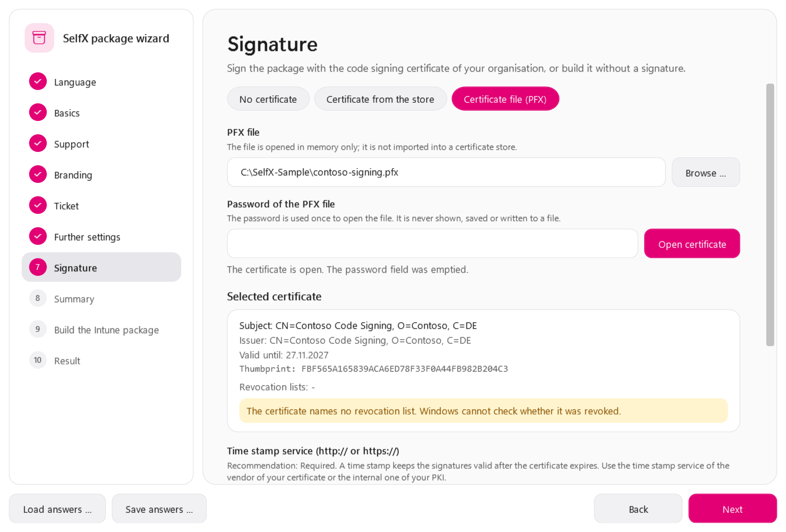
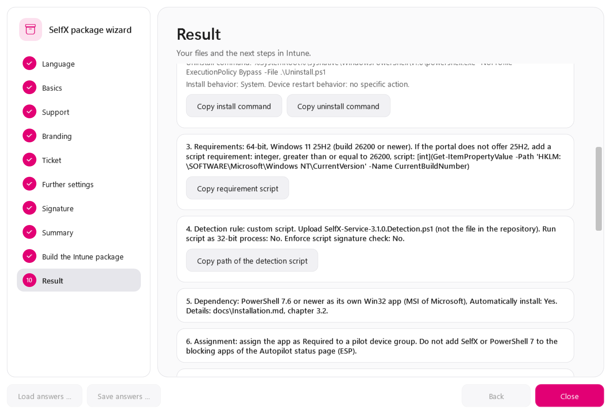

# Package wizard (guided configuration)

**English** | [Deutsch](de/Assistent.md)

The wizard `tools\New-SelfXPackage.ps1` walks you through the SelfX settings with questions and builds
the Intune package from your answers. Every question shows a **recommendation**. At the end it
explains briefly what to do in Intune. It runs on the build machine in Windows PowerShell 5.1 and
PowerShell 7 and needs no network access. It asks for a password only when you sign with a PFX file (see
[Signing](#sign-the-package-trust-mode-signature)).

After the last answer the wizard builds everything **in one run, without further questions**: it checks the files, writes your
settings and the logo, signs (optional), packs, writes the detection script, the AppLocker and App Control files, the scripts for
Intune and the instructions. The result replaces the output folder only when every step worked: an error leaves no half-finished folder
and an earlier result stays as it was. The same run is available to other programs as the function `Invoke-SelfXPackageBuild`
(`tools\Wizard\SelfXWizard.ps1`): answers, payload folder, output folder, tool path, optional certificate and a callback for the progress.

## The window (recommended)

`tools\Start-SelfXPackageWizard.cmd` opens the wizard as a window in the style of SelfX. Double-click it in the unpacked payload
archive (or in the repository). It starts Windows PowerShell 5.1 with `-NoProfile -STA`; PowerShell 7 works as well
(`pwsh -NoProfile -STA -File .\tools\Wizard\SelfXWizardGui.ps1`). No administrator rights are needed.

| Page | What you set |
|---|---|
| Language | Language of the wizard (de, en) and the default language of SelfX on the devices |
| Basics | Name of your organisation and of the tool, where SelfX runs |
| Support | E-mail address, phone, hours, website and Teams contact of the support |
| Branding | Logo (file dialog, preview) and company color; the window shows the color at once |
| Ticket | Ticket e-mail and, for several organisations, one mailbox per organisation, chosen by group tag, OU or device class |
| Connection check | Switch the connection check on, the delivered Microsoft targets on or off, host names in the report on or off, and your own targets (name, host, port, group, kind; up to 8 own targets). See [Network measurements](Configuration.md#network-measurements) |
| Further settings | Copilot Chat, company wiki, status icon, shortcuts, expert settings, AppLocker and App Control (recommended values preset) |
| Signature | No certificate (trust mode Hash), a certificate from the store (only suitable, valid ones) or a PFX file with its password; time stamp service; additional signers for a change of the certificate. Shows subject, issuer, end of validity, thumbprint and the revocation list addresses with warnings. See [Code signing certificate](Certificate-Guide.md) |
| Summary | Your answers, the package folder, the output folder, `IntuneWinAppUtil.exe`, "only write the configuration" |
| Build the Intune package | One click; a list shows every step; **Cancel** stops the build, the output folder stays unchanged |
| Result | Files, **Open folder**, **Copy instructions** and the steps for Intune as cards with copy buttons (app name, install and uninstall command with `-TrustedSigner`, requirement script, detection script, thumbprints, ASR file list) |


- Every value is checked as you type, with the same rules as the console; the error is shown at the field and **Next** stays on the
  page until the marked fields are correct.
- **Load answers** reads a `selfx-answers.json` (an answer with an unknown name is refused), **Save answers** writes one. The file
  never contains a password or a key.
- The build runs in the background: the window stays usable. The result is the same as `New-SelfXPackage.ps1` with the same answers.
- Keyboard: Tab moves through the fields, Enter is **Next**, the underlined letters work with Alt. Screen readers read the name of every
  field, its recommendation and its error.
- The window follows the light or dark mode of Windows and uses the colors and styles of SelfX.
- The password of a PFX file is used once to open the file and the field is emptied; it is never shown, saved or written to
  `selfx-answers.json`. The certificate is not imported into a store.
- Network targets: the list works like the organisations on the page *Ticket*: **Add target**, **Remove**, the error is shown at the field. A host with `https://`, a path or a port, a port outside 1 to 65535, an unknown group, a kind outside the group *Company* and a name used twice are refused. At most 12 targets are possible in the file; four are delivered, so you can add 8.






The console version below stays for automation (answer file).

## Run it

The best starting point is the **payload archive** of a release (`SelfX-Service-<version>-payload.zip`, see the
[installation guide](Installation.md#step-2-build-the-package)). Unpack it into an empty folder and start the wizard from there; the
.NET SDK is **not** needed, because the archive contains the programs. The files are checked against `App\SelfX.Code.json` first: a
changed or added file stops the run.

```powershell
powershell.exe -NoProfile -ExecutionPolicy Bypass -File .\tools\New-SelfXPackage.ps1
```

In the repository the wizard works on the package folder `SelfX Service` and needs the folder `Bin` (`-BuildBinaries` builds it, with
the .NET SDK 10). You need `IntuneWinAppUtil.exe`. Download the file from Microsoft:
<https://github.com/microsoft/Microsoft-Win32-Content-Prep-Tool> (file `IntuneWinAppUtil.exe` in the repository,
preferably from the latest release tag). The wizard asks for the path of the file and checks the Microsoft signature.

| Parameter | Meaning |
|---|---|
| `-Language en` | Language of the wizard (`de`, `en`). Without it the wizard asks first, in English; English is preselected and the other languages are a numbered list. |
| `-AnswerFile <file>` | Uses saved answers and asks nothing (for updates and automation). |
| `-OutputFolder <folder>` | Default: `build\SelfX-Guided` in the repository, `SelfX-Guided` next to the unpacked payload archive. The folder must be new, empty or the result of an earlier run. |
| `-ToolPath <file>` | Path of `IntuneWinAppUtil.exe`. |
| `-PayloadFolder <folder>` | A folder in the layout of the unpacked payload archive. Default: the unpacked archive that contains `tools`, otherwise the repository. |
| `-BuildBinaries` | Only in the repository: builds the folder `Bin` if it is missing. |
| `-ConfigureOnly` | Writes configuration, scripts and instructions only; nothing is packed or signed. |
| `-CertificateThumbprint <thumbprint>` | Trust mode Signature: signs with this code signing certificate from the certificate store. |
| `-PfxPath <file>` | Trust mode Signature: signs with a PFX file. The wizard asks for the password (hidden, never stored). |
| `-TimestampServer <address>` | Time stamp service (`http` or `https`) for the signatures. Recommended. |
| `-AdditionalSigner <thumbprint>` | Change of the certificate: further thumbprints for `-TrustedSigner` of the install command (nothing is signed with them; at most 9). |

## The questions

1. **Basics:** default language, language choice by users, organisation name, tool name, for which Windows the package is (`Windows11` for PCs and notebooks, `WindowsServer` for a terminal server with Windows Server 2022 or 2025; SelfX takes the mode from Windows itself, see [Configuration](Configuration.md#terminal-server-windows-server)) and, for Windows Server, who sees the device status (`TerminalServer_Health`).
2. **Support contacts:** shared mailbox, phone, hours, website, Teams; for Windows Server also the fixed support address of the terminal server (`TerminalServer_Support_Mail`, required).
3. **Branding:** logo (copied) and company color.
4. **Ticket by e-mail:** on or off, default recipient, subject marker. If **other organisations or
   locations** need other mailboxes, you define one **unit** per mailbox. The wizard asks about
   - **hybrid join:** SelfX then routes by **OU name** (for example `OU=Berlin`),
   - **Autopilot group tag (Entra ID):** the most reliable criterion for cloud-only devices,
   - **device class** (for example notebook, desktop, tablet) if another team handles tablets or kiosk PCs.

   SelfX runs on Windows 11 only. **SelfX cannot cover smartphones (iOS, Android).**
   The rules are written to `Ticket_Config.xml` in this order: group tags, then OUs, then device
   classes; the first matching rule wins.
5. **Connection check:** on or off (default off), the delivered Microsoft targets, host names in the report and your own targets (a loop of questions: name, host, port, group, kind). The answers are `NetworkEnabled`, `NetworkMicrosoft`, `NetworkHostNames` and `NetworkTargets`; a target without `NetworkEnabled` is refused, not ignored. The wizard writes them into `Network_Test_Config.xml` and keeps its comments and the four Microsoft targets.
6. **Copilot Chat and company wiki:** offer Copilot only if it is licensed; audience of the answer, clear
   the clipboard. Optionally a wiki button with an `https://` address and a name.
7. **Behavior on the device:** status icon, shortcuts. In expert mode: log retention, file check
   (`Enforce` or `Audit`) and service rights. Without expert mode the secure defaults stay.
8. **AppLocker and App Control:** whether to create AppLocker rules (default yes) and, if you use App Control for Business (WDAC), the
   ID of your base policy. Without an ID no App Control file is written. The rule scripts need Windows PowerShell 5.1; AppLocker also the
   AppLocker cmdlets, App Control the module ConfigCI. Without them the run stops with a clear text: answer *no* or create the files on
   another PC (`tools\New-SelfXAppLockerRules.ps1`, `tools\New-SelfXWdacPolicy.ps1`).
9. **Build:** output folder and path of `IntuneWinAppUtil.exe`.

Every input is checked (addresses, https links, colors, lengths, characters); an invalid input is
refused at once. Values are written to the XML files as escaped text. The logo must be a `png`, `jpg` or `ico` file of at most 2 MB; the
wizard checks the **first bytes of the file**, not only the extension, and stores it as `logo.<type>`. The answers never contain a
password or a key: a name that is no question is refused.

## Sign the package (trust mode Signature)

How to get a suitable certificate, how the devices trust it and how to change it: [Code signing certificate](Certificate-Guide.md).

Without a certificate the package is built in the trust mode **Hash** (no signature; `SelfX.Code.json` is the one of the release). With
`-CertificateThumbprint` or `-PfxPath` the wizard builds a **signed** package in the order that the file lists need: it signs every
program and script, writes `Bin\SelfX.Binaries.json` and `App\SelfX.Code.json` again with the new hashes, makes the signed catalog
`SelfX.Code.cat` of everything outside `Config`, then writes `Config\SelfX.Config.json` and the signed catalog
`Config\SelfX.Config.cat`. The detection script for Intune is signed too, the AppLocker rules are one publisher rule per rule collection and
the instructions show the install command with `-TrustedSigner <thumbprint>`. Details and the way back:
[Set up once instead of per version](Installation.md#set-up-once-instead-of-per-version).

A signed run needs a certificate that is valid for code signing, has a private key and is trusted on the build PC. The password of a PFX
file is read as a secure string, used once and never written to a file, a log, `selfx-answers.json` or an error message. Keep the
certificate protected: whoever has it can sign files that SelfX accepts.

## Result

| File | Purpose |
|---|---|
| `SelfX-Service-<version>.intunewin` | The package for Intune. |
| `SelfX-Service-<version>.Detection.ps1` | The detection script. Upload **this** file. |
| `SelfX-Config-<version>.intunewin`, `SelfX-Config-<version>.Detection.ps1` | Instead of the two files above, when you build the configuration package (summary page: *Configuration package*, console: `-ConfigPackage`). It holds only `Install.ps1`, `Detection.ps1` and `Config` and is installed with `Install.ps1 -ConfigOnly`: [second package for the configuration](Installation.md#second-intune-package-the-configuration-only). |
| `Set-SelfXSupportUnit-*.ps1` | Platform scripts for the ticket routing (per unit, group tag and device class). Units routed by OU only need none. |
| `SelfX-Intune-Guide.<language>.txt` | Short Intune instructions. For a package for Windows Server: `SelfX-Server-Guide.<language>.txt` (installation by hand or with Configuration Manager; Intune cannot install apps on Windows Server). |
| `selfx-answers.json` | Your answers for the next run. **Contains mailbox addresses: do not commit it.** |
| `SelfX.AppLocker.xml` | AppLocker rules (hash rules, or one publisher rule for a signed package). Only with the answer *yes*. |
| `AppControl\` | The App Control (WDAC) supplemental policy as `.xml` and `.cip`. Only with a base policy ID. |
| `package\` | The configured package (input of the packaging). |

The payload and the repository files are **not** changed. For an update unpack the payload archive of the new release and run the wizard
with `-AnswerFile`. In the trust mode Hash, `App\SelfX.Code.json` of the result is the one of the payload, run after run.

## Which package: full or configuration only

On the summary page (console: switches) you choose what the run builds:

- **Full package** (default): everything, as before.
- **Full package with a separate configuration package** (`-SeparateConfig`): the same package; its detection script does not compare the configuration. Choose it when you also use the configuration package.
- **Configuration package** (`-ConfigPackage`): only `Install.ps1`, `Detection.ps1` and `Config`. No programs, no AppLocker or App Control files. Needs an installed SelfX of the same release or newer.

Build both packages from the same release and the same answers. Why and how to roll them out in Intune (dependency, supersedence): [second package for the configuration](Installation.md#second-intune-package-the-configuration-only).

## What to do in Intune

The short instructions appear at the end of the run and in `SelfX-Intune-Guide.<language>.txt`. Details:
[installation guide](Installation.md#step-3-set-up-in-intune). The last step before the test also covers the Defender ASR rule for
executable files (how to find a blocked SelfX file and which files to exclude, at most four):
[Defender ASR: rule for executable files](Installation.md#defender-asr-rule-for-executable-files).

## Add a language to the wizard

Copy `tools\Wizard\Wizard.en.xml` to `Wizard.<culture>.xml`, set `Culture` and `Name` and translate the
texts. Missing texts appear in English. `tools\Test-SelfXPackageWizard.ps1` checks Ids and placeholders.
