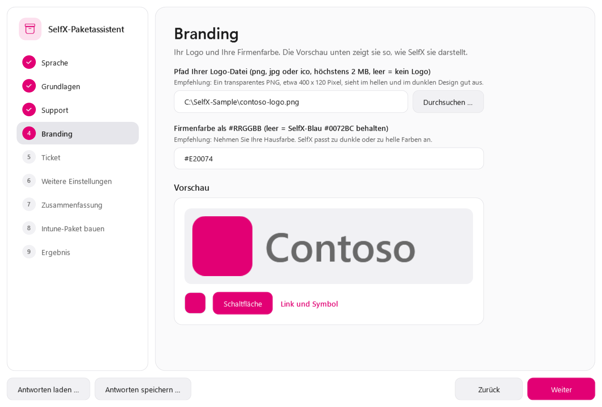
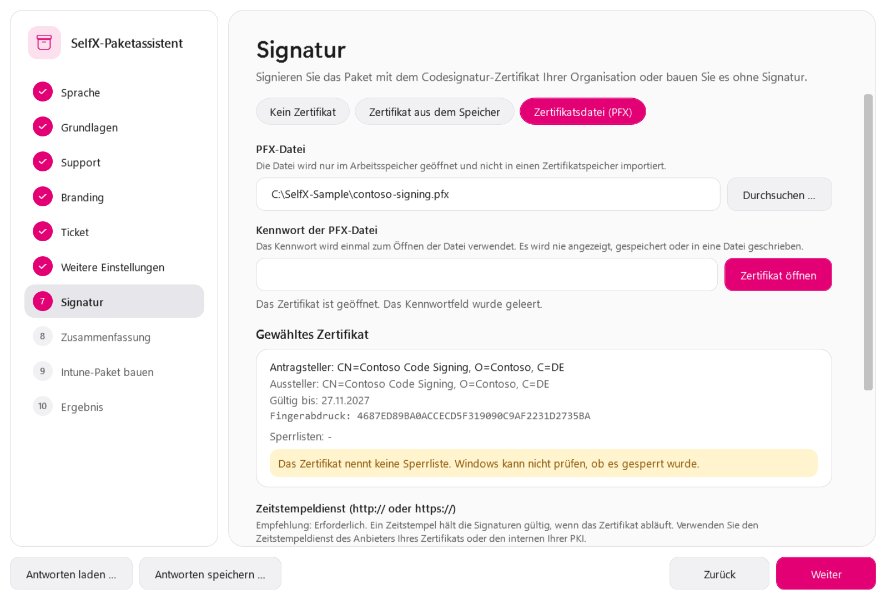
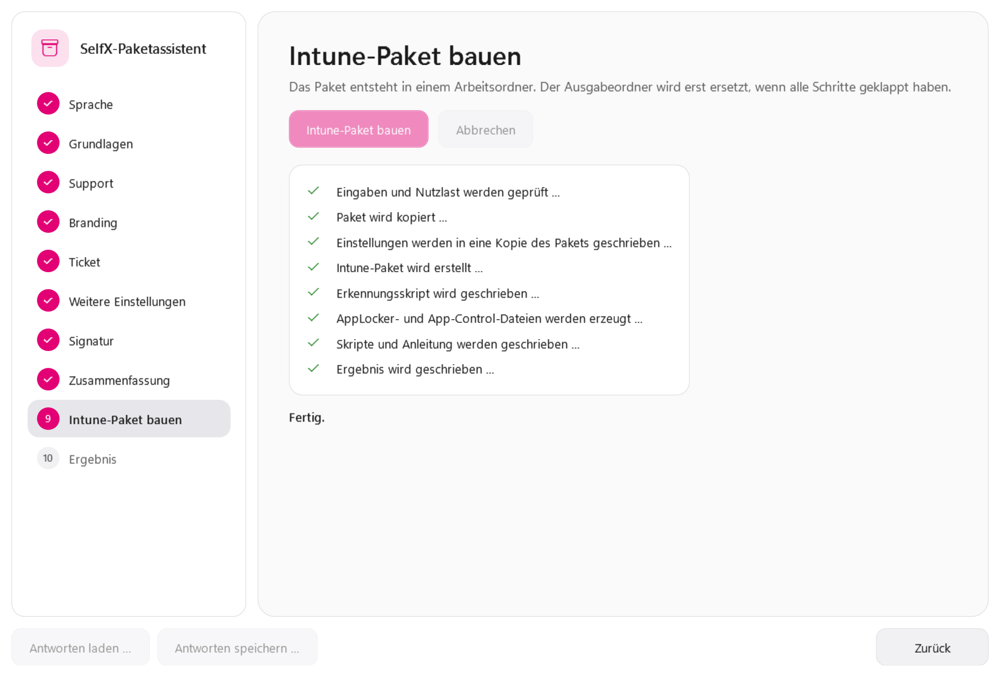
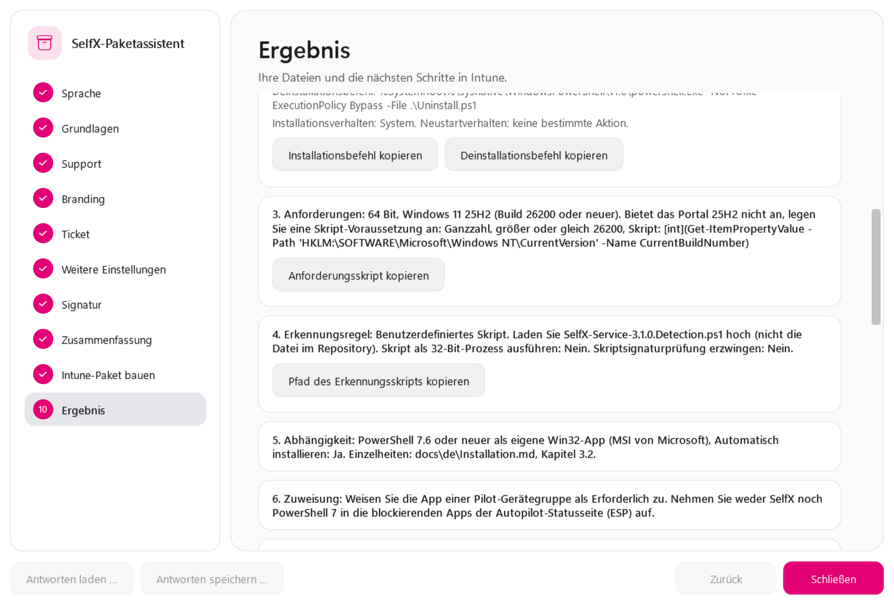

# Paketassistent (geführte Konfiguration)

[English](../Guided-Setup.md) | **Deutsch**

Der Assistent `tools\New-SelfXPackage.ps1` führt Sie mit Fragen durch die Einstellungen von SelfX
und baut daraus das Intune-Paket. Zu jeder Frage zeigt er eine **Empfehlung**. Am Ende erklärt er in
Kurzform, was Sie in Intune tun müssen. Er läuft auf dem Build-Rechner, in Windows PowerShell 5.1 und
PowerShell 7 und braucht keinen Netzwerkzugriff. Ein Kennwort fragt er nur ab, wenn Sie mit einer PFX-Datei signieren (siehe
[Signieren](#paket-signieren-vertrauensmodus-signatur)).

Nach der letzten Antwort baut der Assistent alles **in einem Lauf, ohne weitere Fragen**: Er prüft die Dateien, schreibt Ihre
Einstellungen und das Logo, signiert (optional), verpackt, schreibt das Erkennungsskript, die AppLocker- und App-Control-Dateien, die
Skripte für Intune und die Anleitung. Das Ergebnis ersetzt den Ausgabeordner erst, wenn jeder Schritt gelungen ist: Ein Fehler
hinterlässt keinen halb fertigen Ordner, und ein früheres Ergebnis bleibt unverändert. Derselbe Lauf steht anderen Programmen als
Funktion `Invoke-SelfXPackageBuild` zur Verfügung (`tools\Wizard\SelfXWizard.ps1`): Antworten, Nutzlast-Ordner, Ausgabeordner,
Werkzeugpfad, optionales Zertifikat und ein Rückruf für den Fortschritt.

## Das Fenster (empfohlen)

`tools\Start-SelfXPackageWizard.cmd` öffnet den Assistenten als Fenster im Stil von SelfX. Doppelklicken Sie die Datei im entpackten
Nutzlast-Archiv (oder im Repository). Sie startet Windows PowerShell 5.1 mit `-NoProfile -STA`; PowerShell 7 geht ebenso
(`pwsh -NoProfile -STA -File .\tools\Wizard\SelfXWizardGui.ps1`). Administratorrechte sind nicht nötig.

| Seite | Was Sie einstellen |
|---|---|
| Sprache | Sprache des Assistenten (de, en) und Standardsprache von SelfX auf den Geräten |
| Grundlagen | Name Ihrer Organisation und des Programms, wo SelfX läuft |
| Support | E-Mail-Adresse, Telefon, Servicezeiten, Webseite und Teams-Kontakt des Supports |
| Branding | Logo (Dateiauswahl, Vorschau) und Firmenfarbe; das Fenster zeigt die Farbe sofort |
| Ticket | Ticket-E-Mail und, bei mehreren Organisationen, ein Postfach je Organisation, zugeordnet über Gruppentag, OU oder Geräteklasse |
| Verbindungstest | Verbindungstest einschalten, die mitgelieferten Microsoft-Ziele ein oder aus, Hostnamen im Bericht ein oder aus und eigene Ziele (Name, Host, Port, Gruppe, Art; bis zu 8 eigene Ziele). Siehe [Netzwerk-Messungen](Configuration.md#netzwerk-messungen) |
| Weitere Einstellungen | Copilot Chat, Firmen-Wiki, Statussymbol, Verknüpfungen, Experteneinstellungen, AppLocker und App Control (empfohlene Werte vorbelegt) |
| Signatur | Kein Zertifikat (Vertrauensmodus Hash), Zertifikat aus dem Speicher (nur geeignete, gültige) oder PFX-Datei mit Kennwort; Zeitstempeldienst; weitere Signierer für einen Zertifikatswechsel. Zeigt Antragsteller, Aussteller, Ablauf, Fingerabdruck und die Sperrlisten-Adressen mit Warnungen. Siehe [Codesignatur-Zertifikat](Zertifikat.md) |
| Zusammenfassung | Ihre Antworten, Paketordner, Ausgabeordner, `IntuneWinAppUtil.exe`, „Nur die Konfiguration schreiben“ |
| Intune-Paket bauen | Ein Klick; eine Liste zeigt jeden Schritt; **Abbrechen** beendet den Bau, der Ausgabeordner bleibt unverändert |
| Ergebnis | Dateien, **Ordner öffnen**, **Anleitung kopieren** und die Schritte für Intune als Karten mit Kopieren-Schaltflächen (App-Name, Installations- und Deinstallationsbefehl mit `-TrustedSigner`, Anforderungsskript, Erkennungsskript, Fingerabdrücke, ASR-Dateiliste) |



- Jeder Wert wird schon beim Tippen geprüft, mit denselben Regeln wie in der Konsole; der Fehler steht am Feld, und **Weiter** bleibt
  auf der Seite, bis die markierten Felder stimmen.
- **Antworten laden** liest eine `selfx-answers.json` (eine Antwort mit unbekanntem Namen wird abgelehnt), **Antworten speichern**
  schreibt eine. Die Datei enthält nie ein Kennwort oder einen Schlüssel.
- Der Bau läuft im Hintergrund: Das Fenster bleibt bedienbar. Das Ergebnis ist dasselbe wie mit `New-SelfXPackage.ps1` und denselben
  Antworten.
- Tastatur: Tab wechselt zwischen den Feldern, Enter ist **Weiter**, die unterstrichenen Buchstaben gehen mit Alt. Screenreader lesen
  Name, Empfehlung und Fehler jedes Feldes vor.
- Das Fenster folgt dem hellen oder dunklen Modus von Windows und verwendet Farben und Stile von SelfX.
- Das Kennwort einer PFX-Datei wird einmal zum Öffnen verwendet, danach wird das Feld geleert; es wird nie angezeigt, gespeichert oder
  in `selfx-answers.json` geschrieben. Das Zertifikat wird nicht in einen Speicher importiert.
- Netzwerkziele: Die Liste funktioniert wie die Organisationen auf der Seite *Ticket*: **Ziel hinzufügen**, **Entfernen**, der Fehler steht am Feld. Ein Host mit `https://`, Pfad oder Port, ein Port außerhalb von 1 bis 65535, eine unbekannte Gruppe, eine Art außerhalb der Gruppe *Company* und ein doppelter Name werden abgelehnt. Höchstens 12 Ziele sind in der Datei möglich; vier werden mitgeliefert, Sie können also 8 hinzufügen.







Die Konsolenfassung unten bleibt für die Automatisierung (Antwortdatei).

## Aufruf

Am besten starten Sie mit dem **Nutzlast-Archiv** eines Release (`SelfX-Service-<Version>-payload.zip`, siehe
[Installationsanleitung](Installation.md#schritt-2-paket-bauen)). Entpacken Sie es in einen leeren Ordner und starten Sie den Assistenten
von dort; das .NET SDK ist **nicht** nötig, denn das Archiv enthält die Programme. Die Dateien werden zuerst gegen
`App\SelfX.Code.json` geprüft: Eine geänderte oder hinzugefügte Datei beendet den Lauf.

```powershell
powershell.exe -NoProfile -ExecutionPolicy Bypass -File .\tools\New-SelfXPackage.ps1
```

Im Repository arbeitet der Assistent mit dem Paketordner `SelfX Service` und braucht den Ordner `Bin` (`-BuildBinaries` baut ihn, mit
dem .NET SDK 10). Außerdem brauchen Sie `IntuneWinAppUtil.exe`. Die Datei laden Sie von Microsoft herunter:
<https://github.com/microsoft/Microsoft-Win32-Content-Prep-Tool> (Datei `IntuneWinAppUtil.exe` im Repository, am besten
vom neuesten Release-Tag). Der Assistent fragt nach dem Pfad der Datei und prüft die Microsoft-Signatur.

Wichtige Parameter:

| Parameter | Bedeutung |
|---|---|
| `-Language de` | Sprache des Assistenten (`de`, `en`). Ohne Angabe fragt der Assistent zuerst auf Englisch; Englisch ist vorgewählt, die anderen Sprachen stehen in einer Nummernliste. |
| `-AnswerFile <Datei>` | Verwendet gespeicherte Antworten, stellt keine Fragen (für Updates und Automatisierung). |
| `-OutputFolder <Ordner>` | Standard: `build\SelfX-Guided` im Repository, `SelfX-Guided` neben dem entpackten Nutzlast-Archiv. Der Ordner muss neu, leer oder das Ergebnis eines früheren Laufs sein. |
| `-ToolPath <Datei>` | Pfad von `IntuneWinAppUtil.exe`. |
| `-PayloadFolder <Ordner>` | Ein Ordner im Aufbau des entpackten Nutzlast-Archivs. Standard: das entpackte Archiv, das `tools` enthält, sonst das Repository. |
| `-BuildBinaries` | Nur im Repository: baut den Ordner `Bin`, wenn er fehlt. |
| `-ConfigureOnly` | Schreibt nur Konfiguration, Skripte und Anleitung; es wird nichts verpackt oder signiert. |
| `-CertificateThumbprint <Fingerabdruck>` | Vertrauensmodus Signatur: signiert mit diesem Codesignatur-Zertifikat aus dem Zertifikatspeicher. |
| `-PfxPath <Datei>` | Vertrauensmodus Signatur: signiert mit einer PFX-Datei. Der Assistent fragt das Kennwort ab (verdeckt, wird nie gespeichert). |
| `-TimestampServer <Adresse>` | Zeitstempeldienst (`http` oder `https`) für die Signaturen. Empfohlen. |
| `-AdditionalSigner <Fingerabdruck>` | Zertifikatswechsel: weitere Fingerabdrücke für `-TrustedSigner` im Installationsbefehl (damit wird nichts signiert; höchstens 9). |

## Die Fragen

1. **Grundlagen:** Standardsprache, Sprachwahl durch Nutzer, Name der Organisation, Name des Werkzeugs, wo SelfX läuft (`Client` für einen PC oder ein Notebook, `TerminalServer` für einen Terminalserver oder Sitzungshost mit mehreren Nutzern; siehe [Konfiguration](Configuration.md#terminalserver-und-sitzungshost-environment_mode)).
2. **Support-Kontakte:** Funktionspostfach, Telefon, Servicezeiten, Webseite, Teams.
3. **Branding:** Logo (wird kopiert) und Firmenfarbe.
4. **Ticket per E-Mail:** Ticket-Funktion an oder aus, Standard-Empfänger, Betreff-Kennzeichen.
   Müssen **andere Organisationen oder Standorte** an andere Postfächer gehen, legen Sie je Postfach
   eine **Einheit** an. Dafür fragt der Assistent nach
   - **Hybrid-Join:** dann ordnet SelfX nach dem **OU-Namen** zu (zum Beispiel `OU=Berlin`),
   - **Autopilot-Group-Tag (Entra ID):** die zuverlässigste Zuordnung für reine Cloud-Geräte,
   - **Geräteklasse** (zum Beispiel Notebook, Desktop, Tablet), wenn ein anderes Team Tablets oder
     Kiosk-PCs betreut.

   SelfX läuft nur unter Windows 11. **Smartphones (iOS, Android) kann SelfX nicht abdecken.**
   Die Regeln stehen in dieser Reihenfolge in `Ticket_Config.xml`: zuerst Group Tags, dann OUs,
   dann Geräteklassen; die erste passende Regel gewinnt.
5. **Verbindungstest:** ein oder aus (Standard aus), die mitgelieferten Microsoft-Ziele, Hostnamen im Bericht und eigene Ziele (eine Fragenschleife: Name, Host, Port, Gruppe, Art). Die Antworten heißen `NetworkEnabled`, `NetworkMicrosoft`, `NetworkHostNames` und `NetworkTargets`; ein Ziel ohne `NetworkEnabled` wird abgelehnt, nicht ignoriert. Der Assistent schreibt sie in `Network_Test_Config.xml` und lässt die Kommentare und die vier Microsoft-Ziele stehen.
6. **Copilot Chat und Firmen-Wiki:** Copilot nur anbieten, wenn Sie es lizenziert haben; Zielgruppe der
   Antwort, Zwischenablage leeren. Optional eine Wiki-Schaltfläche mit `https://`-Adresse und Namen.
7. **Verhalten auf dem Gerät:** Statussymbol, Verknüpfungen. Im Expertenmodus: Protokoll-Aufbewahrung,
   Dateiprüfung (`Enforce` oder `Audit`) und Rechte des Dienstes. Ohne Expertenmodus bleiben die sicheren Standardwerte.
8. **AppLocker und App Control:** ob AppLocker-Regeln erzeugt werden (Standard ja) und, wenn Sie App Control for Business (WDAC)
   einsetzen, die ID Ihrer Basisrichtlinie. Ohne ID entsteht keine App-Control-Datei. Die Regelskripte brauchen Windows PowerShell 5.1;
   AppLocker zusätzlich die AppLocker-Cmdlets, App Control das Modul ConfigCI. Fehlen sie, endet der Lauf mit einem klaren Text:
   Antworten Sie *nein* oder erzeugen Sie die Dateien auf einem anderen PC (`tools\New-SelfXAppLockerRules.ps1`,
   `tools\New-SelfXWdacPolicy.ps1`).
9. **Bau:** Ausgabeordner und Pfad von `IntuneWinAppUtil.exe`.

Jede Eingabe wird geprüft (Adressen, https-Links, Farben, Längen, Zeichen). Eine ungültige Eingabe
wird sofort abgelehnt. Die Werte werden als Text in die XML-Dateien geschrieben und dabei maskiert. Das Logo muss eine `png`-, `jpg`- oder
`ico`-Datei von höchstens 2 MB sein; der Assistent prüft die **ersten Bytes der Datei**, nicht nur die Endung, und speichert sie als
`logo.<Typ>`. Die Antworten enthalten nie ein Kennwort oder einen Schlüssel: Ein Name, der keine Frage ist, wird abgelehnt.

## Paket signieren (Vertrauensmodus Signatur)

Wie Sie ein geeignetes Zertifikat bekommen, wie die Geräte ihm vertrauen und wie Sie es wechseln: [Codesignatur-Zertifikat](Zertifikat.md).

Ohne Zertifikat entsteht das Paket im Vertrauensmodus **Hash** (keine Signatur; `SelfX.Code.json` ist die Datei des Release). Mit
`-CertificateThumbprint` oder `-PfxPath` baut der Assistent ein **signiertes** Paket in der Reihenfolge, die die Dateilisten verlangen: Er
signiert jedes Programm und jedes Skript, schreibt `Bin\SelfX.Binaries.json` und `App\SelfX.Code.json` mit den neuen Hashes neu, erzeugt
den signierten Katalog `SelfX.Code.cat` über alles außerhalb von `Config` und schreibt danach `Config\SelfX.Config.json` und den
signierten Katalog `Config\SelfX.Config.cat`. Auch das Erkennungsskript für Intune wird signiert, die AppLocker-Regeln sind je
Regelsammlung eine Herausgeberregel, und die Anleitung zeigt den Installationsbefehl mit `-TrustedSigner <Fingerabdruck>`. Einzelheiten
und den Weg zurück: [Einmal einrichten statt je Version](Installation.md#einmal-einrichten-statt-je-version).

Ein signierter Lauf braucht ein Zertifikat, das für Codesignatur gültig ist, einen privaten Schlüssel hat und auf dem Build-PC als
vertrauenswürdig gilt. Das Kennwort einer PFX-Datei wird als sichere Zeichenfolge gelesen, einmal benutzt und nie in eine Datei, ein
Protokoll, `selfx-answers.json` oder eine Fehlermeldung geschrieben. Schützen Sie das Zertifikat: Wer es hat, kann Dateien signieren, die
SelfX annimmt.

## Ergebnis

Im Ausgabeordner:

| Datei | Wofür |
|---|---|
| `SelfX-Service-<Version>.intunewin` | Das Paket für Intune. |
| `SelfX-Service-<Version>.Detection.ps1` | Das Erkennungsskript. Laden Sie **diese** Datei hoch. |
| `SelfX-Config-<Version>.intunewin`, `SelfX-Config-<Version>.Detection.ps1` | Statt der beiden Dateien darüber, wenn Sie das Konfigurationspaket bauen (Zusammenfassung: *Konfigurationspaket*, Konsole: `-ConfigPackage`). Es enthält nur `Install.ps1`, `Detection.ps1` und `Config` und wird mit `Install.ps1 -ConfigOnly` installiert: [zweites Paket für die Konfiguration](Installation.md#zweites-intune-paket-nur-die-konfiguration). |
| `Set-SelfXSupportUnit-*.ps1` | Plattformskripte für die Ticket-Zuordnung (je Einheit, Group Tag und Geräteklasse). Einheiten, die nur nach OU zugeordnet werden, brauchen keins. |
| `SelfX-Intune-Guide.<Sprache>.txt` | Kurzanleitung für Intune. |
| `selfx-answers.json` | Ihre Antworten für den nächsten Lauf. **Enthält Postfachadressen: nicht in Git einchecken.** |
| `SelfX.AppLocker.xml` | AppLocker-Regeln (Hash-Regeln, bei einem signierten Paket eine Herausgeberregel). Nur bei der Antwort *ja*. |
| `AppControl\` | Die ergänzende App-Control-Richtlinie (WDAC) als `.xml` und `.cip`. Nur mit einer ID der Basisrichtlinie. |
| `package\` | Das konfigurierte Paket (Eingabe der Paketierung). |

Die Nutzlast und die Dateien im Repository werden **nicht** verändert. Für ein Update entpacken Sie das Nutzlast-Archiv des neuen Release
und starten den Assistenten mit `-AnswerFile`. Im Vertrauensmodus Hash ist `App\SelfX.Code.json` im Ergebnis Lauf für Lauf die Datei der
Nutzlast.

## Welches Paket: vollständig oder nur Konfiguration

Auf der Seite Zusammenfassung (Konsole: Schalter) wählen Sie, was der Lauf baut:

- **Vollständiges Paket** (Standard): alles, wie bisher.
- **Vollständiges Paket mit getrenntem Konfigurationspaket** (`-SeparateConfig`): dasselbe Paket; sein Erkennungsskript vergleicht die Konfiguration nicht. Wählen Sie es, wenn Sie auch das Konfigurationspaket nutzen.
- **Konfigurationspaket** (`-ConfigPackage`): nur `Install.ps1`, `Detection.ps1` und `Config`. Keine Programme, keine AppLocker- oder App-Control-Dateien. Braucht ein installiertes SelfX desselben oder eines neueren Release.

Bauen Sie beide Pakete aus demselben Release mit denselben Antworten. Warum und wie Sie sie in Intune verteilen (Abhängigkeit, Ablösung): [zweites Paket für die Konfiguration](Installation.md#zweites-intune-paket-nur-die-konfiguration).

## Was Sie in Intune tun

Die Kurzanleitung steht am Ende des Laufs und in `SelfX-Intune-Guide.<Sprache>.txt`. Die Einzelheiten
stehen in der [Installationsanleitung](Installation.md#schritt-3-in-intune-einrichten). Der Schritt vor dem Test behandelt auch die
Defender-ASR-Regel für ausführbare Dateien (blockierte SelfX-Datei finden, höchstens vier Dateien ausschließen):
[Defender ASR: Regel für ausführbare Dateien](Installation.md#defender-asr-regel-für-ausführbare-dateien).

## Weitere Sprache für den Assistenten

Kopieren Sie `tools\Wizard\Wizard.en.xml` nach `Wizard.<Kultur>.xml`, setzen Sie `Culture` und `Name` und
übersetzen Sie die Texte. Fehlende Texte erscheinen auf Englisch.
`tools\Test-SelfXPackageWizard.ps1` prüft Ids und Platzhalter.
