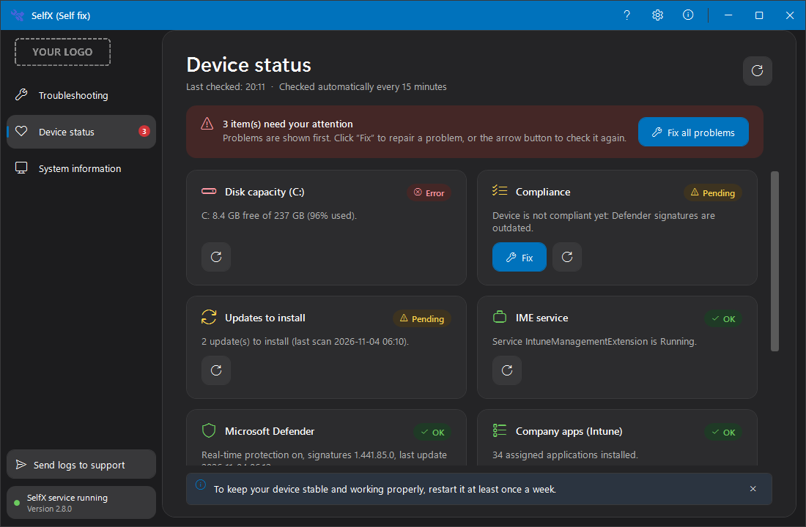

# Konfiguration

[English](../Configuration.md) | **Deutsch**

Diese Anleitung erklärt, welche Einstellungen es gibt und wo Sie sie ändern. Sie ist für
Administratoren geschrieben. Programmierkenntnisse brauchen Sie nicht. Die Installation
selbst steht in der [Installationsanleitung](Installation.md).



*Der Gerätestatus in SelfX 3.0. Die Oberfläche hat ein helles und ein dunkles Design.*

## Inhalt

1. [Wo die Einstellungen liegen](#wo-die-einstellungen-liegen)
2. [Die wichtigsten Einstellungen](#die-wichtigsten-einstellungen)
3. [Aktionen (Fehlerbehebung)](#aktionen-fehlerbehebung)
4. [Oberfläche und Design](#benutzeroberfläche)
5. [Fernwartung: Remote Help](#fernwartung-remote-help-oder-quick-assist)
6. [Statussymbol](#statussymbol)
7. [Gerätestatus und Hintergrundprüfung](#gerätestatus)
8. [Reparaturen](#reparaturen)
9. [Geräteprotokolle für den Support](#geräteprotokolle-für-den-support)
10. [Netzwerk-Messungen](#netzwerk-messungen)
11. [Ticket per E-Mail](#ticket-per-e-mail)
12. [Firmen-Wiki](#firmen-wiki)
13. [Copilot Chat](#copilot-chat)
14. [Protokolle und Aufbewahrung](#protokolle-und-aufbewahrung)
15. [Branding (Firmenlogo und Farben)](#branding)
16. [Sprachen](#sprachen)
17. [Änderungen sicher ausliefern](#änderungen-sicher-ausliefern)

## Wo die Einstellungen liegen

SelfX wird über XML-Dateien im Ordner `SelfX Service\Sources` eingestellt.

- Sie ändern die Dateien **im Paket, vor der Installation**.
- Nach der Installation liegen sie in `%ProgramFiles%\SelfX\Config` (der Code liegt in
  `%ProgramFiles%\SelfX\App`). Nur Administratoren können sie dort ändern. Der Paketbau
  sortiert jede Datei aus `Sources` nach ihrer Dateiklasse in `App` oder `Config`
  ([Architektur](Architecture.md)); eine Datei ohne Klasse bricht den Bau ab.
- SelfX lädt keine Einstellungen aus dem Netzwerk nach. Neue Einstellungen kommen mit einer
  neuen Paketversion.

| Datei | Wofür |
|---|---|
| `Tool_Config.xml` | Allgemeine Einstellungen, Kontakte, Branding, Funktionen ein oder aus |
| `Issues_List.xml` | Aktionen für die Fehlerbehebung |
| `Health_Config.xml` | Gerätestatus: Prüfungen, Reparaturen, Hintergrundprüfung |
| `Network_Test_Config.xml` | Verbindungstest und Netzwerk-Messungen (optional, standardmäßig aus) |
| `Ticket_Config.xml` | Zuordnung von Tickets zu Ihren IT-Einheiten (optional) |
| `Languages\<Sprache>.xml` | Alle Texte, je Sprache |
| `Texts\<Sprache>.xml` | Optional: ersetzt einzelne Texte einer mitgelieferten Sprache ([Text-Überschreibungen](#einzelne-texte-ändern-text-überschreibungen)) |

## Die wichtigsten Einstellungen

Die Datei `Tool_Config.xml` enthält nur Einstellungen, keine Texte. Die Texte stehen in den
Sprachdateien (siehe [Sprachen](#sprachen)).

Die Versionsnummer ist **keine** Einstellung. Sie ist eine Eigenschaft des Codes: Sie ist die eine
Zeile in `SelfX Service\Version.txt`, muss bei jedem Release gleich `$ExpectedVersion` in
`Detection.ps1` sein und wird vom Bau in `SelfX.Code.json` (`ToolVersion`) geschrieben. Ein altes
Element `Tool_Version` in einer `Tool_Config.xml` wird ignoriert. Die Konfiguration hat ihre eigene
Marke: `SelfX.Config.json` enthält `ConfigRevision`, die UTC-Zeit des Paketlaufs. Eine neue Version
ändert keine Einstellungsdatei, und geänderte Einstellungen ändern die Version nicht.

| Einstellung | Standard | Was sie bewirkt |
|---|---|---|
| `Tool_Language` | `de` | Standardsprache. `Auto` nimmt die Anzeigesprache von Windows. Sie können auch `en`, `fr-CH` oder `zh-Hans` schreiben. |
| `Show_Language_Setting` | `True` | Nutzer können die Sprache selbst wählen. `False`: immer `Tool_Language`. |
| `Tool_Name` | SelfX | Name in der Titelleiste. |
| `TerminalServer_Health` | `Off` | Nur auf Windows Server (Modus `TerminalServer`, siehe [Terminalserver](#terminalserver-windows-server)): wer den Gerätestatus bekommt. `Off`: niemand. `AdminOnly`: nur Administratoren, die SelfX mit erhöhten Rechten gestartet haben. Jeder andere Wert gilt als `Off`. |
| `Tool_Theme` | `Auto` | Standardfarbe: `Auto` (folgt Windows), `Dark` oder `Light`. |
| `Show_Theme_Button` | `True` | Nutzer können das Design selbst wählen. |
| `Disturb_Warning` | `True` | Vor einer Aktion, die Teams oder Office-Programme schließt, die Netzwerkadapter neu startet oder das Gerät neu startet, ergänzt SelfX die Bestätigung um den Hinweis *Sie sind anscheinend in einer Besprechung oder Präsentation*, wenn Windows für die eigene Sitzung des Nutzers Präsentationseinstellungen, ein Vollbildprogramm oder die Ruhezeit meldet. Siehe [Hinweis vor störenden Aktionen](#hinweis-vor-störenden-aktionen). `False`: kein Hinweis. |
| `Greeting_Name` | `FirstName` | Begrüßung über dem Titel des Fensters, zum Beispiel *Guten Morgen, Anna.* (Morgen, Tag oder Abend). SelfX fragt Windows im Hintergrund höchstens 2 Sekunden nach dem Vornamen des Kontos (`Windows.System.User`, Eigenschaft `FirstName`, über die geprüfte Windows-SDK-Projektion in `App\WinRT`); das Fenster öffnet sofort mit *Willkommen.* und ergänzt den Namen, sobald er da ist. Ohne Vornamen oder wenn die Windows-Datenschutzeinstellung *Kontoinformationen* es nicht erlaubt, bleibt es bei *Willkommen.*; der Anzeigename oder der Kontoname wird nie stattdessen verwendet. Der Name wird bereinigt (Steuerzeichen und Zeichen, die die Leserichtung ändern, entfernt, höchstens 40 Zeichen), nur als Text angezeigt, nicht protokolliert, nicht gespeichert und nicht weitergegeben. `Off`: immer *Willkommen.* Jeder andere Wert gilt als `Off`. Die Texte sind `Greeting_Morning`, `Greeting_Day`, `Greeting_Evening` (mit `{0}`) und `Greeting_Neutral` in den Sprachdateien und lassen sich in `Config\Texts` ändern; ein Text ohne `{0}` zeigt nie den Namen. |
| `Default_Solution_Mode` | `Simplified` | Startansicht der Fehlerbehebung: `Simplified` (einfach) oder `Detailed` (ausführlich). |
| `Show_Status_Page` | `True` | Seite *Gerätestatus* anzeigen. |
| `Show_SystemInfo_Tab` | `True` | Seite *Systeminformationen* anzeigen. |
| `Show_Support_Button` | `True` | Hilfe-Schaltfläche (?) mit Ihren Kontakten anzeigen. |
| `Show_Reboot_Warning` | `True` | Erinnerung an einen ausstehenden Neustart anzeigen. |
| `Show_Computer_Name_MainGUI` | — | Computername im Fenster anzeigen. |
| `Show_Computer_Name_title_bar` | `False` | Computername in der Titelleiste anzeigen. |
| `Show_About_Button` | `True` | Info-Schaltfläche (i) in der Titelleiste anzeigen. |
| `About_Logo` | `logo.png` | Logo im Info-Dialog. |
| `Show_SystemInfo_Intune_Actions` | `True` | Werkzeuge (Intune, Company Portal, Fernwartung, Protokolle) auf der Seite *Systeminformationen* anzeigen. |
| `SystemInfo_Internet_Test_Host`, `SystemInfo_Internet_Test_Port` | `www.msftconnecttest.com`, `80` | Ziel der Prüfung „Internet erreichbar“ auf der Seite *Systeminformationen*. |
| `Ticket_Subject_Tag` | `SelfX` | Kennzeichen am Anfang des Betreffs einer Ticket-Mail. Erlaubt sind Buchstaben, Ziffern, `.`, `_`, `-` und höchstens 20 Zeichen, sonst `SelfX`. |
| `Shortcut_Desktop`, `Shortcut_StartMenu`, `Shortcut_Name` | — | Verknüpfungen, die die Installation für alle Nutzer anlegt. |
| `Log_Retention_Days` | `90` | Wie lange Protokolle aufbewahrt werden (1 bis 3650 Tage). |
| `EventLog_CallerSid` | `False` | `True`: Das Windows-Ereignisprotokoll SelfX nennt die SID des Nutzers, der eine Aktion als SYSTEM gestartet hat (Ereignisse 4010 bis 4012). Jeder andere Wert: keine SID. Siehe [Protokolle und Aufbewahrung](#protokolle-und-aufbewahrung). |
| `Service_FileCheck` | `Enforce` | `Enforce`: Der Dienst startet nichts, wenn Dateien nicht stimmen. `Audit`: Der Dienst meldet das nur. Siehe [Installationsanleitung](Installation.md#die-dateilisten-selfxcodejson-und-selfxconfigjson). |
| `Service_Privileges` | `Restricted` | Begrenzt die Rechte des Dienstes. `Default` nur zur Fehlersuche. Siehe [Installationsanleitung](Installation.md#rechte-des-dienstes). |
| `Show_Tray_Icon` | `True` | Statussymbol neben der Uhr anzeigen. Siehe [Statussymbol](#statussymbol). |
| `Ticket_Enabled` | `False` | Ticket per E-Mail einschalten. Siehe [Ticket per E-Mail](#ticket-per-e-mail). |
| `Copilot_Enabled` | `False` | Copilot Chat einschalten. Siehe [Copilot Chat](#copilot-chat). |
| `Wiki_Enabled` | `False` | Schaltfläche für das Firmen-Wiki einschalten. Siehe [Firmen-Wiki](#firmen-wiki). |
| `DeviceLogs_Days` | `7` | Wie viele Tage Ereignisse in den Geräteprotokollen stehen (1 bis 60). |

**Support-Kontakte** (im Hilfe-Dialog):

| Einstellung | Beispiel |
|---|---|
| `Support_Hours` | `Mo.–Fr. 08:00–17:00` |
| `Support_Phone_number` | `+49 000 0000` |
| `Support_Mail` | `it-support@ihre-firma.example` |
| `TerminalServer_Support_Mail` | `ts-support@ihre-firma.example`. Nur auf Windows Server: ersetzt `Support_Mail` und `Ticket_Mail` (siehe [Terminalserver](#terminalserver-windows-server)). |
| `Support_Teams` | Teams-Adresse oder `https://`-Link |
| `Support_Website` | `https://support.ihre-firma.example` (nur `https://`) |

`Support_Mail` ist auch der Empfänger der E-Mail mit den Geräteprotokollen. Tragen Sie
**ein Funktionspostfach** ein, kein persönliches.

## Aktionen (Fehlerbehebung)

In `Issues_List.xml` steht jede Aktion, die Nutzer auf der Seite *Fehlerbehebung* sehen. Jede
Aktion hat eine eindeutige `Id`. Die Übersetzungen werden über diese `Id` zugeordnet.

| Element | Bedeutung |
|---|---|
| `Id` (Attribut) | Eindeutiger Name, zum Beispiel `D_Teams_SoundCuts`. |
| `Name`, `Explanation`, `Alerte_MSG` | Titel, Erklärung und Bestätigungstext. Der Basistext ist Englisch. |
| `Category` | Kategorie, zum Beispiel `Teams`, `Outlook`, `Intune`, `Device`. Der Anzeigename kommt aus der Sprachdatei. |
| `Context` | `User`: Das Skript läuft als angemeldeter Nutzer. `System`: Der Dienst führt es als SYSTEM aus. `Link`: Es öffnet nur eine Internetadresse aus `Tool_Config.xml`. Fehlt das Element, gilt `User`. |
| `Script` | Name des Skripts in `Scripts_to_run`. Bei `Link` nicht nötig. |
| `Link` | Nur bei `Link`: Name der Einstellung (`Link_<Name>`) in `Tool_Config.xml`. |
| `TimeoutSeconds` | Nur bei `System`: Zeitlimit von 1 bis 7200 Sekunden, Standard 900. |
| `OtherSessions` | Nur bei `System`: `Block` verhindert die Aktion für normale Nutzer, solange ein anderer Nutzer angemeldet ist. Administratoren sind nicht betroffen. |
| `TerminalServer` | Pflicht. `Show`: Die Aktion betrifft nur die eigene Sitzung oder das eigene Profil und wird auf einem Terminalserver (Windows Server) angeboten. `Hide`: Sie betrifft das ganze Gerät oder alle Nutzer und wird dort ausgeblendet. Verwenden Sie bei allen Einträgen desselben Skripts denselben Wert. |
| `Disruptive` | Optional. `True` kennzeichnet eine Aktion, die ein Programm schließt, die Netzwerkadapter neu startet oder das Gerät neu startet und damit eine Besprechung beenden kann. Gültig ist nur der Wert `True`. Bei allen Einträgen eines Skripts derselbe Wert (`Test-Catalog.ps1` prüft das). Siehe [Hinweis vor störenden Aktionen](#hinweis-vor-störenden-aktionen). |
| `Post_Action` | Nur bei `System`: `MailReport` öffnet nach einem erfolgreichen Lauf eine E-Mail an den Support mit dem Bericht. |

Beispiel:

```xml
<Action Id="D_Intune_RestartService">
    <Name>Restart Intune service</Name>
    <Buttons>Ok_Cancel</Buttons>
    <Explanation>You want to force a synchronization between your device and Intune.</Explanation>
    <Script>SelfX_Intune_RestartService.ps1</Script>
    <Context>System</Context>
    <TimeoutSeconds>300</TimeoutSeconds>
    <Category>Intune</Category>
    <Alerte_MSG>The Intune Management Extension service will be restarted.

Do you want to continue?</Alerte_MSG>
</Action>
```

**Sicherheitsregeln für Aktionen mit `System`:**

- `Script` ist nur ein Dateiname (Buchstaben, Ziffern, `_`, `-`, `.`), endet auf `.ps1` und liegt
  in `Scripts_to_run`. Alles andere weist der Dienst ab.
- Nutzer können dem Dienst keine Pfade, Argumente oder Code übergeben.
- Jeder angemeldete Nutzer kann jede `System`-Aktion starten. Nehmen Sie deshalb nur Aktionen
  auf, die für jeden Nutzer sicher sind.
- Das Skript läuft ohne Profil, ohne Desktop und ohne Eingabeaufforderung. Exitcode `0`
  bedeutet Erfolg. Ausgaben werden protokolliert.
- Der Dienst übergibt die Kennung des anfragenden Nutzers in `SELFX_CALLER_SID`. Nutzen Sie sie
  nur, um einem Nutzer ein Ergebnis zu schicken, nie um über eine Erlaubnis zu entscheiden.

**Neue Aktion anlegen:** Geben Sie ihr eine neue `Id` und ergänzen Sie die Texte in den
Sprachdateien. Ohne Übersetzung erscheint der englische Text. Stufen Sie sie mit `TerminalServer`
ein; ohne diese Angabe schlägt `Test-Catalog.ps1` fehl.

### Terminalserver (Windows Server)

Ein Paket funktioniert auf PCs und auf Terminalservern. SelfX übernimmt den Modus von Windows; es gibt
keine Einstellung dafür, und niemand auf dem Gerät kann ihn ändern:

- Windows 11 (Modus `Client`): ein PC oder Notebook einer Person. Alle Aktionen werden angezeigt.
- Windows Server 2022 oder 2025 mit Desktopdarstellung (Modus `TerminalServer`): ein Terminalserver,
  an dem mehrere Personen gleichzeitig arbeiten. Angezeigt werden nur Aktionen und Reparaturen mit
  `TerminalServer` = `Show`. Sie betreffen nur die eigene Sitzung oder das eigene Profil. Aktionen mit
  `Hide` betreffen den ganzen Server oder alle Nutzer, zum Beispiel ein Neustart, Windows-Updates oder
  die Netzwerkadapter.

Windows Enterprise multi-session, Server Core und Domänencontroller werden nicht unterstützt:
`Install.ps1` bricht dort ab, bevor es etwas ändert. Kann der Produkttyp von Windows nicht gelesen
werden, arbeitet SelfX wie auf einem Terminalserver. Ein Element `Environment_Mode` aus einem früheren
Build in `Tool_Config.xml` wird ignoriert (der Dienst schreibt einen Hinweis in sein Protokoll). Intune
kann auf Windows Server keine Apps installieren; siehe
[Installation, Windows Server](Installation.md#windows-server-terminalserver).

Auf einem Terminalserver lehnt auch der Dienst jede `System`-Aktion und jede Reparatur ab, die nicht als
`Show` eingestuft ist, auch für Administratoren (Ereignis 4008). Das Ausblenden im Fenster reicht nicht,
weil das Fenster keine Sicherheitsgrenze ist. Eine Aktion ohne Einstufung gilt als `Hide`.

Die Prüfung anderer aktiver Sitzungen (`OtherSessions`) gilt in beiden Modi gleich.

**Support-Adresse auf einem Terminalserver.** `TerminalServer_Support_Mail` in `Tool_Config.xml` ist
eine feste E-Mail-Adresse des Teams, das den Terminalserver betreut. Auf Windows Server ist sie die
Support-E-Mail, der Empfänger des Tickets und die Adresse im Hilfe-Fenster. Die Ticket-Zuordnung
(`Ticket_Config.xml` und die für ein Gerät in der Registry gesetzte Adresse) wird dort nicht genutzt:
Support-Einheiten, Group Tags und Geräteklassen beschreiben das Gerät einer Person. Der Computername des
Servers bleibt im Ticket. Ist `TerminalServer_Support_Mail` leer oder keine einzelne Adresse, gelten
`Support_Mail` und `Ticket_Mail`, weiterhin ohne Zuordnung, und SelfX schreibt eine Warnung in sein
Protokoll. Der Paket-Assistent fragt bei einem Paket für Windows Server nach der Adresse; auf Windows 11
wird die Einstellung ignoriert.

**Gerätestatus und Systeminformationen auf einem Terminalserver.** Der Gerätestatus beschreibt den
Server, nicht den Arbeitsplatz des Nutzers. `TerminalServer_Health` legt fest, wer ihn bekommt:

- `Off` (Standard): keine Hintergrundprüfungen, keine Seite *Gerätestatus* und kein Status im
  Statussymbol. Der Dienst beantwortet `HEALTH` und `STATUS` für jeden Aufrufer mit
  `UNAVAILABLE TerminalServer`.
- `AdminOnly`: Die Prüfungen laufen wie auf einem PC, den Status bekommen aber nur Administratoren, die
  SelfX mit erhöhten Rechten gestartet haben. Der Dienst prüft das selbst.

Normale Nutzer sehen in den *Systeminformationen*, im Ticket und im Text für Copilot nur Zeilen zu ihrem
Konto und ihrer Sitzung: Nutzer, UPN, Zeitzone, Proxy, Netzlaufwerke, Citrix Workspace und den Zeitpunkt
der Erfassung. Zeilen zum Server (Name, Hardware, Windows, Verwaltung, Adressen, Verbindungstest) sehen
nur Administratoren mit erhöhten Rechten. LAN, WLAN, Mobilfunk und VPN werden auf einem Terminalserver
nicht angezeigt. SelfX liest diese Werte mit den Rechten des Nutzers; das Ausblenden hält die Ansicht
übersichtlich und ist keine Sicherheitsgrenze.

Einstufung der mitgelieferten Aktionen:

| Aktion (Skript) | Betrifft | `TerminalServer` |
|---|---|---|
| Teams, Word, Excel, Outlook, OneDrive (Neustart, Cache, Zurücksetzen, Add-in, AutoVervollständigen) | eigene Sitzung und eigenes Profil | `Show` |
| Cache von Edge, Chrome und Firefox | Browser der eigenen Sitzung | `Show` |
| Gerät langsam, Fenster zurückholen, Citrix Workspace neu starten | eigene Sitzung | `Show` |
| Office-Lizenz zurücksetzen | eigenes Profil (vorher auf Ihrem Sitzungshost testen) | `Show` |
| Gruppenrichtlinien aktualisieren (`SelfX_Device_GpUpdate.ps1`) | nur die Richtlinien des angemeldeten Nutzers: Auf Windows Server startet das Skript `gpupdate.exe /target:user /force`, nie den Computer-Teil; auf Windows 11 `gpupdate.exe /force` | `Show` |
| Kennwort zurücksetzen, Sicherheitsinformationen (Links) | Browser des Nutzers | `Show` |
| Kein Ton (`SelfX_Audio_Restore.ps1`) | umgeleiteter Ton einer Remotesitzung, nicht getestet | `Hide` |
| DNS-Cache leeren (`SelfX_Device_ClearCache.ps1`) | DNS-Cache des ganzen Geräts | `Hide` |
| Microsoft Store zurücksetzen (`SelfX_Poste_WSReset.ps1`) | Store gibt es auf Servern nicht | `Hide` |
| Uhrzeit, Netzwerkadapter, Datenträgerprüfung, Intune-Neustart, Defender-Scan, Geräteprotokolle | ganzes Gerät oder alle Nutzer | `Hide` |
| Alle Reparaturen des Gerätestatus (Defender, Updates, Neustart, Apps, Speicherplatz freigeben) | ganzes Gerät | `Hide` |

**Konto-Aktionen mit Internetadresse (`Context` = `Link`):** Sie öffnen eine Adresse aus
`Tool_Config.xml` im Webbrowser. Mitgeliefert sind zwei Konto-Aktionen:

| Aktion | Einstellung | Standard |
|---|---|---|
| Passwort vergessen oder abgelaufen (`D_Account_PasswordReset`) | `Link_PasswordReset` | `https://passwordreset.microsoftonline.com/` |
| Anmeldemethoden verwalten (`D_Account_SecurityInfo`) | `Link_SecurityInfo` | `https://mysignins.microsoft.com/security-info` |

- Ersetzen Sie die Adresse, wenn Ihr Unternehmen eine eigene Seite nutzt.
- Leer oder `Off` blendet die Aktion aus.
- Eine Adresse, die nicht mit `https://` beginnt, ist ungültig. Die Aktion wird dann nicht angezeigt, und SelfX schreibt eine Warnung ins Protokoll.
- Die Aktion läuft im Nutzerkontext, der Dienst ist nicht beteiligt. Der Nutzer bestätigt vorher im Dialog.

Mitgelieferte Skripte für `System`-Aktionen:

| Skript | Zweck |
|---|---|
| `SelfX_Intune_RestartService.ps1` | Dienst der Intune Management Extension neu starten |
| `SelfX_Device_AirePlaneMode.ps1` | Alle aktiven Netzwerkadapter neu starten |
| `SelfX_Device_SyncTime.ps1` | Uhr mit der Zeitquelle abgleichen (die Zeit-Konfiguration bleibt unverändert) |
| `SelfX_OneDrive_CHKDSK.ps1` | Festplattenprüfung für das Systemlaufwerk beim nächsten Neustart planen |
| `SelfX_Device_CollectLogs.ps1` | Geräteprotokolle sammeln und eine E-Mail mit dem Bericht öffnen |

### Hinweis vor störenden Aktionen

Manche Aktionen können eine Besprechung oder Präsentation beenden: Sie schließen Teams, Word, Excel oder Outlook, starten
die Netzwerkadapter neu oder (als Reparatur im Gerätestatus) das Gerät. Diese Aktionen tragen
`<Disruptive>True</Disruptive>` in `Issues_List.xml`; die Reparatur „Neustart“ hat den Hinweis immer.

Vor der Bestätigung liest SelfX den Zustand der eigenen Windows-Sitzung des Nutzers
(`SHQueryUserNotificationState`). Meldet Windows einen dieser Zustände, ergänzt SelfX die Bestätigung um den Satz
*Sie sind anscheinend in einer Besprechung oder Präsentation. Diese Aktion kann sie unterbrechen.*:

- Präsentationseinstellungen sind aktiv (zum Beispiel nach `presentationsettings.exe`),
- ein Programm läuft im Vollbild,
- Ruhezeit.

Das ist nur ein Hinweis. Es wird nichts abgeschaltet, blockiert oder an den Dienst gesendet, andere Sitzungen werden nicht
betrachtet, kein Programmname wird gelesen, und das Protokoll nennt nur die Aktions-Id. Für „Nicht stören“, eine
Bildschirmfreigabe in Teams oder ein benutztes Mikrofon oder eine benutzte Kamera gibt es keine dokumentierte Abfrage; eine
solche Besprechung wird nur erkannt, wenn Windows einen der drei Zustände meldet. Lässt sich der Zustand nicht lesen,
erscheint die Bestätigung ohne Hinweis. `Disturb_Warning` = `False` in `Tool_Config.xml` schaltet den Hinweis ab.

### Eigene Skripte der Firma

Eigene Skripte für Aktionen (`Scripts_to_run`) und eigene Prüfskripte (`HealthChecks`) sind
Konfiguration Ihrer Firma. Sie legen sie im Paket in `Sources\Scripts_to_run` oder
`Sources\HealthChecks` ab; der Paketbau trägt sie in `SelfX.Config.json` ein und installiert sie
nach `%ProgramFiles%\SelfX\Config\Scripts_to_run` bzw. `Config\HealthChecks`.

- Ein eigenes Skript läuft nur, wenn der Katalog (`Issues_List.xml`) oder `Health_Config.xml` es
  nennt **und** `SelfX.Config.json` es mit dem SHA256 auflistet, den die Datei jetzt hat. Das gilt
  auch mit `Service_FileCheck` = `Audit`. Ein Skript ohne Eintrag, ein geändertes Skript und ein
  Skript hinter einer Verknüpfung werden nicht gestartet.
- Ein Skript des Projekts mit demselben Namen hat immer Vorrang (`App\Scripts_to_run`); ein
  eigenes Skript kann es nicht ersetzen. Geben Sie Ihren Skripten eigene Namen (zum Beispiel mit
  dem Kürzel Ihrer Firma).
- Ein eigenes Skript liegt in einem anderen Ordner als die Hilfsdateien von SelfX. Laden Sie sie
  aus dem Code-Ordner:

  ```powershell
  $SelfXApp = Join-Path (Split-Path -Parent (Split-Path -Parent $PSScriptRoot)) 'App'
  $SelfXLogScript = Join-Path $SelfXApp 'SelfXLog.ps1'
  if (Test-Path -LiteralPath $SelfXLogScript) { . $SelfXLogScript; Initialize-SelfXLog -Component ([IO.Path]::GetFileNameWithoutExtension($PSCommandPath)) }
  ```

  Skripte für 3.0.x, die `SelfXLog.ps1` oder `SelfXOffice.ps1` über `Split-Path -Parent $PSScriptRoot`
  suchen, finden sie nicht mehr und müssen angepasst werden.

## Benutzeroberfläche

Das Fenster ist für Nutzer ohne Fachwissen gebaut. Es lässt sich in der Größe ändern
(mindestens 640 × 480). Größe, Position, Design, Sprache und das Statussymbol speichert SelfX
für jeden Nutzer getrennt. Pro Nutzer läuft nur ein Fenster.

**Das neue Design (SelfX 3.0):**

- Ruhigere Optik mit größeren Abständen, runden Karten und großen Schaltflächen.
- Ein Drei-Schritte-Hinweis unter dem Titel: „Problem auswählen – Bestätigen – Fertig“.
- Statusmarken mit Symbol, nicht nur mit Farbe.
- Ein helles und ein dunkles Design. `Tool_Theme` legt den Standard fest. Mit
  `Show_Theme_Button` = `True` kann jeder Nutzer *Automatisch*, *Dunkel* oder *Hell* wählen.
- Neues App-Icon für Fenster, Taskleiste und Statussymbol.

**Bereiche des Fensters:**

- **Navigation (links):** *Fehlerbehebung*, *Gerätestatus* (mit Zähler für Probleme und
  Warnungen), *Systeminformationen*, das Firmenlogo und unten *Protokolle an Support senden*.
- **Fehlerbehebung:** Suche, Kategorien und eine Karte je Aktion. Ein Info-Symbol erklärt
  die Aktion. Läuft eine Aktion über den Dienst, zeigt die Karte ein Schild. Während einer
  Aktion ist ihre Schaltfläche gesperrt. Das Ergebnis erscheint in der Meldungsleiste und wird
  protokolliert.
- **Gerätestatus:** Eine Karte je Prüfung, Probleme zuerst. Siehe [Gerätestatus](#gerätestatus).
- **Systeminformationen:** Eine Karte je Bereich (Gerät, Windows, Nutzer und Verwaltung,
  Netzwerk, Bericht). Ein Doppelklick kopiert einen Wert. Die letzten Werte erscheinen sofort
  und werden im Hintergrund aktualisiert. Export als TXT, HTML, CSV oder JSON.
- **Titelleiste:** Hilfe (?), Einstellungen (Sprache, Design, Statussymbol) und Info (i).
- **Hilfe-Dialog:** Zeigt nur die Kontakte, die Sie eingetragen haben. Fehlt ein Kontakt, bittet
  der Dialog, die IT-Abteilung zu kontaktieren.

## Fernwartung: Remote Help oder Quick Assist

Die Kachel für Fernwartung in den Werkzeugen startet **Remote Help**, wenn es installiert ist.
Sonst startet sie Quick Assist. Ist Remote Help da, bietet SelfX Quick Assist nicht an. So gilt
im Unternehmen ein einheitlicher Standard.

- **Erkennung:** SelfX prüft, ob `%ProgramFiles%\Remote Help\RemoteHelp.exe` als normale
  Datei (kein Link) mit gültiger Signatur von „Microsoft Corporation“ vorhanden ist. Eine
  Datei ohne gültige Signatur zählt als nicht installiert. Die Prüfung läuft beim Start des
  Fensters.
- **Verteilung:** Remote Help ist ein Intune-Zusatz mit eigener Lizenz. Verteilen Sie es als
  Win32-App mit dem Installationsbefehl `remotehelpinstaller.exe /quiet acceptTerms=1`.
  Ob ein Nutzer lizenziert ist, kann SelfX nicht prüfen. Die Regel lautet: App installiert =
  Remote Help.
- **Grenze:** SelfX steuert nur die eigene Kachel. Quick Assist selbst sperren Sie über Ihre
  Richtlinien (zum Beispiel Intune, AppLocker oder App Control).
- Eine Einstellung dafür gibt es nicht.

## Statussymbol

Das SelfX-Symbol im Infobereich zeigt mit einem farbigen Punkt den Zustand:
grün (in Ordnung), gelb (Warnung), rot (Problem) oder grau (noch kein Ergebnis). Die Kurzinfo
nennt die Zahl der Probleme und Warnungen. Wechselt eine Prüfung auf *Fehler*, erscheint einmal
eine Windows-Benachrichtigung. Ein Klick darauf öffnet den Gerätestatus. Das Rechtsklick-Menü
öffnet SelfX, prüft den Status, sendet Protokolle oder verbirgt das Symbol.

| Einstellung in `Tool_Config.xml` | Standard | Bedeutung |
|---|---|---|
| `Show_Tray_Icon` | `True` | Das Symbol startet bei jeder Anmeldung. `False` entfernt diesen Start. |
| `Tray_Notifications` | `True` | Benachrichtigung bei einem Fehler. `False` schaltet sie für alle aus. |
| `Tray_Poll_Seconds` | `60` | Wie oft das Symbol den Zwischenspeicher liest (15 bis 3600). Es führt selbst keine Prüfung aus. |
| `Tray_Pin_Icon` | `True` | Windows 11 blendet neue Symbole im Überlauf (Pfeil) aus. `True` setzt das Symbol dauerhaft neben die Uhr. Ein Nutzer kann das mit `HKCU\Software\SelfX\TrayPin = 0` abschalten. |

**Pro Nutzer:** Jeder Nutzer kann Benachrichtigungen ausschalten
(`HKCU\Software\SelfX\TrayNotifications`) und das Symbol verbergen (`HKCU\Software\SelfX\TrayIcon`).
Probleme werden trotzdem gemerkt. Antworten auf eigene Aktionen erscheinen immer.

Das Symbol braucht keine Administratorrechte. Es liest nur den Zwischenspeicher des Dienstes.
Bei einer Installation über Intune startet die neue Version in jeder angemeldeten Sitzung.

## Gerätestatus

Die Seite *Gerätestatus* zeigt das Ergebnis der Gesundheitsprüfungen. Sie liest den Zwischenspeicher
der Hintergrundprüfung. Mit dem Knopf für erneutes Prüfen startet sie eine neue Prüfung.

| Status | Bedeutung |
|---|---|
| **In Ordnung** (grün) | Alles passt. |
| **Bald erledigen** (gelb) | Eine Aktion steht aus, zum Beispiel Updates. Das ist eine Warnung, kein Fehler. |
| **Fehler** (rot) | Die Prüfung ist fehlgeschlagen. |
| **Unbekannt** (grau) | Daten fehlen oder die Quelle ist nicht verfügbar. Das ist **keine** bestandene Prüfung. |

Stellen Sie `Sources\Health_Config.xml` vor dem Paketieren ein. Nutzer können sie nicht ändern.

**Die Prüfungen:**

| Prüfung | Was geprüft wird |
|---|---|
| IME | Läuft der Dienst `IntuneManagementExtension`? Fehlt er oder ist er gestoppt, ist das ein Fehler. |
| Defender | Dienst, Virenschutz und Echtzeitschutz aktiv, Signaturen höchstens 7 Tage alt. Ein Drittanbieter-Virenschutz kann hier einen Fehler auslösen. |
| Compliance | Intune bewertet Compliance in der Cloud. Mit `<Compliance Script="Check-Compliance.ps1" />` prüft SelfX die lokalen Kriterien einer typischen Richtlinie: Registrierung, BitLocker, Secure Boot, TPM, Firewall, Defender und optional eine Mindestversion von Windows. Gleichen Sie `$Require` im Skript mit Ihrer Richtlinie ab. Maßgeblich bleibt das Unternehmensportal. |
| Anwendungen | Die Win32-Apps aus dem Intune-Bericht. Eine Installation mit Fehler zeigt den Fehlercode. Eine App, die noch nicht installiert ist und deren Download seit `StalledMinutes` (Standard 120) nicht weitergeht, ist ein Fehler *download stalled since ...* (hängt seit ...). Bei eigenen Prüfungen für Apps gilt: Ausgeschlossene Apps werden nicht geprüft. |
| Datenträger | Je festes Laufwerk ein Fehler, wenn es zu 90 % belegt ist **oder** weniger als 20 GB frei sind. Beides ist einstellbar. |
| BitLocker | Jedes Systemlaufwerk und jedes feste Datenlaufwerk muss verschlüsselt und geschützt sein. Schlüssel werden nicht erfasst. |
| Neustart ausstehend | Fehler, wenn Windows einen Neustart verlangt. Die Ursache steht im Detail. |
| Zu installierende Updates | Prüft nur den lokalen Cache von Windows Update, ohne Suche und ohne Download. Offene Updates ergeben *Bald erledigen*. |
| Zusätzliche Dienste | Ein Dienst mit dem erwarteten Zustand (`Running` oder `Stopped`). |
| Skriptprüfungen | Exitcode `0` = In Ordnung, `1` = Fehler. Alles andere ist ebenfalls ein Fehler. |

**Beispiel `Health_Config.xml`:**

```xml
<HealthConfig>
  <Disk UsedPercentError="90" MinimumFreeGB="20" />
  <Updates MaxSearchAgeDays="14" />
  <Applications StalledMinutes="120">
    <Exclude Name="Test application*" />
    <Application Name="Business client" Script="Check-BusinessClient.ps1" TimeoutSeconds="15" />
  </Applications>
  <Services>
    <Service Name="Spooler" Expected="Running" />
  </Services>
  <Compliance Script="Check-Compliance.ps1" TimeoutSeconds="30" />
  <CustomChecks>
    <Check Name="Local support data" Script="Check-SupportData.ps1" TimeoutSeconds="10" />
  </CustomChecks>
</HealthConfig>
```

**Hintergrundprüfung:** Der Dienst führt die Prüfungen regelmäßig im Hintergrund aus. Das
Ergebnis steht in `%ProgramData%\SelfX\Cache\Health.json`. Nur SYSTEM und Administratoren
können diese Datei lesen. Einstellungen im Element `Background` von `Health_Config.xml`:

```xml
<Background Enabled="true" IntervalMinutes="15" PauseOnBattery="true" MaxCpuPercent="75" StartDelaySeconds="120" />
```

| Attribut | Standard | Bedeutung |
|---|---|---|
| `Enabled` | `true` | `false`: keine Hintergrundprüfung. SelfX prüft dann beim Öffnen. |
| `IntervalMinutes` | `15` | Abstand zwischen zwei Prüfungen (5 bis 1440). |
| `PauseOnBattery` | `true` | Im Akkubetrieb wird nicht geprüft. |
| `MaxCpuPercent` | `75` | Ist die Last höher, wird die Prüfung um 2 Minuten verschoben (10 bis 100; 100 = kein Limit). |
| `StartDelaySeconds` | `120` | Wartezeit nach dem Start des Dienstes, damit die Anmeldung nicht langsamer wird (0 bis 3600). |

**Inventardatei (optional):** Mit `<Inventory Enabled="true" />` hängt der Dienst nach jeder vollständigen
Prüfung eine JSON-Zeile an `%ProgramData%\SelfX\Inventory\SelfX.Inventory.json` an: Status je Prüfungsart und
fehlgeschlagene Apps mit Fehlercode, ohne Namen und Detailtexte. Ein Protokoll-Sammler wie der Azure Monitor
Agent kann sie an Log Analytics senden. Die Datei hat dieselben Rechte wie der Cache. Auf Windows Server wird
nichts geschrieben, solange `TerminalServer_Health` auf `Off` steht. Einzelheiten: [Überwachung](Monitoring.md).

```xml
<Inventory Enabled="false" MaxSizeKB="1024" />
```

| Attribut | Standard | Bedeutung |
|---|---|---|
| `Enabled` | `false` | `true`: Inventardatei schreiben. Jeder andere Wert oder ein fehlendes Element: keine Datei. |
| `MaxSizeKB` | `1024` | Größengrenze (64 bis 10240). Eine größere Datei wird in `SelfX.Inventory.json.old` umbenannt; eine ältere `.old` wird gelöscht. |

**Eigene Prüfskripte:** Legen Sie sie in `Sources\HealthChecks` ab (installiert nach
`Config\HealthChecks`, siehe [Eigene Skripte](#eigene-skripte-der-firma)). Erlaubt sind nur einfache
Dateinamen, keine Unterordner und keine Pfade. Prüfskripte dürfen **nur lesen**. Sie dürfen nie
neu starten, abmelden, Einstellungen ändern, Eingaben abfragen oder Prozesse im Hintergrund
starten. Prüfen und signieren Sie sie vor der Verteilung. Schreiben Sie keine Zugangsdaten
hinein. Der Exitcode bestimmt den Status. Timeout: 1 bis 30 Sekunden je Skript.

**Hinweis zu Apps:** Der Intune-Zwischenspeicher ist ein internes Detail und kein offizielles
Inventar. Er kann veraltet sein. Eine erfolgreiche Installation beweist nicht, dass eine App
funktioniert. Für wichtige Apps sollten Sie eigene Prüfungen anlegen.

## Reparaturen

Die Prüfungen lesen nur. Damit eine Zeile die Schaltfläche *Beheben* zeigt, legen Sie ein
Reparaturskript in `Sources\Scripts_to_run` ab (ein eigenes Skript wird nach
`Config\Scripts_to_run` installiert, siehe [Eigene Skripte](#eigene-skripte-der-firma)) und tragen
es in `Health_Config.xml` ein:

```xml
<Remediations>
  <Remediation Id="IME" Script="SelfX_Intune_RestartService.ps1" />
  <Remediation Id="Service" Name="Spooler" Script="Repair-Spooler.ps1" />
  <Remediation Id="Compliance" Script="SelfX_Defender_UpdateSignature.ps1" When="NotOK" />
</Remediations>
```

| Attribut | Bedeutung |
|---|---|
| `Id` | Art der Prüfung, zum Beispiel `IME`, `Defender`, `Disk`, `Updates`, `PendingReboot`. |
| `Name` | Optional. Der genaue technische Name der Zeile. Ohne `Name` gilt die Reparatur für alle Zeilen dieser Art. |
| `Script` | Skript in `Scripts_to_run`. |
| `When` | `NotOK`: nur anbieten, solange die Zeile nicht in Ordnung ist. `Always` (Standard): immer anbieten. |
| `TimeoutSeconds` | Zeitlimit, 1 bis 7200 Sekunden. Standard 900. |
| `OtherSessions` | `Block` wie bei Aktionen. Die mitgelieferte Konfiguration setzt es für `Updates` und `PendingReboot`. |
| `TerminalServer` | Pflicht: `Show` oder `Hide` wie bei Aktionen. `Hide` blendet auch den Teil `UserScript` aus. Alle mitgelieferten Reparaturen sind `Hide`. |
| `UserScript` | Optional. Ein erster Teil, den SelfX **als angemeldeter Nutzer** vor `Script` ausführt. Der Dienst führt ihn nie aus. Es muss ein Skript mit `Context : User` sein und darf nicht dieselbe Datei wie `Script` sein. Eine Reparatur mit `UserScript` hat eine eigene Bestätigung und ist nie Teil von *Alle Probleme beheben*. |

**So läuft eine Reparatur:** Der Nutzer bestätigt. Der Dienst prüft, ob das Skript in der
geschützten Liste steht, und führt es als SYSTEM aus. Nutzer können keine eigenen Skripte,
Pfade oder Argumente übergeben. Nach der Reparatur prüft SelfX nur die betroffene Zeile
erneut. Das Ergebnis dieser Prüfung zählt, nicht der Exitcode des Skripts.

**Mitgelieferte Reparaturen:**

- **Defender-Signaturen** (`SelfX_Defender_UpdateSignature.ps1`): aktualisiert die
  Virenschutz-Signaturen. Braucht eine erreichbare Update-Quelle.
- **Updates** (`SelfX_Updates_Install.ps1`): startet die Suche und Installation über den
  Windows-Update-Orchestrator. Das Skript startet Windows **nie** selbst neu. Ein Neustart
  erscheint danach in der Zeile *Neustart ausstehend*. Die Protokolle liegen in
  `%ProgramData%\SelfX\Logs`.
- **Neustart** (`SelfX_Device_Restart.ps1`): Der Nutzer bekommt eine Warnung. Windows startet
  etwa 30 Sekunden nach der Bestätigung neu. Der Neustart ist nie Teil von *Alle Probleme
  beheben*.
- **App-Wiederholung** (`SelfX_Apps_RetryInstall.ps1`): setzt das gespeicherte Ergebnis und den
  Wiederholungsplan einer fehlgeschlagenen Intune-App zurück und startet die Intune Management Extension
  neu (`OtherSessions="Block"`). Es wird keine App deinstalliert. Auf der Karte kann der Nutzer **eine**
  App erneut versuchen: eine fehlgeschlagene App oder eine App, deren Download hängt (`StalledMinutes`
  von `<Applications>`, 30-1440, Standard 120; ein hängender Download ist eine Download-Datei
  `Content\Incoming\<App-ID>_<Revision>.bin` der Intune Management Extension, die sich so lange nicht
  geändert hat). Das Fenster schickt nur die ID der App (`APPRETRY <App-ID>`); der Dienst nimmt sie nur
  an, wenn seine eigene Lesung des lokalen IME-Caches die App als nicht installiert führt, und das Skript
  setzt nur die Einträge dieser App zurück, solange sie noch fehlgeschlagen ist oder hängt (sonst ändert
  es nichts und startet die Intune Management Extension nicht neu). *Alle Probleme beheben* versucht
  weiterhin alle fehlgeschlagenen Apps. `TerminalServer="Hide"`: Intune installiert auf Windows Server
  keine Apps.
- **Speicherplatz freigeben** (`SelfX_Device_FreeSpaceUser.ps1`, danach `SelfX_Device_FreeSpace.ps1`): in der
  Zeile von Laufwerk `C:`, solange sie nicht in Ordnung ist. Der Nutzer sieht eine Bestätigung, die
  aufzählt, was gelöscht wird. Dann:
  1. Als Nutzer: leert den eigenen Papierkorb (nicht rückgängig zu machen), löscht die eigenen
     temporären Dateien und löscht den eigenen Teams-Cache nur, wenn Teams geschlossen ist. Teams wird
     nie geschlossen; läuft es, bleibt der Cache erhalten und SelfX sagt das.
  2. Als SYSTEM: `Dism.exe /Online /Cleanup-Image /StartComponentCleanup` mit festen Argumenten (nie
     `/ResetBase`, installierte Updates bleiben deinstallierbar), der Delivery-Optimization-Cache
     (`Delete-DeliveryOptimizationCache`, angeheftete Dateien bleiben) und Einträge älter als
     `MinimumAgeDays` in `Windows\Temp` und in den Intune-Inhaltsordnern (`Content\Incoming`,
     `Content\Staging`, `Windows\IMECache`). Die alten Einträge löscht `SelfXService.exe /cleanold:`: Es
     öffnet jeden Eintrag einmal, ohne einer Verknüpfung zu folgen, und löscht über dieses Handle, nur
     unterhalb dieser vier festen Ordner. Die Intune-Ordner werden übersprungen, solange
     `AgentExecutor.exe` oder `msiexec.exe` läuft oder dort in den letzten `ImeQuietMinutes` etwas
     geändert wurde. Das ist eine Heuristik; Windows bietet keine Abfrage für „keine Installation läuft“.

  Am Ende zeigt SelfX den freien Platz vorher und nachher. Das kann bis zu einer Stunde dauern (DISM). Es
  ist nie Teil von *Alle Probleme beheben*. Liegt Windows nicht auf `C:`, ändern Sie `Name` der Reparatur.
  Schwellen in `Health_Config.xml`:

  ```xml
  <DiskCleanup MinimumAgeDays="7" ImeQuietMinutes="60" />
  ```

  | Attribut | Standard | Bedeutung |
  |---|---|---|
  | `MinimumAgeDays` | `7` | Nur Einträge, die älter sind, werden in `Windows\Temp` und in den Intune-Inhalten gelöscht (1 bis 365). |
  | `ImeQuietMinutes` | `60` | Die Intune-Inhalte werden übersprungen, wenn sich dort in dieser Zeit etwas geändert hat (1 bis 1440). |

  Ein ungültiger Wert stoppt den SYSTEM-Teil, bevor etwas gelöscht wird. Eine Datei gilt nur als alt,
  wenn Erstellungs-, Schreib- und Änderungszeit alle älter als `MinimumAgeDays` sind.

## Geräteprotokolle für den Support

Mit *Geräteprotokolle an den Support senden* sammelt SelfX alle Protokolle, die für eine
Fehleranalyse nötig sind. Danach öffnet sich eine E-Mail an den Support mit dem Bericht im
Anhang. **Nichts wird automatisch gesendet.** Der Nutzer beschreibt das Problem und sendet die
E-Mail selbst.

**Ablauf:**

1. Der Nutzer bestätigt. Der Dienst führt `SelfX_Device_CollectLogs.ps1` als SYSTEM aus.
2. Das Skript erstellt den Bericht in `%ProgramData%\SelfX\Reports\<Nutzer-SID>`, als `.zip`
   (Standard) oder `.txt` (`DeviceLogs_Compress`).
3. Der Ordner ist geschützt: Vollzugriff für SYSTEM und Administratoren, Lesen nur für den
   anfragenden Nutzer. Berichte, die älter als 7 Tage sind, löscht der Dienst einmal am Tag.
4. Die Oberfläche kopiert den Bericht und öffnet die E-Mail. Empfänger ist `Support_Mail`.

**Was ein normaler Nutzer sieht:** Der Bericht wird pro Nutzer gekürzt. Administratoren mit
erhöhten Rechten erhalten den vollständigen Bericht. Normale Nutzer sehen:

| Bereich | Administrator | Normaler Nutzer |
|---|---|---|
| Sitzungen, Profile, Prozesse | alle | nur die eigenen |
| Konto der Geräteregistrierung, Kennungen | ja | nein (nur Typ und Status) |
| Befehlszeilen von Prozessen | ja | nein (nur Name und Startzeit) |
| Inhalt der Intune- und Windows-Update-Protokolle | ja | nein (nur Dateiname, Größe, Zeit) |
| Text der Ereignisse | ja | nein (nur Zeit, Kennung, Stufe, Anbieter) |
| E-Mail-Adressen und Namen anderer Nutzer | unverändert | ersetzt |
| SelfX-Geräteprotokolle | ja | nein |
| Eigene SelfX-Nutzerprotokolle | ja | ja |

Im Nutzermodus werden E-Mail-Adressen und fremde SIDs vor dem Schreiben ersetzt, auch an
Stellen, die nicht ausdrücklich gekürzt werden. Die ausgelassenen Bereiche sind im Bericht
selbst vermerkt.

**Die Zusammenfassung der Ereignisprotokolle** (Abschnitt 8) zeigt Fehler und Warnungen der
letzten `DeviceLogs_Days` Tage, gezählt nach Anbieter und Ereignis-Kennung. Der Meldungstext
fehlt bewusst, weil er Namen, Pfade und Adressen enthalten kann.

**SelfX-Protokolle im Bericht:** Der Dienst fügt als SYSTEM die Protokolle aus
`%ProgramData%\SelfX\Logs` hinzu (nur für Administratoren, ohne Nutzerordner). SelfX fügt im
Fenster die Protokolle des eigenen Nutzers hinzu. Die Nutzerordner werden nie als SYSTEM
gelesen. Ein Nutzer könnte sie sonst über Verknüpfungen auf geschützte Dateien umlenken.

**Exitcodes des Sammelskripts:** `0` Bericht erstellt, `1` Fehler, `2` anfragender Nutzer
unbekannt.

## Netzwerk-Messungen

Optional und standardmäßig aus. Die Datei `Network_Test_Config.xml` fügt auf der Seite *Systeminformationen*
im Bereich Netzwerk den **Verbindungstest** hinzu. Er beantwortet die Frage jedes Support-Anrufs: Liegt es am
WLAN oder Router, am Internet, an den Microsoft-Diensten für die Geräteverwaltung oder am Firmennetz (VPN)?

- **Vier Zeilen** mit Ampelsymbol: *Lokales Netzwerk (WLAN, Router)*, *Internet*, *Microsoft-Dienste (Intune,
  Entra ID)*, *Firmennetz*. Jede zeigt *erreichbar*, *teilweise erreichbar*, *nicht erreichbar* oder
  *nicht gemessen*.
- **Ein Satz**, der sagt, was vermutlich nicht stimmt, zum Beispiel „Das Internet ist nicht erreichbar.“, „Das
  Internet funktioniert, das Firmennetz ist nicht erreichbar: VPN prüfen.“ oder „Alles ist erreichbar.“.
- **Einzelwerte** je Ziel: Dauer der Namensauflösung und Zeit bis zum Aufbau einer TCP-Verbindung. Das
  Standardgateway wird mit einem Ping gemessen.

Die Zeilen und der Satz gehören zu *Kopieren*, *Exportieren*, dem Support-Bericht und dem Ticket.

```xml
<Network_Test_Config>
  <Settings Enabled="True" Gateway="True" Microsoft="True" HostNames="True" Samples="3" TimeoutMs="2000" />
  <Targets>
    <Target Label="Intune-Dienst" Host="manage.microsoft.com" Port="443" Group="Microsoft" />
    <Target Label="VPN-Gateway" Host="vpn.example.org" Port="443" Group="Company" Kind="Vpn" />
    <Target Label="Dateiserver" Host="files.example.org" Port="445" Group="Company" Kind="Intranet" />
  </Targets>
</Network_Test_Config>
```

| Einstellung | Bedeutung |
|---|---|
| `Enabled` | `True` schaltet die Messungen ein. Standard: `False`. |
| `Gateway` | `True`: Antwortzeit zum Standardgateway messen (Gruppe *Local*). |
| `Microsoft` | `True` (Standard): die Ziele der Gruppe *Microsoft* messen. `False` lässt die Gruppe weg. |
| `HostNames` | `True` (Standard): die Zeilen zeigen Hostname und Port. `False`: nur das Ergebnis wird gezeigt, damit interne Hostnamen nicht in *Kopieren*, *Exportieren* und im Ticket stehen. |
| `Samples` | Messungen je Wert (1 bis 5, Standard 3). |
| `TimeoutMs` | Wartezeit je Messung (200 bis 5000 ms, Standard 2000). |

| Attribut eines Ziels | Bedeutung |
|---|---|
| `Label` | Anzeigename (Buchstaben, Ziffern, `.`, `_`, `-`, Leerzeichen; bis 40 Zeichen; keine Bezeichnung doppelt). |
| `Host` | Ein DNS-Name oder eine IPv4-Adresse, ohne `https://`, ohne Pfad, ohne Port. |
| `Port` | Optional (1 bis 65535). Mit Port wird auch die Zeit bis zum Aufbau einer TCP-Verbindung gemessen. Eine IPv4-Adresse braucht einen Port. |
| `Group` | Zu welcher Zeile das Ziel gehört: `Local` (Drucker, lokales Gerät), `Internet` (öffentliche Adresse), `Microsoft` (Microsoft-Dienst) oder `Company` (Firmennetz). Ohne Gruppe wird das Ziel gemessen und angezeigt, zählt aber nicht für das Ergebnis. |
| `Kind` | Nur mit `Group="Company"`: `Vpn` (über VPN erreichbar: der Hinweis lautet „VPN prüfen“) oder `Intranet` (am Standort erreichbar: der Hinweis bittet, die Netzwerkverbindung am Standort zu prüfen). |

Es werden höchstens **12 Ziele** gelesen. Die Datei wird mit vier Zielen der Gruppe *Microsoft* (TCP 443)
ausgeliefert: `manage.microsoft.com` (Intune), `login.microsoftonline.com` und `graph.windows.net` (Entra-ID-
Anmeldung und -Verzeichnis) sowie `enterpriseregistration.windows.net` (Geräteregistrierung). Quelle ist der
Microsoft-Learn-Artikel *Network endpoints for Microsoft Intune* (geprüft am 27.11.2026); Microsoft ändert die
Liste von Zeit zu Zeit, vergleichen Sie sie, bevor Sie sich darauf verlassen. Die Gruppe schalten Sie mit
`Microsoft="False"` ab.

**Wie der Satz gewählt wird:** Der Router antwortet nicht und das Internet ist nicht erreichbar: *WLAN oder
Router*. Das Internet ist nicht erreichbar: *Internet*. Das Internet funktioniert, die Microsoft-Dienste sind nicht
erreichbar: *Microsoft-Dienste* (Firewall oder Proxy prüfen). Das Internet funktioniert, das Firmennetz ist nicht
erreichbar: *VPN prüfen* (`Kind="Vpn"`) oder *Netzwerkverbindung am Standort prüfen* (`Kind="Intranet"`). Manche
Firewalls verwerfen Ping: Ein Gateway, das nicht antwortet, während das Internet funktioniert, wird **nicht** als
„Router ausgefallen“ gemeldet. Der Test *Internet erreichbar* der Systeminformationen zählt als ein Internet-Ziel.

**Ziele wählen:** Sie bestimmen, was gemessen wird. Ein **Firmenname** zeigt, ob VPN oder Standort funktionieren.
Nehmen Sie nur Adressen, die Ihre Organisation betreibt oder die Microsoft dokumentiert. Benutzer können Ziele
weder hinzufügen noch ändern.

**Sicherheit:** Die Ziele stammen nur aus der Datei, die nur Administratoren ändern können. `Host`, `Port`,
`Group` und `Kind` werden streng geprüft. Das Gerät sendet nur eine Namensabfrage, Ping-Pakete an das Gateway und
Verbindungsversuche zu den Zielen (sofort wieder geschlossen). Es werden keine Daten übertragen und kein Durchsatz
gemessen. Der gesamte Lauf endet nach **15 Sekunden**; Ziele, die bis dahin nicht erreicht wurden, erscheinen als
*nicht gemessen*. Die Datei kann jeder Benutzer auf dem Gerät lesen: keine geheimen Namen eintragen. Der
Assistent schreibt sie von der Seite *Verbindungstest* (siehe [Paketassistent](Assistent.md)).

**Vor dem Verteilen prüfen:** `tools\Test-SelfXNetworkMeasure.ps1` zeigt Einstellungen, Ziele mit Gruppe und Art
und ungültige Einträge. Mit `-Run` führt es die Messungen einmal auf dem aktuellen Gerät aus und gibt die vier
Zeilen und den Satz aus.

## Ticket per E-Mail

Optional und standardmäßig aus (`Ticket_Enabled` = `False`). Ist die Funktion an, zeigt der
Hilfe-Dialog die Zeile *Problem melden* mit der Schaltfläche *Ticket erstellen*.

**Ablauf (ohne erhöhte Rechte):**

1. Der Nutzer beschreibt das Problem (bis 3000 Zeichen).
2. SelfX fügt **immer** die Geräteinformationen hinzu: Gerätename, Windows-Version, SelfX-Version
   und die Angaben aus Systeminformationen und Gerätestatus. Der Nutzer kann sie nicht abwählen.
3. Die E-Mail wird **nur angezeigt**. Der Nutzer prüft sie und sendet sie selbst.

**Übergabe an das Mailprogramm:**

- *Klassisches Outlook:* Empfänger, Betreff, Text und die Datei `TicketInfo-<Gerät>-<Zeit>.txt`
  als Anhang.
- *Neues Outlook oder anderes Mailprogramm:* Empfänger, Betreff und Text. Der Text ist begrenzt
  und wird bei Bedarf gekürzt. Die vollständige Datei markiert SelfX im Explorer. Der Nutzer
  hängt sie selbst an.

**Aufbau des Betreffs:** `[<Ticket_Subject_Tag>][<Art>] <Gerät>`. Das hilft bei Filtern.

**Wer die E-Mail erhält.** Die Reihenfolge, von der höchsten Priorität:

1. **Registrywerte pro Gerät:** `TicketMail` (und optional `TicketCc`) in
   `HKLM\SOFTWARE\SelfX\Support`. Intune kann sie pro Gerätegruppe setzen (siehe
   [Installationsanleitung](Installation.md#ticket-zuordnung-per-intune)).
2. **Regeln in `Ticket_Config.xml`.**
3. **`Ticket_Mail`** in `Tool_Config.xml`, sonst **`Support_Mail`**.

Jede Adresse muss genau eine einfache Adresse sein. Ungültige Werte werden übersprungen. Der
Empfänger steht im Dialog. Der Nutzer kann ihn nicht ändern.

**Regeln in `Ticket_Config.xml`:**

```xml
<Unit Id="IT1" Mail="it1-service@example.com" Cc="" />
<Rule Source="GroupTag" Match="DE-IT1-BER" Unit="IT1" />
<Rule Source="OU" Regex="OU=Berlin" Unit="IT1" />
```

- `Unit` legt eine Einheit mit Empfänger und optionaler Kopie fest.
- `Rule` weist einen Wert einer Einheit zu. `Source` ist `GroupTag`, `OU` oder `Category`.
  `Match` ist ein exakter Wert. Statt `Match` können Sie einen `Regex`-Ausdruck verwenden.
- Regeln werden von oben nach unten geprüft. **Die erste passende Regel gewinnt.**
- Ungültige Einträge werden übersprungen und im SelfX-Protokoll vermerkt.
- **Vor der Verteilung prüfen:** `tools\Test-SelfXTicketRouting.ps1 -GroupTag ... -Category ... -OU ...`
  zeigt, welche Einheit herauskommt. Das Skript sendet nichts.

**Postfächer:** Verwenden Sie nur gemeinsame Funktionspostfächer. `Ticket_Config.xml` liegt auf
jedem Gerät und kann von jedem Nutzer gelesen werden. Adressen, die nicht jeder sehen soll,
gehören in die Registrywerte pro Gerät.

**Sicherheit:** Empfänger und Kopie kommen nur aus den Administrator-Dateien und der Registry.
Felder werden bereinigt: keine Zeilenumbrüche im Betreff und feste Längen. Freitext und
Geräteinformationen stehen in Codeblöcken, damit ein Ticketsystem daraus keine Befehle ausführt.
Testen Sie vor dem Einschalten, ob Ihr Ticketsystem das so behandelt. Das Protokoll nennt nur
das Ergebnis, nie den Text.

## Firmen-Wiki

Optional und standardmäßig aus (`Wiki_Enabled` = `False`). Ist die Funktion an und `Wiki_Url` gültig, zeigt
SelfX in der Navigation die Schaltfläche *Firmen-Wiki*. Ein Klick öffnet die Adresse im Standard-Webbrowser
des Nutzers, zum Beispiel eine Seite mit Tipps und Tricks Ihrer Firma. SelfX sendet dabei keine Daten.

| Einstellung | Bedeutung |
| --- | --- |
| `Wiki_Enabled` | `False` (Standard) oder `True`. |
| `Wiki_Url` | Adresse des Wikis. Nur `https://`, ohne Benutzername und Kennwort, höchstens 2000 Zeichen. Ist sie ungültig, wird die Schaltfläche nicht angezeigt und eine Warnung ins Protokoll geschrieben. |
| `Wiki_Name` | Optional. Name auf der Schaltfläche, bis 40 Zeichen. Leer = Text „Firmen-Wiki“ in der Sprache des Nutzers. |

Die Schaltfläche läuft im Nutzerkontext, der Dienst ist nicht beteiligt. Der Assistent (`tools\New-SelfXPackage.ps1`)
fragt die drei Werte ab.

## Copilot Chat

Optional und standardmäßig aus (`Copilot_Enabled` = `False`). Ist die Funktion an, zeigt der
Hilfe-Dialog die Zeile *Copilot Chat fragen* mit der Schaltfläche *Text vorbereiten*.
Copilot Chat ist die Chat-Funktion in Microsoft 365. **SelfX nutzt keine Schnittstelle und kein
Token.** Der Nutzer fügt den Text selbst in Copilot Chat ein.

**Ablauf:**

1. Der Nutzer beschreibt das Problem mit eigenen Worten (optional, bis 1000 Zeichen) und wählt
   *Text erstellen*.
2. SelfX zeigt den fertigen Text in einer Vorschau. Der Nutzer kann ihn lesen und ändern.
3. *Kopieren und Copilot öffnen* kopiert den Text und öffnet die Adresse aus `Copilot_Url`.
   Der Nutzer fügt den Text mit Strg+V ein und sendet ihn selbst ab.

**Was im Text steht:** Windows-Version und Build, SelfX-Version und Sprache, Tage seit dem
letzten Neustart, Laufwerke (belegt in Prozent, frei in GB), der Gerätestatus und die Art der
Netzwerkverbindung (LAN, WLAN, Mobilfunk, VPN) sowie die Art des Proxys.

**Was nicht im Text steht:** Gerätename, Nutzername, Domäne, E-Mail-Adressen, IP- und
MAC-Adressen, Seriennummern, Protokolle. Taucht so etwas in der Beschreibung auf, ersetzt SelfX
es durch Platzhalter (zum Beispiel `<email>`). Die Erkennung ist nicht vollständig. Deshalb
sieht der Nutzer den Text vor dem Kopieren. Der Text ist auf 6000 Zeichen begrenzt.

| Einstellung | Bedeutung |
|---|---|
| `Copilot_Enabled` | `False` (Standard) oder `True`. |
| `Copilot_Url` | Adresse, die geöffnet wird. Standard `https://copilot.cloud.microsoft`. Muss mit `https://` beginnen, darf keine Zugangsdaten enthalten und höchstens 500 Zeichen haben. |
| `Copilot_Audience` | `User` (Standard): einfache Antworten. `Admin`: technische Antworten für IT-Personal. |
| `Copilot_Include_AppNames` | `True` (Standard): Namen fehlerhafter Firmen-Apps dürfen im Text stehen. `False`: nur ohne Namen und Fehlercodes. |
| `Copilot_Clear_Clipboard` | `False` (Standard) oder `True`: SelfX leert die Zwischenablage später. Siehe unten. |
| `Copilot_Clear_Clipboard_Seconds` | 30 bis 600, Standard 180. |

**Zwischenablage leeren (optional):** Mit `Copilot_Clear_Clipboard` = `True` startet SelfX beim
Kopieren einen Zeitgeber. Nach Ablauf leert SelfX die Zwischenablage, aber nur, wenn der Text
dieses Kopiervorgangs noch darin steht. SelfX liest dafür keinen anderen Inhalt. Hat der Nutzer
inzwischen etwas anderes kopiert, bleibt es unverändert.

Grenzen, die Sie kennen sollten:

- SelfX kann nicht erkennen, ob der Nutzer den Text eingefügt hat. Deshalb ist die Zeit mit
  180 Sekunden so gewählt, dass auch Anmeldung und Bestätigung in Copilot Chat Platz haben.
- Schließt der Nutzer SelfX früher, bleibt der Text in der Zwischenablage. SelfX leert dann
  nicht, weil der Text vielleicht noch nicht eingefügt ist.
- Der Verlauf der Zwischenablage (Win+V) wird nicht geleert. Dorthin gelangt der Text laut
  Windows-Bitte gar nicht erst. Das ersetzt keine DLP-Lösung.

**Anweisung an Copilot anpassen:** Die Anweisung steht in den Sprachdateien unter
`Copilot_Prompt_User` (für Nutzer) und `Copilot_Prompt_Admin` (für IT-Personal). Der Platzhalter
`{DATA}` muss genau einmal vorkommen. Der Text darf höchstens 3000 Zeichen haben. Hält er sich
nicht daran, nimmt SelfX den eingebauten Text.

**Sicherheit:** Die Adresse kommt nur aus `Tool_Config.xml`, die nur Administratoren ändern können.
SelfX stellt keine Netzwerkverbindung her und ruft keinen Dienst auf. Der Text wird aus lokalen
Werten erstellt. Das Protokoll nennt nur Zielgruppe, Länge und Host, nie den Text. Entscheiden
Sie vor dem Einschalten, ob Ihre Richtlinien erlauben, Text aus SelfX in Copilot Chat einzufügen.

## Protokolle und Aufbewahrung

SelfX schreibt Protokolle nach `%ProgramData%\SelfX\Logs`. Es gibt pro Skript und Tag eine Datei
`<Skript>_<Datum>.log`. Jede Zeile hat die Ortszeit des Geräts:

```text
2026-11-06 13:29:56.522 | Info    |  52068 | SelfX 3.0.0 opened: language de (setting de), page ''.
2026-11-06 13:30:04.426 | Warning |  52068 | Message (Warning): Windows restarts in about 30 seconds. ...
```

| Ordner | Inhalt | Lesbar für |
|---|---|---|
| `Logs` | Skripte als SYSTEM, `SelfXService.log`, `Install.log`, `Uninstall.log` | SYSTEM und Administratoren |
| `Logs\Users\<SID>` | Skripte des Nutzers: Fenster, Statussymbol, Nutzeraktionen | der Nutzer, SYSTEM und Administratoren |

Das Fenster protokolliert seinen Start, jede Aktion und jede angezeigte Meldung. Protokolliert
werden auch das Ergebnis jeder Aktion und Sprachwechsel. Die Protokolle enthalten keine
Passwörter und keine Geheimnisse.

**Aufbewahrung:** Dateien, die älter sind als `Log_Retention_Days` (Standard **90** Tage), werden
gelöscht:

- Der Dienst löscht alte Protokolle in `Logs` einmal am Tag.
- Jeder Nutzer löscht alte Dateien in seinem eigenen Ordner, höchstens einmal am Tag. Der Dienst
  löscht dort nie. Ein Löschen als SYSTEM dürfte keinem Link folgen, den ein Nutzer angelegt hat.

`Uninstall.ps1` behält die Protokolle. Mit `-RemoveLogs` werden sie gelöscht.

**Windows-Ereignisprotokoll:** Der Dienst schreibt außerdem Ereignisse in ein eigenes Protokoll *SelfX*
(Ereignisanzeige: *Anwendungs- und Dienstprotokolle*): Sicherheitsereignisse, Aktionen als SYSTEM (gestartet,
erfolgreich, fehlgeschlagen) und Zeilen des Gerätestatus, die auf *Fehler* wechseln. Jeder angemeldete Nutzer
kann dieses Protokoll lesen; es enthält deshalb keine Nutzernamen und keine Detailtexte. Die SID des Nutzers,
der eine Aktion gestartet hat, steht nur mit `EventLog_CallerSid` = `True` darin; schalten Sie das nur ein, wenn
Ihr SIEM sie braucht und Ihre Regeln für personenbezogene Daten es erlauben. `Uninstall.ps1` entfernt das
Protokoll. IDs und Felder: [Installationsanleitung](Installation.md#windows-ereignisprotokoll).

## Branding

Firmenlogo, Symbol und Farben stehen im Bereich `Branding` von `Tool_Config.xml`. Kopieren Sie die
Bilder vor dem Paketieren nach `SelfX Service\Sources\Branding` (installiert nach
`%ProgramFiles%\SelfX\Config\Branding`). Ein Wert, der mit `Branding\` beginnt, wird in
`Config\Branding` gesucht; ein anderer relativer Wert ist ein Standardbild von SelfX in `App`
(zum Beispiel `Repair.ico`, `logo.png`); ein vollständiger Pfad wird unverändert verwendet. Ein
relativer Wert mit `..` wird ignoriert. Ein Bild direkt in `Sources` (außerhalb von `Branding`)
hat keine Dateiklasse und bricht den Paketbau ab. Alle Schlüssel sind optional.

Die mitgelieferte `Tool_Config.xml` enthält **Platzhalter**: das Logo „YOUR LOGO“, die Farbe
`#0072BC` und die Kontakte `support@example.com` und `+1 555 0100`. Ersetzen Sie sie vor dem
Paketieren durch Ihre Werte, oder leeren Sie sie, um sie auszublenden.

| Schlüssel | Standard | Bedeutung |
|---|---|---|
| `Brand_Logo` | leer (kein Logo) | Logo oben in der Navigation. PNG, JPG, BMP, GIF oder ICO. Ein transparentes PNG passt zu beiden Designs am besten. |
| `Brand_Logo_Height` | `40` | Höhe in der Navigation (16 bis 120 Pixel). |
| `Brand_Icon` | `Repair.ico` | Symbol von Fenster, Taskleiste und Statussymbol. Eine 256 × 256-Pixel-`.ico` ergibt ein scharfes Bild. |
| `Brand_Accent_Color` | leer (nutzt `Tool_Color`) | Firmenfarbe als `#RRGGBB` für Schaltflächen und Auswahl. Die Textfarbe wählt SelfX automatisch. |
| `Brand_TitleBar_Color` | Fensterhintergrund | Hintergrund der Titelleiste als `#RRGGBB`. |
| `Brand_Run_Button_Color` | Akzentfarbe | Farbe der Start-Schaltflächen und von *Beheben*. |
| `Brand_Info_Button_Color` | Akzentfarbe | Farbe der Symbole „Mehr Informationen“. |

```xml
<Brand_Logo>Branding\contoso.png</Brand_Logo>
<Brand_Logo_Height>48</Brand_Logo_Height>
<Brand_Icon>Branding\contoso.ico</Brand_Icon>
<Brand_Accent_Color>#E20074</Brand_Accent_Color>
<Brand_TitleBar_Color>#3A0021</Brand_TitleBar_Color>
```

SelfX passt sehr dunkle oder sehr helle Farben an, damit sie in beiden Designs lesbar bleiben.

## Sprachen

Die Basissprache ist Deutsch. Mit `Tool_Language` = `Auto` folgt SelfX der Anzeigesprache von
Windows. Nutzer können unter den Einstellungen (Zahnrad) selbst eine Sprache wählen. Die Texte
stehen in `Sources\Languages\<Sprache>.xml`. Es gibt Dateien für 24 Sprachen, darunter Deutsch,
Englisch, Französisch, Spanisch, Italienisch, Niederländisch, Polnisch, Türkisch, Arabisch
(rechts nach links) und Chinesisch.

Englisch ist die Referenz und der Rückfall. Die übrigen Sprachen wurden maschinell übersetzt.
**Lassen Sie sie vor einem Rollout von Muttersprachlern prüfen.**

**Welche Sprache gilt?** SelfX prüft der Reihe nach:

1. Die Wahl des Nutzers. *Automatisch* heißt: weiter mit Schritt 2. Die Wahl wird ignoriert, wenn
   `Show_Language_Setting` = `False` ist.
2. `Tool_Language` in `Tool_Config.xml`.
3. Die übergeordnete Sprache. `de-CH` nutzt `de.xml`, `pt-BR` nutzt `pt.xml`.
4. Passt nichts, gilt `de.xml`.

Fehlt ein Text in der gewählten Sprache, erscheint er auf Englisch. Eine Beschriftung bleibt
also nie leer.

**Aufbau einer Sprachdatei:**

| Abschnitt | Inhalt |
|---|---|
| `UI` | Texte von Fenster, Dialogen, Meldungen, Gerätestatus und Statussymbol. `{0}` und `{1}` sind Platzhalter. |
| `SystemInfo` | Beschriftungen der Systeminformationen. |
| `Catalog/Categories` | Namen der Kategorien. |
| `Catalog/Actions` | `Name`, `Explanation` und `Alerte_MSG` je Aktions-`Id`. |

**Neue Sprache hinzufügen:**

1. Kopieren Sie `en.xml` nach `<Sprache>.xml`, zum Beispiel `cs.xml`.
2. Setzen Sie `Culture`, `Name` und `NativeName` am Wurzelelement. Für Schriften von rechts nach
   links setzen Sie `FlowDirection="RightToLeft"`.
3. Übersetzen Sie die Texte. Behalten Sie Element-Namen, Kennungen und Platzhalter bei.
4. Prüfen Sie die Datei:

   ```powershell
   & '.\SelfX Service\Test-LanguageFiles.ps1' -Culture cs
   ```

   Die Prüfung meldet fehlende Schlüssel, defekte Platzhalter und unbekannte Katalogeinträge.

Eine eigene Sprachdatei (eine Kultur, die SelfX nicht mitbringt) ist Konfiguration: Sie wird nach
`%ProgramFiles%\SelfX\Config\Languages` installiert. SelfX bietet sie neben den mitgelieferten
Sprachen (`App\Languages`) an. Eine eigene Datei mit dem Namen einer mitgelieferten Sprache wird
ignoriert; die mitgelieferte Datei gilt.

Um einen einzelnen Text für Ihr Unternehmen zu ändern, zum Beispiel den Haupttitel, bearbeiten
Sie keine mitgelieferte Sprachdatei. Nutzen Sie eine Text-Überschreibung (nächster Abschnitt).

### Einzelne Texte ändern (Text-Überschreibungen)

Die mitgelieferten Sprachdateien (`App\Languages`) sind Code: Sie kommen mit jedem Release, und
eine geänderte Datei passte nicht mehr zu `SelfX.Code.json`. Ihre eigene Formulierung gehört
deshalb in eine optionale **Text-Überschreibung** (Konfiguration): die Datei
`Texts\<Sprache>.xml` in `Sources` des Pakets, installiert nach `%ProgramFiles%\SelfX\Config\Texts`.
Eine Änderung braucht eine neue Konfiguration, keine neue Code-Version, und ein neues SelfX-Release
überschreibt sie nicht.

Beispiel `Texts\de.xml` (nur die Texte, die Sie ändern):

```xml
<?xml version="1.0" encoding="utf-8"?>
<SelfX_Language Culture="de">
	<UI>
		<Main_Title_Text>Haben Sie ein Problem mit Ihrem Gerät? Wir helfen.</Main_Title_Text>
		<Action_Success_Text>Erledigt: {0}</Action_Success_Text>
	</UI>
	<Catalog>
		<Categories><Category Id="Device">Geräte</Category></Categories>
	</Catalog>
</SelfX_Language>
```

So funktioniert es:

- Die Datei hat das Format einer Sprachdatei, enthält aber nur die Texte, die Sie ändern. Die
  Abschnitte sind `UI`, `SystemInfo` und `Catalog` (`Categories`, `Messages`, `Actions` mit `Name`,
  `Explanation`, `Alerte_MSG`). Die Kennungen sind die aus `en.xml` und `de.xml`.
- SelfX lädt erst die mitgelieferte Datei, dann die Überschreibung. Der Name der Überschreibung ist
  die Kultur der **geladenen mitgelieferten Datei**: Ein Nutzer mit `de-CH` bekommt `de.xml` und damit
  `Texts\de.xml`. Eine Überschreibung ändert nur ihre eigene Sprache; legen Sie also je Sprache, die Sie
  ändern wollen, eine Datei an (eine englische Überschreibung ändert keine deutschen Texte).
- `Culture` muss dem Dateinamen entsprechen. Andere Attribute des Wurzelelements (`NativeName`,
  `FlowDirection`) werden ignoriert. Eine Überschreibung kann keine Sprache hinzufügen und keine
  mitgelieferte Datei ersetzen; für eine eigene Sprache nutzen Sie `Languages\<Sprache>.xml`.
- Ein Text gilt nur, wenn alles Folgende zutrifft; sonst behält SelfX den mitgelieferten Text:
  - Er ist nicht leer und nicht länger als **1500 Zeichen**.
  - Er enthält **kein Markup**: kein `<` und keine Folge wie `&amp;` oder `&#60;` im angezeigten Text (ein einfaches `&`
    ist in Ordnung, in der XML-Datei schreiben Sie es als `&amp;`; ein `>` ist erlaubt).
  - Er enthält keine Steuerzeichen.
  - Er hat dieselben **Platzhalter** wie der mitgelieferte Text (`{0}` bleibt `{0}`, `{1:D2}` bleibt `{1:D2}`),
    und `SystemInfo_Export_Filter` behält seine Anzahl `|`-Trenner.
  - Seine Kennung kommt nur einmal vor.
- Die Copilot-Prompts (`Copilot_Prompt_User`, `Copilot_Prompt_Admin`) lassen sich nicht überschreiben.
- Eine Kennung, die keine mitgelieferte Datei kennt, wird **ignoriert** und im Protokoll des Nutzers
  vermerkt (`Logs\Users\<SID>`, siehe [Protokolle und Aufbewahrung](#protokolle-und-aufbewahrung)). Das
  Protokoll nennt Kennung und Grund, nie den Text.
- Die Datei muss gültiges XML ohne DTD sein, höchstens 256 KB groß und kein Link. Sonst nutzt SelfX
  sie gar nicht.
- Die Dateien in `Texts` stehen wie Ihre übrigen Konfigurationsdateien in `SelfX.Config.json`. Etwas
  anderes darf nicht im Ordner liegen (der Paketbau bricht bei einer Datei ab, die nicht
  `<Kultur>.xml` heißt).

Prüfen Sie Ihre Überschreibung, bevor Sie das Paket bauen. Die Prüfung nutzt denselben Code wie SelfX
und meldet, was SelfX ignorieren würde:

```powershell
& '.\SelfX Service\Test-LanguageFiles.ps1' -Culture de
```

Fehler sind Dateien und Texte, die SelfX nicht verwenden würde (ungültige Datei, Markup, falsche
Platzhalter, zu lang); Warnungen sind unbekannte Kennungen und eine Überschreibung ohne
mitgelieferte Sprachdatei gleichen Namens.

## Änderungen sicher ausliefern

1. Sichern Sie die aktuellen XML-Dateien und Skripte.
2. Prüfen Sie, dass alle XML-Dateien gültig bleiben.
3. Prüfen Sie, dass jedes Skript, das Sie eintragen, im Paket liegt.
4. Testen Sie Aktionen und Bestätigungstexte auf einem Testgerät, als Standardnutzer.
5. Führen Sie die Tests aus (siehe [Installationsanleitung](Installation.md#schritt-4-testen)).
6. Liefern Sie Änderungen nur als **neue Paketversion** aus (siehe
   [Installationsanleitung](Installation.md#schritt-2-paket-bauen)).

SelfX lädt keine Konfiguration aus dem Netzwerk nach. Jede Änderung ist im Paket nachvollziehbar.
