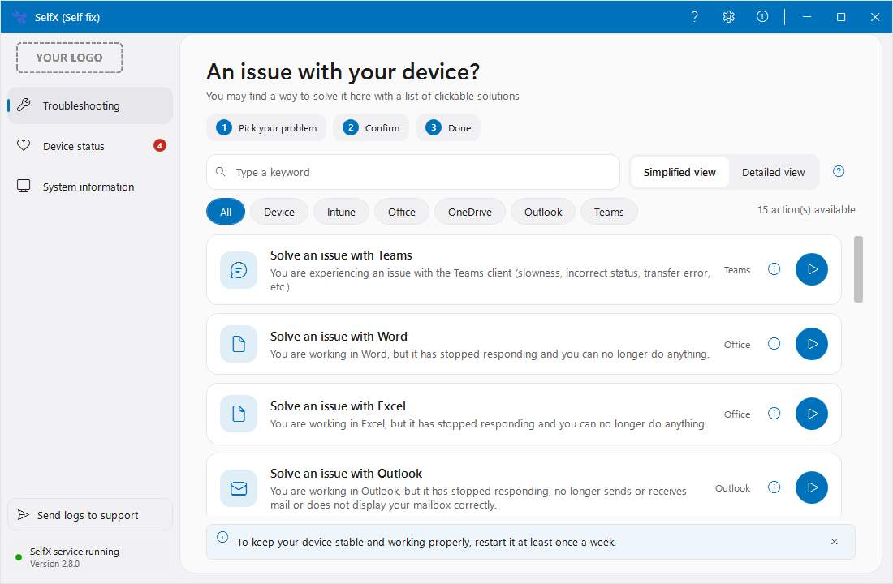

# Installation

[English](../Installation.md) | **Deutsch**

Diese Anleitung zeigt Schritt für Schritt, wie Sie **SelfX Service** bauen, mit
Microsoft Intune verteilen und prüfen. Sie ist für Administratoren geschrieben. Sie
brauchen keine Programmierkenntnisse.



*Das neue Design von SelfX 3.0: ruhige Farben, runde Karten, große Schaltflächen und ein
Drei-Schritte-Hinweis („Problem auswählen – Bestätigen – Fertig“). Es gibt ein helles und
ein dunkles Design; SelfX folgt der Windows-Einstellung.*

## Inhalt

1. [Das Wichtigste in Kürze](#das-wichtigste-in-kürze)
2. [Voraussetzungen](#voraussetzungen)
3. [Schritt 1: Build-Rechner einmal vorbereiten](#schritt-1-build-rechner-einmal-vorbereiten)
4. [Schritt 2: Paket bauen](#schritt-2-paket-bauen)
5. [Schritt 3: In Intune einrichten](#schritt-3-in-intune-einrichten)
6. [Schritt 4: Testen](#schritt-4-testen)
7. [Update auf eine neue Version](#update-auf-eine-neue-version)
8. [Deinstallation](#deinstallation)
9. [Optionale Bausteine](#optionale-bausteine)
10. [Hintergrund: Was die Installation macht](#hintergrund-was-die-installation-macht)
11. [Fehlerbehebung](#fehlerbehebung)
12. [Checkliste für die Bereitstellung](#checkliste-für-die-bereitstellung)

## Das Wichtigste in Kürze

- SelfX Service wird **einmal pro Gerät** installiert und arbeitet ohne Internet.
- Sie bauen das Paket **auf einem Build-Rechner**. Auf den Geräten wird nichts
  kompiliert.
- Auf den Geräten müssen **Windows 11 25H2** (Build 26200 oder neuer) und
  **PowerShell 7.6 oder neuer** vorhanden sein.
- Verteilt wird immer das **ganze Paket**, nie einzelne Dateien.
- Die Versionsnummer in `SelfX Service\Version.txt` und der Wert `$ExpectedVersion` in
  `Detection.ps1` müssen **gleich** sein. Sonst erkennt Intune das Update nicht. Die Version
  ist eine Eigenschaft des Codes: Der Bau schreibt sie in `SelfX.Code.json`; die
  Einstellungsdatei `Tool_Config.xml` enthält sie nicht.
- Fehlt PowerShell 7, wird SelfX trotzdem installiert. So bleibt Autopilot ungestört.

## Voraussetzungen

**Auf den Geräten:**

| Voraussetzung | Einzelheiten |
|---|---|
| Windows 11 25H2 (Build 26200) oder neuer, 64 Bit | Auf älteren Versionen bricht der Installer ab, bevor er etwas ändert. |
| PowerShell 7.6 oder neuer | Für alle Nutzer installiert (MSI von Microsoft), Pfad `%ProgramFiles%\PowerShell\7\pwsh.exe`. Die Store-Variante (MSIX) geht nicht. |
| Windows PowerShell 5.1 | Ist in Windows enthalten. SelfX nutzt sie nur für `Install.ps1`, `Uninstall.ps1`, `Detection.ps1` und `Collect-DeviceLogs.ps1`. |
| .NET | **Nicht nötig.** Dienst und Starter bringen alles selbst mit. |

**Auf dem Build-Rechner (nicht auf den Geräten):**

| Voraussetzung | Einzelheiten |
|---|---|
| Windows-Rechner | Ein normaler Administrator-Arbeitsplatz reicht. **Kein Internet nötig** (siehe „Offline-Build“). |
| .NET SDK 10 | „SDK“, nicht nur „Runtime“. Dieselbe Version wie beim Export des Ordners `offline-feed`. |
| `IntuneWinAppUtil.exe` | Das Win32 Content Prep Tool von Microsoft. |
| Das SelfX-Repository | `git clone` oder ZIP von GitHub, einschließlich des Ordners `offline-feed` (NuGet-Pakete mit Hashliste). |

## Schritt 1: Build-Rechner einmal vorbereiten

Auf dem Build-Rechner wird nichts aus dem Internet geladen. Alles Nötige kommt aus dem Repository oder aus Ihrer eigenen Softwareverteilung.

1. Installieren Sie das **.NET SDK 10** aus Ihrer Softwareverteilung. Die Version muss zu der passen, mit der der Ordner `offline-feed` erzeugt wurde (siehe „Offline-Build“ unten).
2. Öffnen Sie ein **neues** PowerShell-Fenster und prüfen Sie die Version:

   ```powershell
   dotnet --version
   ```

   Die Ausgabe muss mit `10.` beginnen.
3. Legen Sie `IntuneWinAppUtil.exe` (Win32 Content Prep Tool von Microsoft) in einen Ordner, zum Beispiel `C:\Tools\IntuneWinAppUtil.exe`, und merken Sie sich den Pfad. Die Datei laden Sie auf einem Rechner **mit** Internet aus dem offiziellen Repository <https://github.com/microsoft/Microsoft-Win32-Content-Prep-Tool> und übertragen sie auf den Build-Rechner. Das Paketskript prüft die Microsoft-Signatur.
4. Kopieren Sie das Repository **einschließlich des Ordners `offline-feed`** auf den Build-Rechner, zum Beispiel als ZIP-Datei oder über einen Datenträger.

## Schritt 2: Paket bauen

> **Einfacher mit dem Assistenten:** `tools\New-SelfXPackage.ps1` stellt Fragen mit Empfehlungen, baut das Paket
> und erklärt die Schritte in Intune. Siehe [Paketassistent](Assistent.md). Die folgenden Schritte zeigen den manuellen Weg.

Wiederholen Sie diesen Schritt bei jeder neuen Version. Öffnen Sie PowerShell im Ordner
des Repositorys.

1. **Einstellungen anpassen.** Branding, Support-Kontakte und Funktionen stehen in
   `SelfX Service\Sources\Tool_Config.xml` (siehe [Konfiguration](Configuration.md)).
2. **Versionsnummer prüfen.** Bei einem neuen Release tragen Sie dieselbe Nummer an zwei
   Stellen ein:
   - `SelfX Service\Version.txt` (eine Zeile, zum Beispiel `3.0.3`)
   - `$ExpectedVersion` in `Detection.ps1`

   Das Paketskript bricht ab, wenn beide Werte verschieden sind. Eine geänderte Einstellung
   (zum Beispiel ein Logo) ändert die Version nicht, und eine neue Version ändert keine
   Einstellungsdatei.
3. **Programme bauen.** Der Befehl erzeugt den Ordner `SelfX Service\Bin`:

   ```powershell
   powershell.exe -NoProfile -ExecutionPolicy Bypass -File .\tools\Build-SelfXBinaries.ps1
   ```

   Am Ende zeigt das Skript die gebauten Dateien mit ihrem Hash. Der Bau braucht kein
   Internet: Alle NuGet-Pakete kommen aus dem Ordner `offline-feed` und werden vorher gegen
   `SelfX.OfflineFeed.json` geprüft (siehe „Offline-Build“ unten).
4. **AppLocker anpassen** (nur wenn Sie AppLocker nutzen). Das Skript schreibt
   `build\SelfX.AppLocker.xml`. Übernehmen Sie diese Regeln und löschen Sie die Regeln der
   vorherigen Version, bevor das Paket die Geräte erreicht.
5. **Intune-Paket erstellen.** Setzen Sie bei `-ToolPath` den Pfad aus Schritt 1:

   ```powershell
   powershell.exe -NoProfile -ExecutionPolicy Bypass -File .\tools\New-SelfXIntuneWin.ps1 -ToolPath C:\Tools\IntuneWinAppUtil.exe
   ```

Ergebnis im Ordner `build`:

| Datei | Wofür |
|---|---|
| `SelfX-Service-<Version>.intunewin` | Das Paket für Intune. |
| `SelfX-Service-<Version>.Detection.ps1` | Das Erkennungsskript für Intune. Laden Sie **diese** Datei hoch, nicht die Kopie im Repository. |

Das Skript prüft vorher: Die Setup-Datei ist da, alle XML-Dateien sind gültig, `Bin` passt
zu den Quelltexten, die beiden Versionen sind gleich und `IntuneWinAppUtil.exe` hat die
Microsoft-Signatur. Es lädt nichts nach Intune hoch.

**Alternative: Release auf GitHub.** Setzen Sie nach dem Merge das Tag `v<Version>`
(die Nummer aus `Version.txt`, zum Beispiel `v3.0.0`) auf `main`. Der Workflow `.github/workflows/release.yml` baut
Programme, `.intunewin`, eine Stückliste (SBOM) und `SHA256SUMS.txt` und legt einen
**Entwurf** unter *Releases* an. Er veröffentlicht nichts. Prüfen Sie die Hashes und
veröffentlichen Sie den Entwurf erst danach. Der Workflow bricht ab, wenn Tag und
`Version.txt` nicht übereinstimmen.

### Offline-Build: Paketordner erneuern

Der Bau lädt **nichts** aus dem Internet. `NuGet.config` im Repository erlaubt nur den Ordner `offline-feed` als
Paketquelle. `Build-SelfXBinaries.ps1` prüft den Ordner vor jedem Bau gegen `offline-feed\SelfX.OfflineFeed.json`
(SHA512 je Paket), baut mit einem frischen Paketcache `.nuget-cache` im Repository und bricht ab, wenn ein Paket fehlt,
verändert wurde oder zusätzlich im Ordner liegt. Der Build-Rechner braucht deshalb nur das .NET SDK 10 (aus Ihrer
Softwareverteilung), `IntuneWinAppUtil.exe` und das Repository **mit** dem Ordner `offline-feed`.

Den Ordner erneuern Sie nur bei einer **neuen SDK-Version** (das Runtime-Paket gehört zur SDK-Version; der Bau meldet es,
wenn die Versionen nicht passen) oder bei einem **neuen oder aktualisierten Paket**:

1. Öffnen Sie einen Rechner **mit Internet** und **demselben .NET SDK 10** wie der Build-Rechner.
2. Führen Sie aus:

   ```powershell
   powershell.exe -NoProfile -ExecutionPolicy Bypass -File .\tools\Export-SelfXOfflineFeed.ps1
   ```

   Das Skript lädt die Pakete von nuget.org in einen leeren Zwischenordner, lässt die NuGet-Schwachstellenprüfung laufen
   (bei einer Meldung bricht es ab; nach eigener Prüfung geht `-AllowVulnerabilities`), prüft, dass alle Pakete der
   `packages.lock.json` vorhanden sind, schreibt `offline-feed` neu und stellt zur Kontrolle alle Projekte nur aus diesem Ordner
   wieder her (ohne Internet, leerer Cache, Lock-Dateien erzwungen).
3. **Beim ersten Mal:** Die Pakete, die in keiner Lock-Datei stehen (Runtime-Paket, Windows-SDK-Projektion), sind nur durch
   die Hashliste festgelegt. Führen Sie den Export zur Kontrolle auf einem zweiten Rechner aus; die Hashes in
   `SelfX.OfflineFeed.json` müssen übereinstimmen.
4. Prüfen Sie `git diff`, checken Sie den Ordner ein und kopieren Sie das Repository auf den Build-Rechner.
5. **Test ohne Internet:** Trennen Sie den Build-Rechner vom Netz und führen Sie Schritt 2.3 aus. Der Bau muss ohne
   Fehlermeldung durchlaufen.

Dependabot-Vorschläge für NuGet-Pakete ändern den Ordner nicht: Nach einer Übernahme den Export wiederholen.

## Schritt 3: In Intune einrichten

Öffnen Sie das Microsoft Intune Admin Center: *Apps > Windows > Hinzufügen > Windows-App
(Win32)*. Laden Sie die Datei `SelfX-Service-<Version>.intunewin` hoch.

### 3.1 App-Einstellungen

| Einstellung | Wert |
|---|---|
| Installationsbefehl | `%SystemRoot%\sysnative\WindowsPowerShell\v1.0\powershell.exe -NoProfile -ExecutionPolicy Bypass -File .\Install.ps1` |
| Deinstallationsbefehl | `%SystemRoot%\sysnative\WindowsPowerShell\v1.0\powershell.exe -NoProfile -ExecutionPolicy Bypass -File .\Uninstall.ps1` |
| Installationsverhalten | System |
| Erkennungsregel | Benutzerdefiniertes Skript: `SelfX-Service-<Version>.Detection.ps1` aus dem Ordner `build` |
| Voraussetzung (Requirement) | Windows 11 25H2, siehe 3.3 |
| Abhängigkeit | App „PowerShell 7“, *Automatisch installieren* = Ja, siehe 3.2 |

Die Erkennung meldet „installiert“ nur, wenn Version, registrierter Dienst, Dateiliste **und**
Vertrauensanker (`HKLM\SOFTWARE\SelfX\Trust`, von `Install.ps1` geschrieben) passen. So wird auch
ein Update mit geänderten Dateien, aber gleicher Versionsnummer, erkannt. Eine Installation einer
Version ohne Anker wird nicht erkannt und einmal erneut installiert.

#### Optional: signiertes Paket (Vertrauensmodus Signatur)

Für ein Paket, dessen Dateien mit dem Codesignatur-Zertifikat des Unternehmens signiert sind,
kommt der Fingerabdruck des Signaturzertifikats in den Installationsbefehl:

`%SystemRoot%\sysnative\WindowsPowerShell\v1.0\powershell.exe -NoProfile -ExecutionPolicy Bypass -File .\Install.ps1 -TrustedSigner <Fingerabdruck>`

- Der Fingerabdruck ist der SHA1-Fingerabdruck des **Signaturzertifikats** (40 Hexadezimalzeichen,
  ohne Leerzeichen), nicht der der Zertifizierungsstelle. Mehrere Fingerabdrücke werden durch
  Kommas ohne Leerzeichen getrennt (`-TrustedSigner <alt>,<neu>`); so lässt sich ein erneuertes
  Zertifikat schon vor dem Wechsel erlauben.
- `Install.ps1` installiert dann nur, wenn jedes Programm und jedes Skript des Pakets von einem
  dieser Zertifikate signiert ist und die beiden signierten Kataloge (`Config\SelfX.Config.cat`,
  `SelfX.Code.cat`) zum Paket passen. Andernfalls bricht es vor jeder Änderung am Gerät ab
  ([Architektur](Architecture.md#der-modus-signatur-in-installps1)).
- Die Zertifikatskette (Stamm- und Zwischenzertifikate) muss auf dem Gerät vertrauenswürdig sein,
  **bevor** SelfX installiert wird, auch bei Autopilot: Das Zertifikatsprofil so zuweisen, dass es
  zuerst ankommt.
- Ein Gerät, das mit `-TrustedSigner` installiert wurde, lehnt eine Installation ohne den
  Parameter ab. Für den Weg zurück zu einem unsignierten Paket einmal den Schalter
  `-AllowHashMode` angeben.
- Sperrliste: Windows fragt die Adresse ab, die im Zertifikat steht. Für Geräte außerhalb des
  Firmennetzes sollte das eine aus dem Internet erreichbare HTTP-Adresse sein. Eine nicht
  erreichbare Liste bricht die Installation nicht ab (Standardeinstellung von Windows), kann sie
  aber verlangsamen; `tools\Measure-SelfXRevocationDelay.ps1` misst das auf einem Testgerät.
- Die Paketwerkzeuge signieren noch nicht: Das Paket wird mit `tools\SelfXSigning.ps1` signiert,
  bis der Assistent das übernimmt.

### 3.2 PowerShell 7 als eigene Win32-App

1. Laden Sie die MSI-Datei (`PowerShell-7.6.x-win-x64.msi`) von Microsoft und verpacken Sie
   sie als **Win32-App**, nicht als Branchen-App (MSI). Die Mischung beider Typen kann bei
   Autopilot fehlschlagen.
2. Installationsbefehl, zum Beispiel:

   ```text
   msiexec.exe /package PowerShell-7.6.x-win-x64.msi /quiet DISABLE_TELEMETRY=1 USE_MU=0 ENABLE_MU=0
   ```

   Ändern Sie den Installationsordner nicht. `ADD_PATH` ist nicht nötig. Testen Sie den
   Befehl vorher auf einem Testgerät.
3. Erkennungsregel: Datei `%ProgramFiles%\PowerShell\7\pwsh.exe`, Dateiversion größer
   oder gleich 7.6.0.
4. Neue PowerShell-Versionen verteilen Sie als neue Version dieser App.
5. In der SelfX-App unter *Abhängigkeiten* die App „PowerShell 7“ hinzufügen,
   *Automatisch installieren* = Ja. Intune installiert dann zuerst PowerShell 7.

### 3.3 Voraussetzungsregel für Windows 11 25H2

Prüfen Sie, ob das Portal „Windows 11 25H2“ als Mindest-Betriebssystem anbietet. Wenn
nicht, legen Sie eine Voraussetzungsregel vom Typ *Skript* an: Ausgabedatentyp *Ganzzahl*,
Operator *Größer oder gleich*, Wert `26200`:

```powershell
[int](Get-ItemPropertyValue -Path 'HKLM:\SOFTWARE\Microsoft\Windows NT\CurrentVersion' -Name CurrentBuildNumber)
```

Ältere Geräte erhalten die App dann nicht, statt mit einem Fehler abzubrechen.

### 3.4 Autopilot und Statusseite (ESP)

Autopilot installiert Apps in beliebiger Reihenfolge und darf nie an SelfX scheitern.
Deshalb gilt:

- Nehmen Sie **weder SelfX noch PowerShell 7** in die Liste der blockierenden Apps der ESP
  auf (*Block device use until these required apps are installed* = *Selected*, ohne
  diese beiden Apps).
- Ein fehlendes PowerShell 7 ist nur eine **Warnung**. SelfX startet dann keine Skripte,
  prüft aber vor jedem Start erneut und arbeitet, sobald PowerShell 7 da ist.
- Ein **unsicheres** PowerShell 7 ist dagegen ein harter Abbruch (siehe Tabelle unten).

| Lage auf dem Gerät | Installer | Dienst |
|---|---|---|
| Windows älter als 25H2 | Abbruch vor jeder Änderung, Exitcode 1. Eine vorhandene Installation bleibt unverändert. | nicht betroffen |
| PowerShell 7 fehlt oder ist älter als 7.6 | **Warnung** im Installationsprotokoll, die Installation läuft weiter. | startet kein Skript und meldet den Grund |
| Der Ordner `%ProgramFiles%\PowerShell\7` oder `pwsh.exe` ist für normale Nutzer änderbar | Abbruch vor jeder Änderung, Exitcode 1. | startet nichts |

### 3.5 Zuweisung

Weisen Sie die App einer Gerätegruppe als *Erforderlich* zu. Beginnen Sie mit einer kleinen
Pilotgruppe.

## Schritt 4: Testen

Testen Sie auf einem Gerät, das nicht produktiv ist:

1. Neuinstallation: Das SelfX-Fenster, das Statussymbol neben der Uhr und die
   Verknüpfungen erscheinen.
2. Als **normaler Nutzer** (ohne Administratorrechte) eine Aktion ausführen.
3. Update von der Vorversion.
4. Deinstallation und Erkennung.
5. Auf einem Gerät mit mehreren Nutzern: zweiten Nutzer angemeldet lassen.
6. Installation ohne PowerShell 7 (Warnung, später funktioniert SelfX von selbst) und
   auf Windows 11 24H2 (Abbruch mit Exitcode 1).
7. Einen Autopilot-Lauf mit beiden Apps (die Bereitstellung darf nicht hängen).

Prüfen auf dem Gerät:

```powershell
Get-Service SelfXService
Get-Content "$env:ProgramData\SelfX\Logs\Install.log" -Tail 20          # als Administrator
Get-Content "$env:ProgramData\SelfX\Logs\SelfXService.log" -Tail 20     # als Administrator
```

Die Tests des Repositorys führen Sie so aus (jeder Test endet mit Exitcode 1, wenn er einen
Fehler findet; GitHub Actions führt dieselben Tests bei jedem Pull Request aus):

```powershell
Get-ChildItem '.\SelfX Service' -Filter 'Test-*.ps1' | ForEach-Object {
    powershell.exe -NoProfile -ExecutionPolicy Bypass -File $_.FullName
    if ($LASTEXITCODE -ne 0) { Write-Warning "$($_.Name) failed" }
}
```

## Update auf eine neue Version

1. Verteilen Sie immer das **ganze Paket**. Oberfläche und Dienst müssen zusammenpassen.
2. Erhöhen Sie `Version.txt` und `$ExpectedVersion` auf denselben neuen Wert.
3. Bauen Sie Programme und Paket neu (Schritt 2) und ersetzen Sie die AppLocker-Regeln.
4. Laden Sie die neue `.intunewin` **und** das neue Erkennungsskript in dieselbe Intune-App
   hoch.
5. Prüfen Sie vor dem Paketieren die Support-Kontakte in `Tool_Config.xml` und
   `Health_Config.xml` (siehe [Konfiguration](Configuration.md)).

**Update von SelfX 2.6.9 (Upstream):** Zusätzlich brauchen die Geräte Windows 11 25H2 und
PowerShell 7.6 (Schritt 3). Das Paket muss mit dem .NET SDK 10 neu gebaut werden; die alte
Methode, den Dienst auf dem Gerät zu kompilieren, gibt es nicht mehr. Ersetzen Sie auch die
AppLocker-Regeln. Die Standardsprache der Oberfläche ist jetzt Deutsch
(`Tool_Language` = `de`). Alle Änderungen stehen im [Änderungsprotokoll](../../CHANGELOG.md).

## Deinstallation

`Uninstall.ps1` entfernt den Dienst, `%ProgramFiles%\SelfX` (mit `App` und `Config`, auch eine
Installation im alten Aufbau von 3.0.x), die Verknüpfungen, den Eintrag
unter Apps & Features, den Autostart des Statussymbols, den Status-Cache und die Berichte.
Offene SelfX-Fenster und Statussymbole werden vorher geschlossen. Hält ein anderes
Programm eine Datei offen, versucht der Deinstaller es bis zu 90 Sekunden lang erneut.

- Die Protokolle bleiben erhalten. Mit `-RemoveLogs` wird auch `%ProgramData%\SelfX`
  gelöscht.
- Einstellungen einzelner Nutzer (`HKCU\Software\SelfX`, `%LOCALAPPDATA%\SelfX`) werden
  nicht entfernt.
- Das Ergebnis steht in `%ProgramData%\SelfX\Logs\Uninstall.log`.

## Optionale Bausteine

### Ticket-Zuordnung per Intune

Nur nötig, wenn Sie die Ticket-Funktion (`Ticket_Enabled`) mit Regeln für Group-Tag oder
Kategorie in `Ticket_Config.xml` nutzen (siehe
[Konfiguration](Configuration.md#ticket-per-e-mail)). SelfX liest die Werte nur. Sie stehen in
`HKLM\SOFTWARE\SelfX\Support`:

- `GroupTag` und `Category` (je bis 64 Zeichen: Buchstaben, Ziffern, Leerzeichen, `.`, `_`, `-`)
- `TicketMail` und `TicketCc`: genau eine einfache Adresse je Wert, nur Funktionspostfächer,
  keine persönlichen Postfächer

Hybrid-Geräte können zusätzlich nach der OU zugeordnet werden; dafür ist nichts zu setzen.

So gehen Sie vor (*Geräte > Skripte und Fehlerbehebungen > Plattformskripts*):

1. Kopieren Sie das Skript unten je Einheit und passen Sie die Werte oben an.
2. Einstellungen: *Mit den Anmeldeinformationen des angemeldeten Benutzers ausführen* =
   **Nein** (läuft als SYSTEM), *Skripthost in 64-Bit-PowerShell ausführen* = **Ja**.
3. Weisen Sie das Skript einer Entra-Gerätegruppe zu. Die Gruppen sollten sich gegenseitig
   ausschließen. Das Skript setzt immer alle vier Werte; wechselt ein Gerät die Gruppe,
   ersetzt das Skript der neuen Gruppe die Werte der alten.
4. Kontrolle auf dem Gerät: `Get-ItemProperty 'HKLM:\SOFTWARE\SelfX\Support'`. Vor der
   Verteilung zeigt `tools\Test-SelfXTicketRouting.ps1 -GroupTag ... -Category ...`, welche
   Einheit herauskommt.

Das Skript läuft in Windows PowerShell 5.1 und PowerShell 7 und ändert nur diese vier
Werte. Ungültige Werte brechen ab, bevor etwas geschrieben wird.

```powershell
# Set-SelfXSupportUnit.ps1 (example) - sets the values SelfX reads for the ticket routing.
# Intune platform script: run as SYSTEM (not as the signed-in user), 64-bit, one copy per assignment.
# Use shared (functional) mailboxes only, no personal mailboxes.
$GroupTag   = 'DE-IT1-BER'          # optional, up to 64 characters: letters, digits, space, . _ -
$Category   = 'Category-A'          # optional, same rules
$TicketMail = 'it1-service@example.com'   # recipient of the ticket e-mail: exactly one plain address
$TicketCc   = ''                    # optional second address (needs TicketMail)
# An empty value removes the registry value. All four values are always set, so a script of a new
# group replaces what a script of the old group set when a device moves to another group.

$ErrorActionPreference = 'Stop'
$key = 'HKLM:\SOFTWARE\SelfX\Support'    # below HKLM\SOFTWARE: only administrators can write, users can only read
$tag = '^[A-Za-z0-9._ -]{1,64}\z'
$mail = '^[A-Za-z0-9._%+-]{1,64}@[A-Za-z0-9.-]{1,190}\.[A-Za-z]{2,}\z'
$values = [ordered]@{ GroupTag = @($GroupTag, $tag); Category = @($Category, $tag); TicketMail = @($TicketMail, $mail); TicketCc = @($TicketCc, $mail) }
foreach ($name in $values.Keys) {
    $value = ("$($values[$name][0])").Trim()
    if ($value -and $value -notmatch $values[$name][1]) { Write-Output "$name has an invalid value."; exit 1 }
}
foreach ($name in $values.Keys) {
    $value = ("$($values[$name][0])").Trim()
    if ($value) {
        if (-not (Test-Path -LiteralPath $key)) { New-Item -Path $key -Force | Out-Null }
        New-ItemProperty -LiteralPath $key -Name $name -Value $value -PropertyType String -Force | Out-Null
    } elseif (Test-Path -LiteralPath $key) {
        Remove-ItemProperty -LiteralPath $key -Name $name -ErrorAction SilentlyContinue
    }
}
Write-Output 'SelfX support values set.'
exit 0
```

### App Control for Business (WDAC)

SelfX braucht WDAC nicht, und im Paket ist nichts davon eingeschaltet. Wenn Ihre
Organisation App Control for Business einsetzt, können Sie damit zusätzlich verhindern, dass
auf den Geräten andere als die ausgelieferten SelfX-Programme und -Skripte laufen. SelfX
bleibt unsigniert und wird per Hash zugelassen.

1. **Basisrichtlinie.** Sie gehört Ihrer Organisation. Sie muss ergänzende Richtlinien
   erlauben (Regeloption 17) und die von Microsoft signierten Dateien zulassen, darunter
   `%ProgramFiles%\PowerShell\7\pwsh.exe` und den Intune-Agenten.
2. **Paket bauen** (Schritt 2).
3. **Ergänzende Richtlinie erzeugen**, in Windows PowerShell 5.1 auf einem
   Administrator-PC (Modul ConfigCI):

   ```powershell
   powershell.exe -NoProfile -ExecutionPolicy Bypass -File .\tools\New-SelfXWdacPolicy.ps1 -BasePolicyId {GUID der Basisrichtlinie}
   ```

   Das Skript legt in `build\wdac` die XML- und die `.cip`-Datei ab. Sie enthält
   Hashregeln für alle Programme, Bibliotheken und Skripte des Pakets. Es ändert nichts auf
   dem PC.
4. **Verteilen** mit Intune (Richtlinie für App Control for Business) an dieselben Geräte
   wie das SelfX-Paket. Die Richtlinie muss vor dem Paket auf dem Gerät sein.
5. **Erst im Überwachungsmodus.** Ob überwacht oder erzwungen wird, bestimmt die
   Basisrichtlinie (Regeloption 3, „Audit Mode“). Im Überwachungsmodus läuft alles weiter,
   und Windows protokolliert, was blockiert würde (Protokoll
   `Microsoft-Windows-CodeIntegrity/Operational`, Ereignis 3076). Prüfen Sie auf einem
   Testgerät, dass für SelfX kein Ereignis entsteht. Erst dann schaltet die Organisation
   die Option 3 ab.
6. **Bei jeder neuen Version** die Richtlinie neu erzeugen und mit dem Paket verteilen,
   denn jede Skriptänderung ändert den Hash. Für gestaffelte Rollouts erzeugen Sie die
   Richtlinie mit `-PolicyId {neue GUID}` je Version und entfernen die alte, wenn alle
   Geräte aktualisiert sind.

Hinweise: Regeloption 19 („Dynamic Code Security“) nur nach einem Test im Überwachungsmodus
einschalten, weil SelfX-Skripte `Add-Type` nutzen. Eine unsignierte Richtlinie kann ein
lokaler Administrator ersetzen. Die Vorlage ist noch nicht auf einem Gerät erprobt.

## Hintergrund: Was die Installation macht

`Install.ps1` läuft mit Administratorrechten, in Intune als SYSTEM. Es prüft **ganz am
Anfang**, bevor es etwas ändert: Windows-Version, PowerShell-7-Ordnerrechte, die Programme
in `Bin` (SHA256-Manifest) und die Dateiliste. Passt etwas nicht, endet es mit Exitcode 1,
und die bisherige Installation bleibt unverändert. Danach:

1. Es stoppt und entfernt einen vorhandenen `SelfXService`.
2. Es leert `%ProgramFiles%\SelfX` (der Ordner selbst bleibt) und legt darin zwei Ordner an:
   `App` (Code: Programme, Bibliotheken, Skripte und Sprachdateien des Projekts,
   `Uninstall.ps1`, `SelfX.Code.json`) und `Config` (Konfiguration: die Einstellungsdateien,
   `Branding`, Ihre eigenen Skripte und Sprachdateien, `SelfX.Config.json`). Benutzer dürfen
   dort nur lesen und ausführen; SYSTEM und Administratoren haben Vollzugriff (dieselben
   Rechte wie bisher).
3. Es installiert `SelfXService.exe` (den Dienst) und `SelfX.exe` (einen kleinen Starter
   ohne Konsolenfenster, der SelfX oder das Statussymbol mit einem versteckten
   PowerShell 7 startet) nach `App`. Es prüft die installierten Dateien noch einmal gegen
   beide Listen; außer `App` und `Config` darf in `%ProgramFiles%\SelfX` nichts übrig sein.
4. Es registriert und startet den Dienst `SelfXService` (LocalSystem, automatischer Start,
   Neustart nach einem Fehler) und begrenzt seine Rechte.
5. Es legt Verknüpfungen auf dem öffentlichen Desktop und im Startmenü an und einen
   Eintrag unter Apps & Features.
6. Ist `Show_Tray_Icon` = `True` (Standard), legt es den Autostart `SelfXTray` an. Als
   SYSTEM startet der Installer das Statussymbol in jeder aktiven Nutzersitzung mit den
   normalen Rechten des Nutzers. Bei manueller Installation erscheint es bei der nächsten
   Anmeldung.

Ein Update bricht nicht ab, wenn ein Nutzer SelfX geöffnet hat: Der Installer leert den
Ordner, statt ihn zu löschen, und wiederholt gesperrte Dateien 20 Sekunden lang.

**Update von Version 3.0.x (alter Aufbau).** Bis 3.0.x lagen alle Dateien direkt in
`%ProgramFiles%\SelfX`. Ab 3.1.0 entfernt der Installer diesen Inhalt zuerst vollständig und
installiert danach `App` und `Config`; einen Mischzustand gibt es nicht. Ein leerer alter
Ordner, den ein laufendes Programm noch als Arbeitsordner nutzt, darf bis zur nächsten
Abmeldung bleiben; eine Datei des alten Aufbaus neben `App` und `Config` bricht die
Installation ab (Exitcode 1). `Detection.ps1` von 3.1.0 erkennt den alten Aufbau nicht, daher
installiert Intune das Update. Das Paket selbst hat die Ordner `App` und `Config` statt
`Sources`; bauen Sie es mit `tools\New-SelfXIntuneWin.ps1` (im Repository bleibt der Ordner
`Sources`).

### Protokolle

| Protokoll | Ort | Wer liest |
|---|---|---|
| Installation | `%ProgramData%\SelfX\Logs\Install.log` | Administratoren, SYSTEM |
| Dienst | `%ProgramData%\SelfX\Logs\SelfXService.log` (rotiert bei 5 MB nach `.old`) | Administratoren, SYSTEM |
| Skripte | `%ProgramData%\SelfX\Logs` (eine Datei pro Skript und Tag) | Administratoren, SYSTEM |
| Fenster, Statussymbol, Nutzeraktionen | `%ProgramData%\SelfX\Logs\Users\<SID>` | jeder Nutzer nur den eigenen Ordner |

Dateien, die älter sind als `Log_Retention_Days` (Standard 90), werden automatisch gelöscht
(siehe [Protokolle und Aufbewahrung](Configuration.md#protokolle-und-aufbewahrung)).

### Windows-Ereignisprotokoll

Der Dienst schreibt sicherheitsrelevante Ereignisse in das Protokoll *Anwendung* (Quelle
`SelfXService`), damit Defender for Endpoint, Intune oder ein SIEM sie auswerten können. Die
Texte sind fest und enthalten keine Anfragetexte und keine Nutzernamen. Je Ereignis-ID gelten
höchstens 10 Einträge in 10 Minuten; danach meldet 4099 die Zahl der ausgelassenen.

| ID | Stufe | Bedeutung |
|---|---|---|
| 4001 | Fehler | Der Pipe-Name gehört schon einem anderen Prozess; der Dienst nimmt keine Verbindungen an, bis er frei ist. |
| 4002 | Warnung | Eine Anfrage oder Verbindung wurde abgelehnt (ungültig, nicht erlaubt, Begrenzung). |
| 4003 | Warnung | PowerShell 7 ist nicht gegen Änderungen durch Nutzer geschützt; Aktionen als SYSTEM werden nicht gestartet. |
| 4004 | Fehler | `%ProgramData%\SelfX` ist nicht geschützt (Verknüpfung oder fremder Besitzer); der Dienst schreibt dort nichts, bis ein Administrator es repariert (SelfX neu installieren). |
| 4005 | Fehler | Installierte Skripte oder Konfigurationen stimmen nicht mit `SelfX.Code.json` und `SelfX.Config.json` überein; der Dienst startet nichts. Mit `Service_FileCheck` = `Audit` nur eine Warnung. |
| 4099 | Warnung | Weitere Ereignisse derselben ID wurden nicht geschrieben (Begrenzung). |

### Die Dateilisten `SelfX.Code.json` und `SelfX.Config.json`

Der Paketbau schreibt den SHA256 jeder installierten Datei in eine von zwei Listen.
`SelfX.Code.json` enthält die Programme, Bibliotheken sowie die Skripte, Sprachdateien und Bilder
des Projekts; `SelfX.Config.json` enthält die Einstellungsdateien, alles unter `Branding` und Ihre
eigenen Skripte und Sprachdateien. Jede Datei steht in genau einer Liste; eine Datei in beiden
Listen, in keiner oder in der falschen Liste wird abgelehnt. Die Listen werden bei jedem Bau neu
erzeugt; Sie müssen nichts von Hand pflegen. Ein geändertes Firmenlogo ändert nur
`SelfX.Config.json`. Frühere Versionen hatten eine einzige Liste `SelfX.Files.json`; die
Installation ersetzt sie.

- `Install.ps1` prüft vor und nach dem Kopieren, dass jede Datei zur Liste passt und keine
  Datei ohne Eintrag im Paket liegt.
- Der Dienst prüft vor **jedem** Start (Aktion, Gesundheitsprüfung, Hintergrundprüfung), dass
  alle gelisteten Dateien unverändert sind, dass keine Datei ohne Eintrag im Ordner liegt und
  dass keine Verknüpfung im Weg ist. Bei einer Abweichung startet er nichts und schreibt
  Ereignis 4005.
- Für den ersten Rollout können Sie `Service_FileCheck` auf `Audit` stellen (nur
  protokollieren).
- Die Bibliotheken `WinRT\*.dll` (Windows-Update-Schnittstelle) und `Audio\SelfXAudio.dll`
  (Aktion „Kein Ton an diesem PC“) werden zusätzlich **beim Laden** geprüft und dabei
  geöffnet gehalten, damit sie nicht zwischen Prüfung und Laden ersetzt werden können.
- Grenze: Die Prüfung erkennt Unfälle (defektes oder halbes Update) und eine ausgetauschte
  `SelfX.exe`, aber keinen Angreifer mit Administratorrechten. Dagegen helfen die
  Ordnerrechte und App Control.

Welche Datei zu welcher Klasse gehört, die Aufteilung in eine Code-Liste und eine
Konfigurationsliste sowie die geplanten Vertrauensmodi beschreibt die [Architektur](Architecture.md).

### Ausführungsrichtlinie `-ExecutionPolicy Bypass`

Dienst, Starter, Fenster, Statussymbol und Gesundheitsprüfung starten PowerShell mit
`-ExecutionPolicy Bypass`. Das ist gewollt: Die Skripte liegen im geschützten
Installationsordner, und die Ausführungsrichtlinie ist ohnehin keine Sicherheitsgrenze.
Schutz bieten die Dateiliste und App Control.

Erzwingt Ihre Gruppenrichtlinie `AllSigned`, hat `Bypass` keine Wirkung. Signieren Sie dann
alle SelfX-Skripte (die Dateien in `Sources`, alle Prüf- und Aktionsskripte, auch
`Collect-DeviceLogs.ps1`) mit einem vertrauenswürdigen Codesignatur-Zertifikat. Ein eigenes
Signaturkonzept gibt es nicht.

### Rechte des Dienstes

Der Dienst läuft als LocalSystem. `Install.ps1` begrenzt sein Token mit `sc.exe privs` auf die
nötigen Rechte (`Service_Privileges` = `Restricted`, Standard). Gefährliche Rechte wie
`SeTcbPrivilege`, `SeDebugPrivilege`, `SeCreateTokenPrivilege`, `SeLoadDriverPrivilege` und
`SeSecurityPrivilege` hat der Dienst dann nicht.

| Recht | Wofür |
|---|---|
| `SeChangeNotifyPrivilege` | jeder Prozess |
| `SeImpersonatePrivilege` | Pipe-Client prüfen |
| `SeCreateGlobalPrivilege` | globale Objekte des Dienstes |
| `SeShutdownPrivilege` | Aktion Neustart |
| `SeSystemtimePrivilege` | Zeit synchronisieren |
| `SeBackupPrivilege`, `SeRestorePrivilege`, `SeTakeOwnershipPrivilege` | Dateireparaturen (zum Beispiel Spooler) |
| `SeManageVolumePrivilege` | Datenträgerprüfung |

Prüfen: `sc.exe qprivs SelfXService`. Schlägt das Setzen fehl, meldet `Install.ps1` nur eine
Warnung (Autopilot scheitert nie daran). `Service_Privileges` = `Default` lässt alle Rechte
und ist nur für die Fehlersuche gedacht. Testen Sie vor der Verteilung jede System-Aktion
einmal auf einem Testgerät.

## Fehlerbehebung

| Meldung oder Lage | Bedeutung und Lösung |
|---|---|
| `The command dotnet was not found` | Das .NET SDK 10 fehlt, oder das PowerShell-Fenster ist älter als die Installation. SDK installieren und ein neues Fenster öffnen. |
| `The .NET SDK 10 is required, found '…'` | Es ist kein SDK 10 installiert. Bei mehreren SDKs wählt die `global.json` im Repository automatisch SDK 10. |
| `The offline feed folder … does not exist` oder `SelfX.OfflineFeed.json is missing` | Der Ordner `offline-feed` fehlt oder ist leer. Export auf einem Rechner mit Internet ausführen (Abschnitt „Offline-Build“) und den Ordner kopieren. |
| `… does not match its SHA512` oder `… not listed in SelfX.OfflineFeed.json` | Ein Paket im Ordner `offline-feed` wurde verändert oder ergänzt. Ordner aus dem Repository wiederherstellen oder den Export wiederholen. |
| `The offline feed was exported with .NET SDK …` | Auf dem Build-Rechner ist eine andere SDK-Version installiert als beim Export. Dieselbe Version installieren oder den Export mit dieser Version wiederholen. |
| `NU1101` oder `NU1102` beim Bau | Ein Paket fehlt im Ordner `offline-feed`. Export wiederholen. |
| `The folder Bin is missing …` | Schritt 2.3 fehlt oder wurde vor dem Paketbau nicht ausgeführt. Schritt 2.3 und 2.5 wiederholen. |
| `Bin was not built from the current …` | Ein Quelltext wurde nach dem Bauen geändert. Schritt 2.3 und 2.5 wiederholen. |
| Installation endet mit Exitcode 1 | Den Grund nennt die letzte Zeile von `Install.log`. Die bisherige Installation bleibt unverändert. |
| `Trust mode Signature: … have no valid signature of an allowed signer` | Ein Programm oder Skript des Pakets ist nicht signiert, wurde nach dem Signieren geändert, ist von einem Zertifikat signiert, das nicht in `-TrustedSigner` steht, oder seine Zertifikatskette ist auf dem Gerät nicht vertrauenswürdig (Grund in Klammern: `NotSigned`, `HashMismatch`, `SignerNotAllowed`, `NotTrusted`). Diese Meldung steht nicht in `Install.log`: zum Lesen den Installationsbefehl in einer Konsole mit erhöhten Rechten ausführen. |
| `… is not a valid signed catalog …` | Eine Datei wurde nach dem Signieren des Katalogs geändert, hinzugefügt oder entfernt (die Meldung nennt sie), oder der Katalog fehlt oder ist von einem anderen Zertifikat signiert. Das Paket neu signieren. |
| `This device is in the trust mode Signature …` | Das Gerät wurde mit `-TrustedSigner` installiert, und der Installationsbefehl enthält den Parameter nicht. `-TrustedSigner` ergänzen, oder `-AllowHashMode`, um bewusst auf ein unsigniertes Paket zu wechseln. |
| `The package is signed … but -TrustedSigner was not given` | Ein signiertes Paket wurde ohne `-TrustedSigner` installiert. Den Parameter im Installationsbefehl ergänzen. |
| `-TrustedSigner: every entry must be a SHA1 thumbprint …` | Der Wert enthält ein Leerzeichen, ein anderes Zeichen oder einen leeren Eintrag. Je Fingerabdruck 40 Hexadezimalzeichen verwenden, Kommas ohne Leerzeichen. |
| Intune erkennt SelfX nach dem Update auf diese Version nicht | Der Vertrauensanker fehlt (`Detection_<Datum>.log`: `trust anchor missing`). Intune installiert das Paket erneut; danach ist der Anker vorhanden. |
| Intune erkennt ein Update nicht | `Version.txt` und `$ExpectedVersion` sind gleich geblieben, oder Sie haben die Kopie aus dem Repository statt `build\SelfX-Service-<Version>.Detection.ps1` hochgeladen. |
| SelfX startet keine Aktion | PowerShell 7.6 fehlt (Warnung im `Install.log`), oder Ereignis 4005 meldet eine abweichende Datei. Das SelfX-Protokoll nennt die Einzelheiten. |

## Checkliste für die Bereitstellung

1. Konfiguration angepasst (Branding, Support-Kontakte, Funktionen) und alle XML-Dateien
   gültig.
2. `Version.txt` und `$ExpectedVersion` sind gleich und neu; Verlauf in `Detection.ps1`
   ergänzt.
3. Alle Tests laufen ohne Fehler.
4. Programme gebaut, AppLocker-Regeln ersetzt (falls genutzt).
5. Paket gebaut; `.intunewin` **und** `…Detection.ps1` aus `build` verwendet.
6. PowerShell 7 als Win32-App und als Abhängigkeit eingerichtet; Voraussetzungsregel
   Windows 11 25H2 gesetzt; weder SelfX noch PowerShell 7 blockieren die ESP.
7. Auf einem Testgerät geprüft (Neuinstallation, Update, Deinstallation, Standardnutzer,
   Autopilot).
8. Erst mit einer Pilotgruppe verteilen, dann breit.
